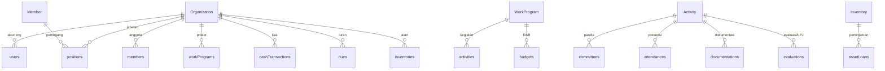

# 04 — Model & Relasi Eloquent

## Daftar model (22)

| Model | Tabel | Peran |
|---|---|---|
| `User` | `users` | Akun login SSO (role developer/organization), avatar, api_token |
| `Organization` | `organizations` | Organisasi (HIMA-TI, HIMATIKA, dll.) |
| `Member` | `members` | Anggota mahasiswa per organisasi (bukan akun) |
| `Position` | `positions` | Jabatan struktural → pemegang anggota |
| `Archive` | `archives` | Arsip SK/surat |
| `Announcement` | `announcements` | Pengumuman |
| `Recruitment` | `recruitments` | Rekrutmen anggota |
| `WorkProgram` | `work_programs` | Program kerja (E-Progress) |
| `Activity` | `activities` | Kegiatan (kalender) |
| `Proposal` | `proposals` | Penyimpanan proposal (menu dihapus, data lama) |
| `Committee` | `committees` | Panitia per kegiatan |
| `Attendance` | `attendances` | Presensi (QR/manual) |
| `Documentation` | `documentations` | Dokumentasi kegiatan |
| `Evaluation` | `evaluations` | Evaluasi & LPJ |
| `Budget` | `budgets` | Anggaran RAB per proker+tahun |
| `CashTransaction` | `cash_transactions` | Transaksi kas (+ bukti) |
| `Dues` | `dues` | Iuran anggota (+ bukti) |
| `FundRequest` | `fund_requests` | Penyimpanan pengajuan dana (menu dihapus) |
| `Inventory` | `inventories` | Aset/inventaris |
| `AssetLoan` | `asset_loans` | Peminjaman aset |
| `FooterSetting` | `footer_settings` | Pengaturan footer landing |
| `DomainEvent` | `domain_events` | Outbox sinkronisasi antar modul |

## Relasi penting

```
Organization
 ├─ users ()                 Akun login organisasi
 ├─ members ()               Anggota mahasiswa
 ├─ positions ()             Jabatan struktural
 ├─ archives / announcements / recruitments
 ├─ workPrograms ()
 │    └─ activities ()       Kegiatan
 │         ├─ committees ()  Panitia
 │         ├─ attendances () Presensi
 │         ├─ documentations () Galeri
 │         └─ evaluations () Evaluasi/LPJ
 ├─ budgets () ── workProgram ()   RAB ↔ Proker (integrasi SENTRA↔E-Progress)
 ├─ cashTransactions, dues, fundRequests
 └─ inventories () ── assetLoans ()

Activity
 ├─ organization, workProgram, creator
 ├─ proposals/committees/attendances/documentations/evaluations

Documentation: activity, organization, uploader → user
Dues: (name = nama pengurus dari members), organization, user
CashTransaction: organization, creator → user
Budget: organization, workProgram
Evaluation: activity, creator; type = evaluasi|lpj
```

## Atribut khas
- `Activity::STAGES = perencanaan, pelaksanaan, evaluasi, pelaporan, selesai` (status kegiatan & proker).
- `Proposal::STATUS_PENDING/APPROVED/REJECTED = menunggu/disetujui/ditolak`.
- `Dues::STATUS_PAID/UNPAID = lunas/belum_bayar`.
- `Evaluation::TYPE_EVALUATION/TYPE_REPORT = evaluasi/lpj`, `STATUS_DRAFT/DONE`.
- `Documentation::TYPES = foto, video, dokumen, lainnya` + accessor `file_url`, `is_image`.
- `CashTransaction & Dues`: accessor `proof_url`, konstanta tipe, `amount` float.
- `Budget::percentage` accessor (realized/allocated × 100).
- `Organization::logo_url` + `User::avatar_url`: logo organisasi = avatar akun organization (satu foto sama, tampil semua host).
- Semua model tabel modul memiliki `organization_id` (kepemilikan data).

## Diagram relasi (ringkas)


