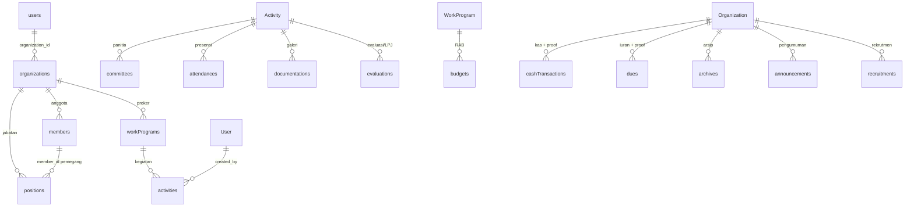

# 06 — Database: Tabel & Struktur Data

Database: **MySQL**. Total **±24 tabel**. Semua tabel modul memiliki `organization_id` (FK → `organizations`, cascade on delete).

## Tabel inti

### `users`
| Kolom | Tipe | Keterangan |
|---|---|---|
| id | bigint | PK |
| name, email, password | | Akun login; password default `password` (dari seeder) |
| role | varchar | `developer` / `organization` |
| organization_id | FK null | Organisasi pemilik (untuk role organization) |
| nim | varchar null | NIM pengguna |
| avatar_path | varchar null | Foto profil; untuk organization = logo organisasi |
| api_token | varchar null | Token auth API (`GET /api/v1/me`) |
| email_verified_at, remember_token, timestamps | | Standar Laravel |

### `organizations`
`id, name, slug (unik), full_name, banner_color, accent_color, focus, period, registration_url, instagram_url, tiktok_url, youtube_url, whatsapp_url, facebook_url, x_url, email, telegram_url, description, vision, mission, logo_path, sort_order, timestamps`

### `members`
`id, organization_id, user_id null, name, nim, email null, phone null, faculty null, division null, status (aktif/nonaktif), avatar_path null, timestamps`
- NIM unik per organisasi. `division` = divisi anggota (untuk struktur grup Divisi).

### `positions`
`id, organization_id, member_id null (FK members), name, description null, sort_order, group_type (Pimpinan/Wakil Pimpinan/BPI/Divisi), timestamps`
- **Satu jabatan = satu pemegang** (menunjuk ke anggota).

### `footer_settings`
`id, identity_text, instagram_url, tiktok_url, website_url, timestamps` (satu baris, current).

## Tabel ORGMATE
| Tabel | Kolom kunci |
|---|---|
| `archives` | organization_id, uploaded_by, title, type (sk/surat_masuk/surat_keluar), number, date, file_path |
| `announcements` | organization_id, created_by, title, content, published_at |
| `recruitments` | organization_id, created_by, title, division, description, deadline, status (dibuka) |

## Tabel E-PROGRESS
| Tabel | Kolom kunci |
|---|---|
| `work_programs` | organization_id, created_by, name, description, status (5 tahapan), start_date, end_date |
| `activities` | organization_id, work_program_id null, created_by, name, description, location, start_at, end_at, status |
| `proposals` | organization_id, activity_id null, submitted_by, decided_by, title, description, status (menunggu/disetujui/ditolak), decided_at |
| `committees` | organization_id, activity_id, user_id null, name, role |
| `attendances` | organization_id, activity_id, user_id null, name, checked_at, method (qr/manual) |
| `documentations` | organization_id, activity_id, uploaded_by, title, type (foto/video/dokumen/lainnya), file_path |
| `evaluations` | organization_id, activity_id, created_by, title, content, type (evaluasi/lpj), status (draft/selesai) |

## Tabel SENTRA
| Tabel | Kolom kunci |
|---|---|
| `cash_transactions` | organization_id, created_by, type (pemasukan/pengeluaran), title, amount decimal(15,2), date, category, **proof_path** |
| `budgets` | organization_id, work_program_id null (→ E-Progress), program_name, year, allocated, realized |
| `fund_requests` | organization_id, decided_by, title, description, amount, status (menunggu/disetujui/ditolak), applicant, decided_at |
| `dues` | organization_id, user_id null, name (nama pengurus), amount, status (lunas/belum_bayar), paid_at, period, **proof_path** |
| `inventories` | organization_id, created_by, name, category, condition, status (tersedia/dipinjam/…) |
| `asset_loans` | organization_id, inventory_id, borrower_name, loan_date, return_date, status |

## Tabel sistem
| Tabel | Fungsi |
|---|---|
| `domain_events` | Outbox sinkronisasi (event organization/user) |
| `cache`, `jobs`, `sessions`, `password_reset_tokens` | Standar Laravel |

## Integrasi antar modul (jalur data uang)
1. **ORGMATE → E-PROGRESS**: data `members` menjadi saran nama panitia (Kepanitiaan).
2. **E-PROGRESS → SENTRA**: `budgets.work_program_id` menaut RAB ke proker; `evaluations` bertipe **LPJ** tampil di halaman Realisasi SENTRA sebagai bukti.
3. **SENTRA internal**: Iuran lunas → pemasukan Kas (salin bukti); Catat Realisasi → pengeluaran Kas + `budgets.realized += jumlah`.

## Diagram ERD lengkap

