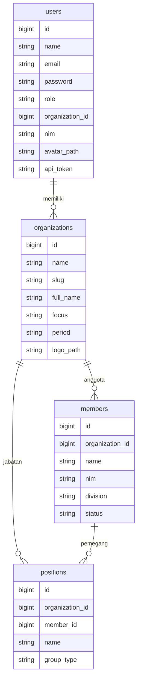
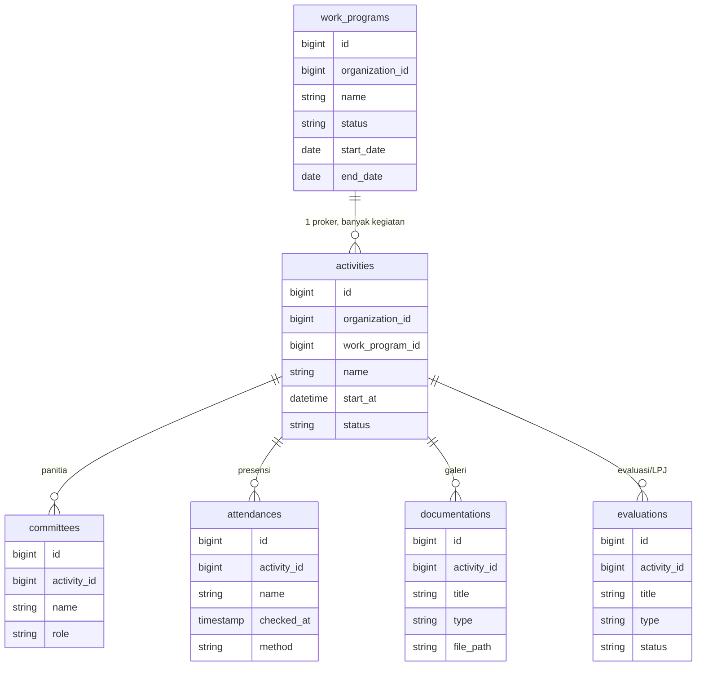
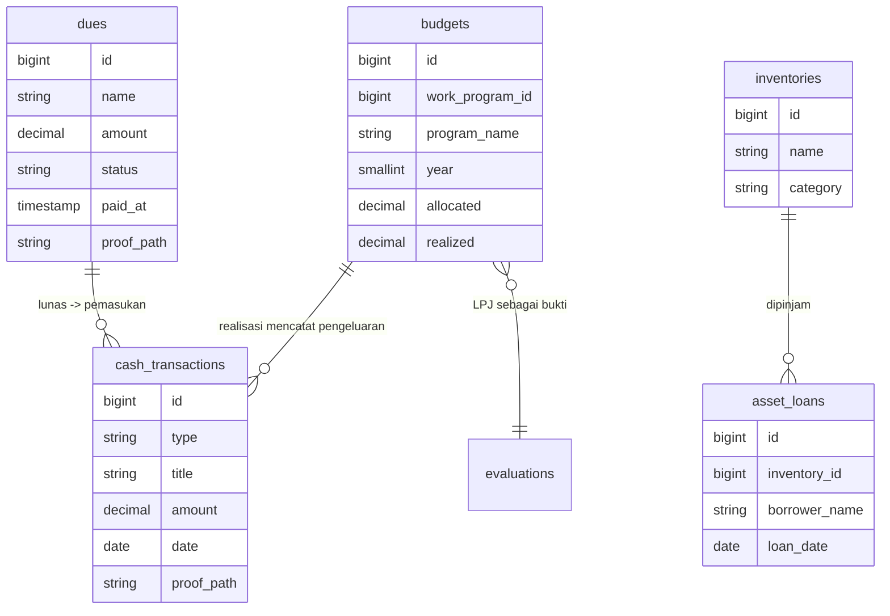

# 07 — ERD (Entity Relationship Diagram)

## ERD utama (inti + ORGMATE)

## ERD E-PROGRESS

## ERD SENTRA + integrasi

## Keterangan relasi
- Semua FK organisasi bersifat `cascadeOnDelete`; FK ke pengguna (`created_by`, `uploaded_by`, `user_id`) bersifat `nullOnDelete` agar data tidak hilang bila akun dihapus.
- `budgets.work_program_id` adalah jembatan SENTRA ↔ E-Progress; `evaluations` tipe LPJ adalah jembatan bukti LPJ → Realisasi SENTRA.
- `dues.name` menyimpan nama pengurus (dari `members`); `dues.user_id` opsional (pemilik tagihan) — karena pengurus bukan akun login.
