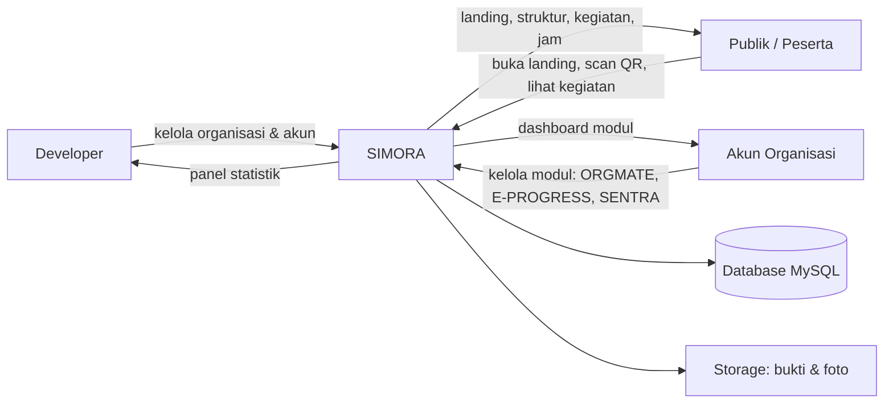
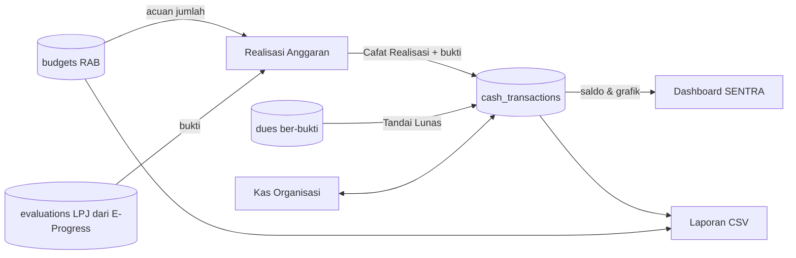

# 08 — DFD (Data Flow Diagram)

## DFD Level 0 (Context Diagram)



## DFD Level 1 — proses utama

```mermaid
flowchart TB
    subgraph P1[1.0 Autentikasi & Panel]
        LOGIN[Login SSO] --> PANEL[Panel Utama]
    end
    subgraph P2[2.0 Manajemen Organisasi - ORGMATE]
        STRUK[Struktur & Anggota] --> DB1[(members, positions)]
        ARSIP[Arsip & Pengumuman] --> DB1
    end
    subgraph P3[3.0 Kegiatan & Proker - E-PROGRESS]
        PROK[Proker & Kalender] --> DB2[(work_programs, activities)]
        PANIT[Kepanitiaan] --> DB2
        PRES[Presensi QR] --> DB2
        DOK[Dokumentasi] --> DB2
        LPJ[Evaluasi & LPJ] --> DB2
    end
    subgraph P4[4.0 Keuangan - SENTRA]
        KAS[Kas] --> DB3[(cash_transactions)]
        RAB[RAB] --> DB3
        IUR[Iuran] --> DB3
        REAL[Realisasi] --> DB3
        LAP[Laporan CSV] --> DB3
    end
    PANEL --> P2 & P3 & P4
    PROK -. taut ke -> RAB
    LPJ -. bukti LPJ .-> REAL
    STRUK -. saran nama panitia .-> PANIT
    IUR -. lunas jadi pemasukan .-> KAS
    REAL -. pengeluaran .-> KAS
    KAS & PROK & DOK --> PUBD[Publik: landing & /kegiatan]
```

## DFD Level 2 — aliran uang (SENTRA)



## Keterangan aliran data
- Data mengalir satu arah antar modul lewat tabel bersama (`work_programs`, `evaluations`, `cash_transactions`) — tidak ada panggilan antar-modul langsung.
- Bukti uang (foto/struk kamera) mengalir dari input pengguna → storage → tampil sebagai thumbnail di Kas/Iuran/Realisasi.
- Aliran publik (landing, kegiatan) read-only dari database yang sama.
