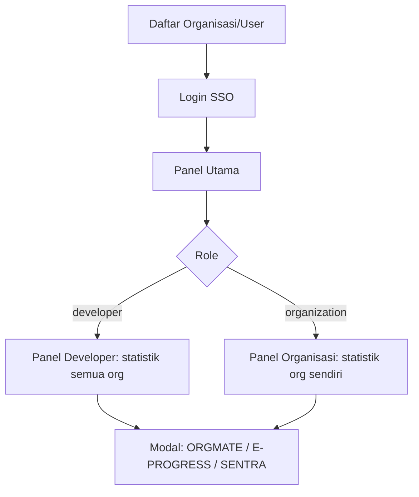
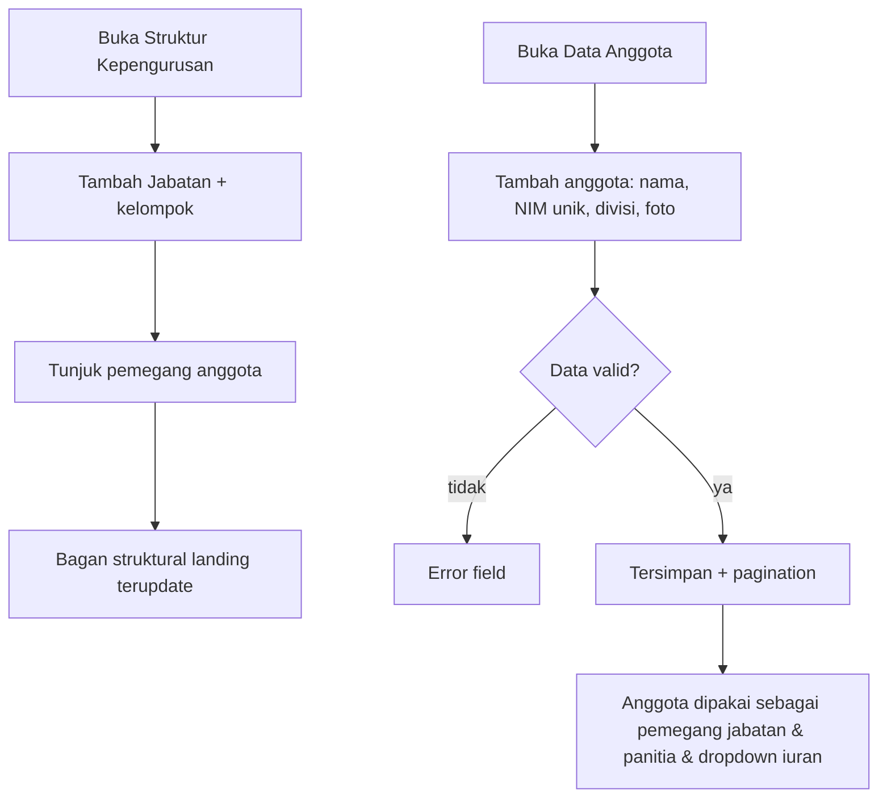
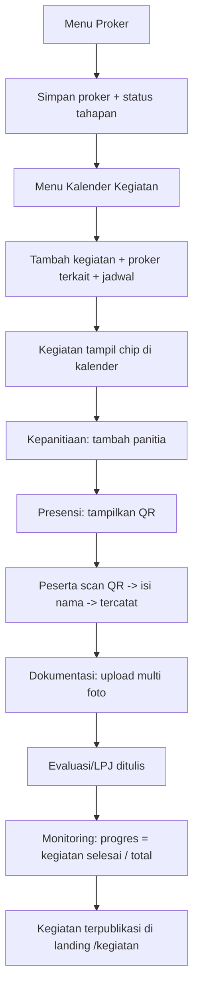
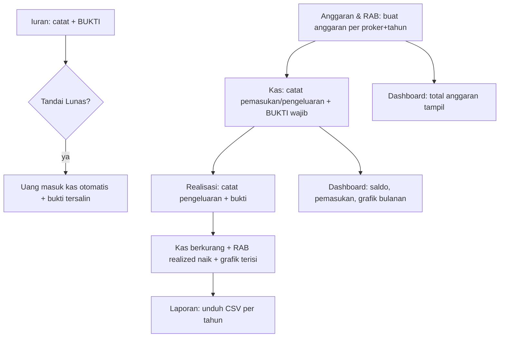

# 09 — Flowchart Alur Fitur (per Menu)

## Alur login & panel



## ORGMATE — Struktur & Anggota



## E-PROGRESS — Proker → Kalender → Kegiatan



## E-PROGRESS — Presensi QR (publik)

```mermaid
flowchart TD
    A[Panitia tampilkan QR kegiatan] --> B[Peserta scan]
    B --> C[URL bertanda tangan]
    C --> {Signature valid?}
    C -->|tidak| E403[403 Forbidden]
    C -->|ya| F[Form nama peserta]
    F --> G[Tombol Saya Hadir]
    G --> H[Tercatat: method=qr, waktu sekarang]
    H --> I[Hal: Berhasil Check-in]
    H --> J[Daftar hadir di dashboard panitia update]
```

## SENTRA — Uang masuk/keluar



## Diagram flowchart umum fitur

```mermaid
flowchart LR
    U[User] --> LOGIN[Login]
    LOGIN --> DASH[Dashboard modul]
    DASH --> LIST[Daftar data]
    LIST --> FORM[Form tambah]
    FORM --> VAL{Validasi + bukti?}
    VAL -->|gagal| FORM
    VAL -->|lolos| SAVE[Simpan DB + file]
    SAVE --> LIST
    LIST --> EDIT[Edit modal]
    EDIT --> SAVE
    LIST --> DEL[Hapus + konfirmasi]
    DEL --> LIST
