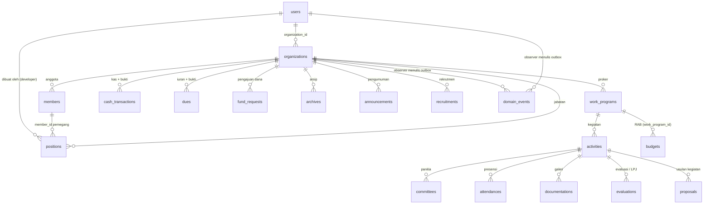
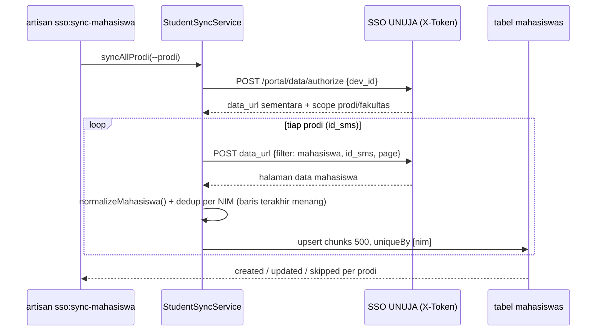
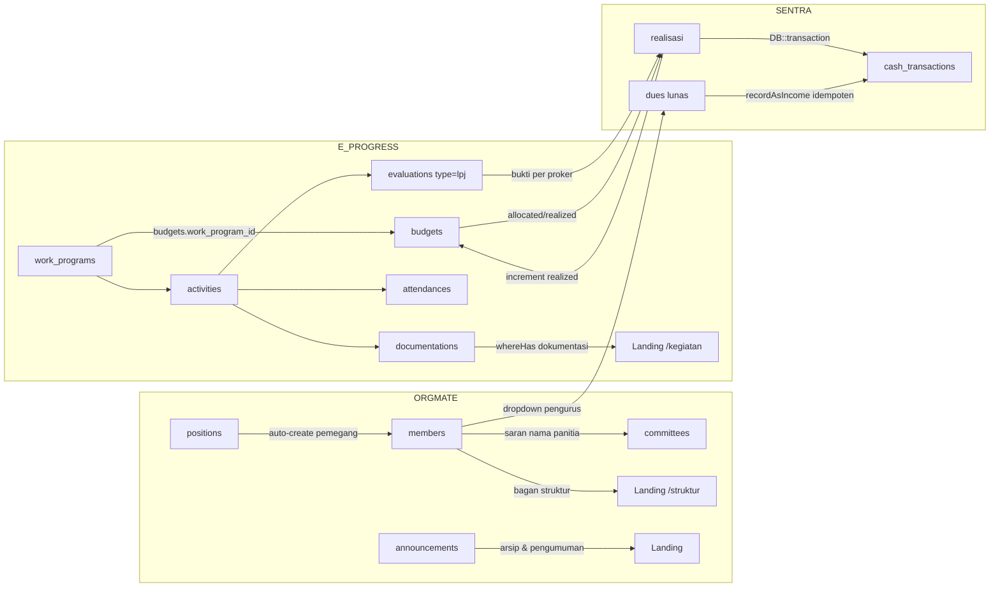
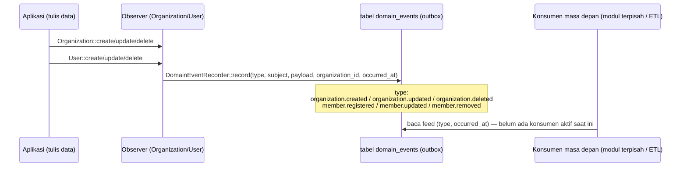
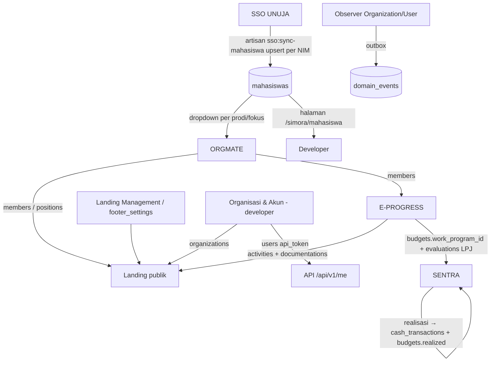

# 14 — Database Schema: Akses Data per Halaman & Alur Sinkronisasi

File ini menjawab dua pertanyaan utama:

1. **Halaman X membaca/menulis tabel apa saja?** — dari Landing page, Login, Panel SIMORA, ORGMATE, E-PROGRESS, sampai SENTRA.
2. **Bagaimana data disinkronkan?** — sinkronisasi eksternal (SSO UNUJA), sinkronisasi internal antar modul (same database), dan outbox `domain_events`.

Database: **MySQL** (`DB_CONNECTION=mysql`), driver `SESSION_DRIVER=database`, `CACHE_STORE=database`, `QUEUE_CONNECTION=database`.

---

## 1. Peta Tabel (Schema Ringkas)

### 1.1 Tabel inti / autentikasi

| Tabel | Kolom kunci | Pemilik data |
|---|---|---|
| `users` | `id, name, email (unik), password, role (developer\|organization), organization_id (FK null), nim, avatar_path, api_token (sha256), email_verified_at, remember_token` | Developer (CRUD akun) |
| `organizations` | `id, name, slug (unik), full_name, banner_color, accent_color, focus (prodi), period, registration_url, sosmed (instagram/tiktok/youtube/whatsapp/facebook/x/telegram), email, description, vision, mission, logo_path, sort_order` | Developer (CRUD), organization (sosmed, visi-misi, pendaftaran) |
| `members` | `id, organization_id, user_id (null), name, nim (unik per org), email, phone, faculty, division, status, avatar_path` | ORGMATE (Data Anggota) |
| `positions` | `id, organization_id, member_id (null → pemegang), name, description, sort_order, group_type (Pimpinan/Wakil Pimpinan/BPI/Divisi)` | ORGMATE (Struktur) |
| `mahasiswas` | `id, nim (unik), name, faculty, study_program, prodi_id, fakultas_id, gender, enrollment_year, synced_at` | **Hasil sinkron SSO** (bukan data keanggotaan) |
| `footer_settings` | `id, identity_text, tagline, instagram_url, tiktok_url, website_url` (satu baris *current*) | Developer (Kelola Landing) |

### 1.2 Tabel ORGMATE

| Tabel | Kolom kunci |
|---|---|
| `archives` | organization_id, uploaded_by, title, type (sk/surat_masuk/surat_keluar), number, date, file_path |
| `announcements` | organization_id, created_by, title, content, published_at |
| `recruitments` | organization_id, created_by, title, division, description, deadline, status |

### 1.3 Tabel E-PROGRESS

| Tabel | Kolom kunci |
|---|---|
| `work_programs` | organization_id, created_by, name, description, status (tahapan), start_date, end_date |
| `activities` | organization_id, work_program_id (null), created_by, name, description, location, start_at, end_at, status |
| `proposals` | organization_id, activity_id, submitted_by, decided_by, title, status (menunggu/disetujui/ditolak) |
| `committees` | organization_id, activity_id, user_id (null), name, role |
| `attendances` | organization_id, activity_id, user_id (null), name, checked_at, method (qr/manual) |
| `documentations` | organization_id, activity_id, uploaded_by, title, type (foto/video/dokumen/lainnya), file_path |
| `evaluations` | organization_id, activity_id, created_by, title, content, type (evaluasi/**lpj**), status (draft/selesai) |

### 1.4 Tabel SENTRA

| Tabel | Kolom kunci |
|---|---|
| `cash_transactions` | organization_id, created_by, type (pemasukan/pengeluaran), title, amount `decimal(15,2)`, date, category, **proof_path** |
| `budgets` | organization_id, **work_program_id (→ E-PROGRESS)**, program_name, year, allocated, realized |
| `fund_requests` | organization_id, decided_by, title, description, amount, status, applicant, decided_at |
| `dues` | organization_id, user_id (null), name, amount, status (lunas/belum_bayar), paid_at, period, **proof_path** |
| `inventories` / `asset_loans` | (tabel sudah dihapus lewat migration `drop_inventories_and_asset_loans_tables`) |

### 1.5 Tabel sistem

| Tabel | Fungsi |
|---|---|
| `domain_events` | **Outbox sinkronisasi antar modul** (`type, subject_type, subject_id, organization_id, payload json, occurred_at`) |
| `sessions` | Sesi login (driver `database`) |
| `cache` | Rate limit login (`throttle:5,1`) & cache lainnya |
| `jobs` | Antrean job (driver `database`) |
| `password_reset_tokens` | Reset password |

### 1.6 ERD gabungan



---

## 2. Akses Data per Halaman

Kunci: **R** = dibaca, **W** = ditulis/diubah/dihapus. Route terdaftar di `routes/web.php` dan `routes/api.php`.

### 2.1 Landing Page (publik, tanpa login)

| Route | Controller | Tabel (R/W) | Catatan |
|---|---|---|---|
| `GET /` | `LandingController` | **R** `organizations` | Urut `sort_order`, `name` → kartu organisasi |
| `GET /kontak` | `ContactController` | **R** `organizations` | Daftar kontak/sosmed tiap organisasi |
| `GET /struktur` | `LandingStructureController@index` | **R** `organizations` | Daftar organisasi |
| `GET /struktur/{slug}` | `LandingStructureController@show` | **R** `organizations`, `users`, `positions`, `members` | Bagan struktur + pemegang jabatan (`positions.member_id` → `members`) |
| `GET /kegiatan` | `LandingKegiatanController@index` | **R** `activities` + `organizations` + `work_programs` + `documentations` | **Hanya kegiatan yang punya dokumentasi** (`whereHas('documentations')`) |
| `GET /kegiatan/{activity}` | `LandingKegiatanController@show` | **R** `activities`, `documentations`, `organizations`, `work_programs` | 404 bila tanpa dokumentasi; + 3 kegiatan terkait |
| `GET /presensi/{activity}` (signed) | `AttendanceController@checkin` | **R** `activities` | URL bertanda tangan 5 menit, `throttle:5,1`, **tanpa login** |
| `POST /presensi/{activity}` (signed) | `AttendanceController@checkinStore` | **W** `attendances` | `method='qr'`, hanya `name` + `checked_at` |
| Partial `site-footer` | (view) | **R** `footer_settings` | `FooterSetting::current()` — satu baris |

**API publik read-only** (`routes/api.php`, tanpa auth kecuali `/me`):

| Endpoint | Tabel (R) | Catatan |
|---|---|---|
| `GET /api/v1/organizations` | `organizations` | Paginasi 15–100 |
| `GET /api/v1/organizations/{slug}` | `organizations` | Detail |
| `GET /api/v1/organizations/{slug}/structure` | `organizations`, `positions` (+`members` relasi), `members` | **PII disembunyikan**: tanpa `nim`, tanpa `status` |
| `GET /api/v1/me` (header `Authorization: Bearer`) | `users` (+ `organizations`) | Middleware `api.token`, cocokkan `sha256(api_token)` |

### 2.2 Login & Sesi

| Route | Tabel (R/W) | Alur |
|---|---|---|
| `GET /login` | — | Jika sudah login → redirect `route('panel')` |
| `POST /login` (`throttle:5,1`) | **R** `users` (`email`, `password` verify), **W** `sessions`, **W/R** `cache` | `Auth::attempt()` → `session()->regenerate()` → redirect `route('panel')` |
| `POST /logout` | **W** `sessions` | `invalidate()` + `regenerateToken()` |
| `GET /api/v1/me` | **R** `users` | Token `api_token` (sha256) |

- Setelah login, **route berikutnya divalidasi middleware `role:`** (`app/Http/Middleware`), bukan oleh tabel lain.
- `remember` → kolom `remember_token` di `users`.
- **Tabel yang dibaca login hanya `users`** — role & `organization_id` ikut terbawa dari baris tersebut dan menjadi dasar *scope* semua halaman panel.

### 2.3 Panel SIMORA (`GET /panel`, middleware `auth` + `role:developer,organization`)

`PanelController` bercabang dua berdasar `users.role`:

**a) Role `organization` → `simora.organization-panel`**

| Data | Tabel (R) | Rumus |
|---|---|---|
| Profil & logo | `users` + `organizations` | `$user->load('organization')` |
| Jumlah pengurus | `users` | `organizations.users()->count()` |
| Statistik | `work_programs`, `activities`, `cash_transactions`, `dues` | count proker, count kegiatan, **saldo kas = Σ pemasukan − Σ pengeluaran**, iuran lunas/total |
| Kegiatan terbaru | `activities` (+ `work_programs`) | 5 terbaru berdasar `start_at` |

**b) Role `developer` → `simora.panel`**

| Data | Tabel (R) |
|---|---|
| Statistik global | `organizations` (count), `users` (count + count role organization), `work_programs` (count) |
| Organisasi terbaru | `organizations` (6 terbaru, `sort_order`) |

### 2.4 Panel pendukung SIMORA

| Route | Role | Tabel (R/W) |
|---|---|---|
| `Route::resource /simora/organisasi` | developer | **R/W** `organizations` (CRUD, slug, sosmed, logo) |
| `Route::resource /simora/akun` | developer | **R/W** `users` (+ `organizations` untuk dropdown); membuat `api_token` (sha256) & menyalin `avatar_path` → `organizations.logo_path` |
| `GET+PUT /simora/kelola-landing` | developer | **R/W** `footer_settings` (satu baris current) |
| `PUT /simora/organisasi-saya/pendaftaran` | organization | **R/W** `organizations.registration_url` |
| `PUT /simora/organisasi-saya/sosmed` | organization | **R/W** `organizations.*_url` |
| `PUT /simora/organisasi-saya/visi-misi` | organization | **R/W** `organizations.vision`, `mission` |
| `GET /simora/mahasiswa` | developer | **R** `mahasiswas` (filter prodi + pencarian nama/NIM) |

### 2.5 ORGMATE (`/simora/orgmate/*`)

| Route | Tabel (R) | Tabel (W) | Catatan |
|---|---|---|---|
| `dashboard` | `organizations`, `users`, `members` | — | Statistik anggota/pengurus, grafik Jan–Des dari `users.created_at` + `email_verified_at`; `totalDivisi/totalDokumen/totalPengumuman` masih **0 jujur** (belum ada tabel) |
| `panduan` | — | — | Data statis |
| `struktur` | `positions` (+`member`), `members`, **`mahasiswas`** (kandidat pemegang), `organizations` | **W** `positions` (store/update/destroy) | Kandidat = `mahasiswas.study_program = organizations.focus`, dikelompokkan per `enrollment_year`; pemegang otomatis jadi baris `members` |
| `anggota` | `members`, `positions` (opsi divisi), **`mahasiswas`** (dropdown tambah) | **W** `members` | Pencarian `name/nim/email`, paginasi 5–50 |
| `pengumuman` | `announcements` (+`creator`), `organizations` | **W** `announcements` | |
| `arsip` | `archives` (+`uploader`), agregat `groupBy('type')` | **W** `archives` | Unduh file `file_path` |
| `rekrutmen` | `organizations` (`registration_url`, `period`) | — | Menampilkan link pendaftaran |

### 2.6 E-PROGRESS (`/simora/e-progress/*`)

| Route | Tabel (R) | Tabel (W) | Catatan |
|---|---|---|---|
| `dashboard` | `organizations`, `activities`, `work_programs`, `attendances` | — | Statistik + grafik 6 bulan (`start_at`, status `selesai`) |
| `proker` | `work_programs` | **W** `work_programs` | |
| `monitoring` | `work_programs` + `activities` | — | Progress = kegiatan `selesai` / total kegiatan proker |
| `kalender` | `activities` (+`work_programs`), `work_programs` (dropdown) | **W** `activities` | Filter tahun/bulan `start_at` |
| `kepanitiaan` | `activities`, `committees`, **`members`** (saran nama) | **W** `committees` | |
| `presensi` | `activities`, `attendances` | **W** `attendances` (manual) | QR: `URL::temporarySignedRoute(..., now()->addMinutes(5))` |
| `dokumentasi` | `activities`, `documentations` | **W** `documentations` | Maks 10 file; juga sumber halaman publik `/kegiatan` |
| `evaluasi` | `activities`, `evaluations` | **W** `evaluations` | Tipe `evaluasi` atau `lpj` |

### 2.7 SENTRA (`/simora/sentra/*`)

| Route | Tabel (R) | Tabel (W) | Catatan |
|---|---|---|---|
| `dashboard` | `cash_transactions`, `budgets` | — | Total pemasukan/pengeluaran per bulan (tahun `?periode=`), total anggaran; **`iuranLunas/iuranTotal` masih hardcode 0** di dashboard |
| `kas` | `cash_transactions` | **W** `cash_transactions` | Pencarian `title/category`, bukti wajib (`proof_path`) |
| `rab` | `budgets` (+`work_programs`), `work_programs` (dropdown) | **W** `budgets` | `budgets.work_program_id` menautkan RAB ke proker E-PROGRESS |
| `iuran` | `dues`, `members` (dropdown) | **W** `dues` | Filter periode/status, hitung lunas/terkumpul |
| `realisasi` | `budgets` (+`organizations`, `work_programs`), **`evaluations` tipe LPJ** | **W** `cash_transactions`, **W** `budgets.realized` | LPJ dikelompokkan via `evaluations.activity_id → activities.work_program_id` |
| `laporan` | — (saat ini `emptyData()`) | — | Unduh CSV sudah tersedia, **isi baris masih placeholder 0** |
| `panduan` | — | — | Data statis |

### 2.8 Matriks ringkas: halaman → tabel

```text
LANDING      : organizations | positions | members | activities | documentations | work_programs | footer_settings
LOGIN        : users | sessions | cache
PANEL        : users | organizations | work_programs | activities | cash_transactions | dues
ORGMAETE     : members | positions | archives | announcements | mahasiswas | organizations | users
E-PROGRESS   : work_programs | activities | committees | attendances | documentations | evaluations | members | organizations
SENTRA       : cash_transactions | budgets | dues | evaluations | members | work_programs | organizations
MAHASISWA    : mahasiswas (developer) + organizations (dropdown)
KELA LANDING : footer_settings
```

---

## 3. Alur Sinkronisasi Data

Ada **tiga lapisan** sinkronisasi: (A) eksternal SSO, (B) internal antar modul dalam satu database, (C) outbox `domain_events` untuk pemisahan modul di masa depan.

### 3.1 A — Sinkronisasi eksternal: SSO UNUJA → `mahasiswas`

Dijalankan manual via Artisan (belum ada jadwal di `routes/console.php`):

```bash
php artisan sso:sync-mahasiswa --prodi="Teknologi Informasi"   # satu prodi
php artisan sso:sync-mahasiswa                                  # semua prodi dalam scope
```



Aturan penting:

- **`mahasiswas` ≠ `members`**. `mahasiswas` adalah direktori mahasiswa per prodi (hak akses developer), sedangkan `members` adalah keanggotaan organisasi yang ditulis manual oleh role organization.
- Kunci upsert: **`nim`**. Kolom yang diperbarui: `name, faculty, study_program, prodi_id, fakultas_id, gender, enrollment_year, synced_at`.
- Baris tanpa NIM/nama **dilewati** (dihitung `skipped`), seluruh proses dibungkus `DB::transaction`.
- Pemakaian hilir: dropdown ORGMATE (Struktur & Data Anggota) menyaring `mahasiswas.study_program = organizations.focus`, dikelompokkan per angkatan dari `enrollment_year`.

### 3.2 B — Sinkronisasi internal antar modul (satu database, transaksi langsung)

Karena semua modul berbagi database yang sama, sinkronisasi modul dilakukan lewat **foreign key + query silang + penulisan ganda dalam satu transaksi** (tanpa message broker).



Rincian jalur penulisan (semua dalam `DB::transaction` kecuali disebut lain):

| # | Dari → Ke | Mekanisme | Kode |
|---|---|---|---|
| 1 | **ORGMATE → E-PROGRESS** | `members` dipakai sebagai saran nama panitia (`committees.name`) | `EProgressController@kepanitiaan` |
| 2 | **ORGMATE internal** | Menunjuk pemegang jabatan otomatis membuat baris `members` | `PositionController@store` (`Member::create`) |
| 3 | **E-PROGRESS → SENTRA (RAB)** | `budgets.work_program_id` menautkan anggaran ke proker | `BudgetController@store` |
| 4 | **E-PROGRESS → SENTRA (LPJ)** | `evaluations` tipe `lpj` dikelompokkan per `activities.work_program_id` dan ditampilkan di Realisasi | `SentraController@realisasi` |
| 5 | **SENTRA internal (realisasi)** | Satu transaksi: insert `cash_transactions` (pengeluaran + bukti) **dan** `budgets.realized += amount` | `RealizationController@store` |
| 6 | **SENTRA internal (iuran)** | `dues` ditandai lunas → insert `cash_transactions` pemasukan; **idempoten** (dicek judul `Iuran {name}` agar tidak dobel) | `DuesController@markPaid` → `recordAsIncome()` |
| 7 | **E-PROGRESS → Landing** | Hanya kegiatan yang punya `documentations` yang tampil publik | `LandingKegiatanController` |
| 8 | **ORGMATE → Landing** | `positions` + `members` membentuk bagan struktur publik | `LandingStructureController@show` |
| 9 | **Akun → Organisasi** | Avatar akun organization disalin menjadi `organizations.logo_path` | `AccountController@store` |
| 10 | **Presensi QR → E-PROGRESS** | URL signed 5 menit → insert `attendances` tanpa login | `AttendanceController@checkinStore` |

### 3.3 C — Outbox `domain_events` (persiapan pemisahan modul)

Saat ini semua modul masih satu proses. Agar **ketika modul dipisah menjadi layanan terpisah** tidak perlu message broker, setiap perubahan penting dicatat ke tabel outbox `domain_events`.



- Pendaftaran observer: `AppServiceProvider::boot()` → `Organization::observe()`, `User::observe()`.
- Pembuat: `app/Support/DomainEventRecorder.php` (`record()` manual, `forModel()` otomatis mengisi `subject_*` + `organization_id`).
- Index pendukung: `(type, occurred_at)`, `(organization_id, occurred_at)`, `(subject_type, subject_id)`.
- **Status saat ini**: *write-only*. Belum ada listener/job yang memprosesnya — tabel ini sudah berfungsi sebagai log perubahan lintas modul.

### 3.4 Ringkasan arah data antar halaman



---

## 4. Catatan Batas & Konsistensi

1. **Scope organisasi**: semua query panel memakai pola `organizationContext()` — role `organization` selalu `where organization_id = user.organization_id`; role `developer` bebas memilih `?organization=slug` atau melihat agregat semua organisasi. Pembagian ini dijaga `app/Support/OrganizationScope.php` (baca: `forUser`, tulis: `assertCanAccessOrganization`).
2. **Developer read-only di modul**: route tulis ORGMATE/E-PROGRESS/SENTRA selalu diberi `->middleware('role:organization')`.
3. **Idempotensi**: pemasukan iuran hanya dibuat sekali (`recordAsIncome` mengecek keberadaan judul `Iuran {name}`), mencegah duplikasi saat tombol *Tandai Lunas* ditekan berulang.
4. **Bukti/bukti transaksi** disimpan di disk `local` (`bukti-iuran/`, `bukti-realisasi/`, arsip, dokumentasi) dan hanya bisa diunduh lewat route dengan pemeriksaan scope organisasi.
5. **Data yang belum diisi jujur (bukan 0 palsu)**: `SentraController@laporan` memakai `emptyData()` (placeholder), `iuranLunas/iuranTotal` dashboard SENTRA masih `0`, dan `OrgmateController` menampilkan `totalDivisi/totalDokumen/totalPengumuman = 0` karena belum ada tabelnya.
6. **PII di endpoint publik**: `/api/v1/organizations/{slug}/structure` tidak mengeluarkan `nim` dan `status` anggota.
7. **Tabel yang sudah dihapus**: `inventories`, `asset_loans` (migration `2026_11_08_072232`).

---

## 5. Referensi Kode

| Topik | File |
|---|---|
| Route publik + modul | `routes/web.php`, `routes/api.php` |
| Landing | `app/Http/Controllers/LandingController.php`, `LandingStructureController.php`, `LandingKegiatanController.php`, `ContactController.php` |
| Login | `app/Http/Controllers/Auth/LoginController.php` |
| Panel | `app/Http/Controllers/PanelController.php` |
| ORGMATE | `app/Http/Controllers/Simora/OrgmateController.php` + `Member/Position/Archive/AnnouncementController` |
| E-PROGRESS | `app/Http/Controllers/Simora/EProgressController.php` + `WorkProgram/Activity/Committee/Attendance/Documentation/EvaluationController` |
| SENTRA | `app/Http/Controllers/Simora/SentraController.php` + `CashTransaction/Budget/Dues/RealizationController` |
| Sinkron SSO | `app/Console/Commands/SyncMahasiswaFromSso.php`, `app/Services/StudentSyncService.php`, `app/Services/SsoUnujaService.php` |
| Outbox | `app/Support/DomainEventRecorder.php`, `app/Observers/{Organization,User}Observer.php`, `database/migrations/*create_domain_events_table.php` |
| Scope | `app/Support/OrganizationScope.php` |
