# SIMORA — Dokumentasi Lengkap Project

**Dari UI/UX & Frontend, Backend, Database (ERD / DFD / Flowchart), hingga Microservice Readiness**

---

## Tentang dokumen ini

Dokumen ini adalah **versi gabungan final** dari seluruh dokumentasi SIMORA. Isi file `01-arsitektur-struktur-project.md` sampai `14-database-schema-akses-dan-sinkronisasi.md` **sengaja dipertahankan** sebagai dokumentasi per-topik, lalu disatukan di sini menjadi satu narasi yang urut: dimulai dari apa yang dilihat pengguna (UI/UX), masuk ke frontend, fitur tiap modul, backend (route/controller/model), database lengkap dengan diagram, auth & keamanan, sinkronisasi data, dan berakhir pada kesiapan microservice.

> **Catatan penting:** File 01–14 **tidak dihapus** dan tetap dapat dibaca langsung. Dokumen ini bukan pengganti, melainkan **penyatuan + penyempurnaan**. Bila ada perbedaan, uraian di dokumen ini yang lebih baru (khususnya Bab XIX–XXVI tentang microservice).

### Cara membaca

| Kalau Anda ingin… | Baca |
|---|---|
| Gambaran singkat sistem | Bab 1 |
| Memahami tampilan & pengalaman pengguna | Bab 2–5 |
| Menambah menu / fitur | Bab 3–5 + Bab 6–8 |
| Memahami query & relasi data | Bab 9–12 |
| Melacak alur data lintas modul | Bab 13–15 |
| Memahami login & hak akses | Bab 16 |
| Memisahkan modul jadi service | Bab 17–25 |
| Referensi file & ringkasan cepat | Bab 26–27 |

---

## Daftar isi

**BAB I — GAMBARAN UMUM**
1. [Apa itu SIMORA](#1-apa-itu-simora)
2. [Arsitektur logis & keputusan utama](#2-arsitektur-logis--keputusan-utama)

**BAB II — UI/UX & FRONTEND**
3. [Prinsip UI/UX SIMORA](#3-prinsip-uiux-simora)
4. [Blade, CSS, dan JavaScript](#4-blade-css-dan-javascript)

**BAB III — FITUR & ALUR PENGGUNA**
5. [ORGMATE](#5-orgmate)
6. [E-PROGRESS](#6-e-progress)
7. [SENTRA](#7-sentra)
8. [Flowchart alur fitur](#8-flowchart-alur-fitur)

**BAB IV — BACKEND**
9. [Routing](#9-routing)
10. [Controller](#10-controller)
11. [Model & relasi Eloquent](#11-model--relasi-eloquent)

**BAB V — DATABASE**
12. [Skema tabel](#12-skema-tabel)
13. [ERD — Entity Relationship Diagram](#13-erd--entity-relationship-diagram)
14. [DFD — Data Flow Diagram](#14-dfd--data-flow-diagram)
15. [Akses data per halaman](#15-akses-data-per-halaman)

**BAB VI — AUTH, SINKRONISASI & BATASAN**
16. [Auth, role & kepemilikan data](#16-auth-role--kepemilikan-data)
17. [Sinkronisasi data](#17-sinkronisasi-data)
18. [Catatan batas & konsistensi](#18-catatan-batas--konsistensi)

**BAB VII — MICROSERVICE READINESS**
19. [Latar belakang & glosarium](#19-latar-belakang--glosarium)
20. [Arsitektur akhir & daftar perubahan](#20-arsitektur-akhir--daftar-perubahan)
21. [Fondasi konfigurasi](#21-fondasi-konfigurasi)
22. [Jalur baca: Directory & Internal API](#22-jalur-baca-directory--internal-api)
23. [Health check](#23-health-check)
24. [Jalur event: outbox & ingest](#24-jalur-event-outbox--ingest)
25. [Alur end-to-end, keputusan, pengujian & operasional](#25-alur-end-to-end-keputusan-pengujian--operasional)

**BAB VIII — PENUTUP**
26. [Referensi kode](#26-referensi-kode)
27. [Ringkasan satu halaman](#27-ringkasan-satu-halaman)

---

# BAB I — GAMBARAN UMUM

## 1. Apa itu SIMORA

**SIMORA** (Sistem Manajemen Organisasi Kemahasiswaan) adalah aplikasi **monolit Laravel 13 / PHP 8.4** untuk mengelola organisasi kemahasiswaan Fakultas Teknik UNUJA. Satu aplikasi menyatukan:

| Modul | Fokus | Kata kunci |
|---|---|---|
| **ORGMATE** | Keanggotaan & struktural | anggota, jabatan, arsip, pengumuman, rekrutmen |
| **E-PROGRESS** | Program & kegiatan | proker, kalender, panitia, presensi QR, dokumentasi, evaluasi/LPJ, monitoring |
| **SENTRA** | Keuangan | kas, RAB/anggaran, iuran, realisasi, laporan |
| **Portal SSO** | Akses | login session, role, organization scope |
| **Landing publik** | Tampilan untuk publik | beranda, struktur, kegiatan, kontak |

Bukan microservice: semua domain berbagi **satu database, satu session auth, dan satu OrganizationScope**. Pemisahan folder/route/view ada, tetapi pemisahan proses/service belum — itulah yang disiapkan di Bab VII.

---

## 2. Arsitektur logis & keputusan utama

### 2.1 Arsitektur logis

```
┌─────────────────────────────────────────────────────────────────┐
│                        Browser (UI)                              │
│  Landing publik │ Panel Utama │ ORGMATE │ E-PROGRESS │ SENTRA   │
└──────────────────────────────┬──────────────────────────────────┘
                                │ HTTP (blade + form POST/PUT/DELETE)
┌──────────────────────────────▼──────────────────────────────────┐
│                 Laravel Monolith (Controller + View)              │
│                                                                   │
│  Tiap menu dirender server-side (SSR Blade):                      │
│  Controller (validasi, scope organisasi) → Query Eloquent         │
│    → Blade view (layout + section + komponen)                     │
│                                                                   │
│  Lapisan pendukung:                                               │
│   • app/Support/OrganizationScope — penegak kepemilikan data      │
│   • Middleware: auth, role, ForceRootUrlFromRequest, signed       │
│   • domain_events (outbox) — sinkronisasi antar modul             │
│   • API publik read-only /api/v1 + api_token                      │
│   • Internal API /api/internal/v1 + service.token (Bab VII)       │
└──────────────────────────────┬──────────────────────────────────┘
                                │ MySQL (24+ tabel)
┌──────────────────────────────▼──────────────────────────────────┐
│  Relasional: users ──< organizations ──< tabel modul             │
└─────────────────────────────────────────────────────────────────┘
```

### 2.2 Alur request (pola baku)

```
HTTP request
  → Middleware web (session, CSRF, ForceRootUrlFromRequest)
  → auth (session login SSO) + role:developer,organization
  → Controller
      1. organizationContext(): developer boleh pilih ?organization=,
         organization selalu terikat organization_id login
      2. Query dibatasi organization_id (scope organisasi)
      3. Validasi input (Form Request inline / $request->validate)
      4. Simpan/ubah/hapus + flash session 'status'
      5. Redirect kembali ke halaman menu (PRG pattern)
  → Blade view
      layout.blade.php modul (sidebar, topbar, breadcrumb)
      + halaman (intro, statistik pastel, tabel, form, dialog edit)
      + CSS/JS versi ?v= untuk cache-busting
```

**PRG pattern** (*Post-Redirect-Get*) penting: setelah form disimpan, pengguna di-redirect, bukan langsung merender hasil. Menekan tombol *refresh* tidak akan mengirim data dua kali.

### 2.3 Struktur folder penting

```
SIMORA/
├── app/
│   ├── Http/
│   │   ├── Controllers/        ← 30 controller (Bab 10)
│   │   ├── Middleware/         ← auth, role, ForceRootUrlFromRequest,
│   │   │                         api.token, service.token
│   ├── Models/                 ← 22 model Eloquent (Bab 11)
│   ├── Support/                ← OrganizationScope, DomainEventRecorder
│   ├── Modules/                ← Contracts/Data/Directories/Events (Bab VII)
│   ├── Observers/              ← DomainEvent outbox
│   └── Console/                ← job/komando jadwal
├── database/
│   ├── migrations/             ← 24+ migrasi (Bab 12)
│   └── seeders/, factories/
├── resources/
│   ├── views/
│   │   ├── welcome.blade.php            ← landing publik
│   │   ├── struktur/, kegiatan/        ← halaman publik
│   │   ├── partials/, components/      ← header, footer, kartu org
│   │   └── simora/
│   │       ├── ORGMATE/   (dashboard, struktur, anggota, arsip, pengumuman, rekrutmen, panduan)
│   │       ├── E-PROGRESS/(dashboard, proker, kalender, kepanitiaan, presensi, dokumentasi, evaluasi, monitoring, panduan)
│   │       ├── SENTRA/    (dashboard, kas, rab, iuran, realisasi, laporan, panduan)
│   │       ├── panel.blade.php, organization-panel.blade.php
│   │       └── organisasi/, akun/, layouts
│   ├── css/                    ← sumber CSS per modul (wajib sinkron ke public/)
│   └── js/                     ← landing.js, clock.js
├── public/
│   ├── assets/css|js/          ← hasil sinkron CSS/JS (?v=)
│   ├── storage/                ← bukti/foto via disk public
│   └── build/                  ← Vite (Vite manifest)
├── routes/ web.php, api.php, console.php, bootstrap/app.php
├── tests/Feature/              ← ±40 test fitur per menu + test microservice
└── modull/                     ← dokumentasi project (01–14 + modulSIMORA.md)
```

### 2.4 Tujuh keputusan arsitektur utama

1. **Satu monolit, tiga modul logis** — pemisahan hanya di folder/routes/view, bukan service.
2. **Kepemilikan data = `organization_id` di semua tabel modul.** `OrganizationScope::assertCanAccessOrganization` mencegah akses lintas organisasi (403).
3. **Role ganda**: `developer` = view + pemilih organisasi lintas-org; `organization` = tulis data hanya org-nya (konsisten di semua modul).
4. **Anggota ≠ akun login** — `members` adalah data keanggotaan mahasiswa; `users` adalah akun login SSO.
5. **Sinkronisasi antar modul** via foreign key + query silang + outbox `domain_events` (Bab 17 & 24).
6. **Akses publik**: landing read-only dari database; file bukti/foto di disk dengan URL relatif dipaksa host request (`ForceRootUrlFromRequest` agar localhost & ngrok tampil logo sama).
7. **Jam real-time** satu file `public/assets/js/clock.js` dipakai landing, panel, dan semua dashboard.

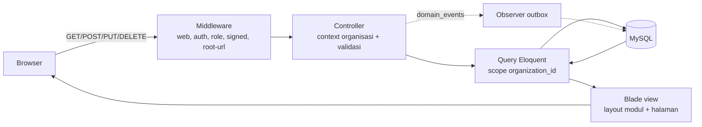

---

# BAB II — UI/UX & FRONTEND

## 3. Prinsip UI/UX SIMORA

### 3.1 Karakter tampilan

- **Server-side rendering (SSR)** sepenuhnya. Tidak ada SPA/React/Vue. Setiap klik menu = request baru yang dirender Blade.
- **Satu layout per modul**, sehingga sidebar, topbar, breadcrumb, toast, dan script global konsisten.
- **Statistik jujur**: angka di dashboard diambil dari query nyata. Bila belum ada datanya, ditampilkan `0` dengan catatan, bukan angka palsu (lihat Bab 18).
- **Warna pastel + ikon Lucide** untuk kartu statistik, supaya halaman keuangan yang berat terasa lebih ringan.
- **Palet resmi**: navy `#092e69` + biru `#1265d8`, selaras dengan landing.
- **Dark mode** via `localStorage ft-theme` → `body.dark-mode`, dengan variabel `--sentra-*` dan override `.dark-mode`.
- **Responsif**: breakpoint `1024 / 768 / 640 / 480 / 360 px`.

### 3.2 Pola halaman modul (standar, wajib diikuti)

Setiap halaman menu memakai urutan yang sama:

1. **Intro**: kicker + judul + lead + aksi (pemilih organisasi, tombol kembali, tombol Panduan).
2. **Toast status**: `@if (session('status'))` dengan kelas `orgmate-toast is-show`.
3. **Statistik pastel**: `.eprogress-stat` / `.sentra-stat` + ikon Lucide + warna biru/hijau/ungu/amber/merah.
4. **Kartu** `.orgmate-card`: head (judul + badge jumlah) → isi (tabel/galeri/list) → pagination.
5. **Form**: `.orgmate-form` + `.orgmate-form-grid` + `.orgmate-field`; error per field `@error('...')`.
6. **Edit modal**: `<dialog class="orgmate-dialog">` + JS buka/tutup (klik backdrop menutup).
7. **Ikon & jam**: Lucide (`data-lucide`), jam real-time `<span data-live-clock>` + `clock.js`.

### 3.3 Pengalaman pengguna per peran

| Aspek | `developer` | `organization` |
|---|---|---|
| Landing & publik | Bisa melihat | Bisa melihat |
| Panel | Statistik **semua** organisasi + pemilih `?organization=slug` | Statistik **organisasi sendiri** |
| Form tulis | **Tidak ada** (pesan view-only) | Ya, hanya untuk org sendiri |
| Route tulis | Diblokir `role:organization` | Diizinkan |
| Data asing | Boleh dibaca (mode monitoring) | `403` |

---

## 4. Blade, CSS, dan JavaScript

### 4.1 Sistem templating

- Setiap modul punya **satu layout** yang menentukan sidebar, topbar, breadcrumb, toast, dan script global:
  - `simora/ORGMATE/layout.blade.php`
  - `simora/E-PROGRESS/layout.blade.php`
  - `simora/SENTRA/layout.blade.php`
- Halaman meng-`@extends` layout modul + `@section('content')`.

### 4.2 Struktur view

```
resources/views/
├── welcome.blade.php                ← landing publik (beranda)
├── kontak.blade.php                 ← halaman kontak
├── struktur/
│   ├── index.blade.php              ← daftar organisasi → struktural
│   └── show.blade.php               ← bagan struktural bertingkat (4 tingkat)
├── kegiatan/
│   ├── index.blade.php              ← daftar kartu kegiatan + dokumentasi
│   └── show.blade.php               ← detail kegiatan + galeri
├── auth/                            ← form login
├── components/
│   ├── organization-card.blade.php
│   └── panel-header.blade.php
├── partials/
│   ├── site-header.blade.php
│   ├── site-footer.blade.php
│   └── camera-capture.blade.php     ← dialog ambil foto kamera (SENTRA)
├── vendor/pagination/orgmate.blade.php
└── simora/
    ├── panel.blade.php / organization-panel.blade.php
    ├── ORGMATE/*.blade.php
    ├── E-PROGRESS/*.blade.php
    └── SENTRA/*.blade.php
```

### 4.3 CSS — sumber ke publik (wajib sinkron)

| Sumber | Publik | Dipakai oleh |
|---|---|---|
| `resources/css/simora/orgmate/orgmate.css` | `public/assets/css/orgmate.css` | ORGMATE, E-Progress, SENTRA (layout bersama) |
| `resources/css/simora/e-progress/e-progress.css` | `public/assets/css/e-progress.css` | E-Progress |
| `resources/css/simora/sentra/sentra.css` | `public/assets/css/sentra.css` | SENTRA |
| `resources/css/landing/landing.css` | `public/assets/css/landing.css` | Landing, struktur, kegiatan |
| `resources/css/struktur/struktur.css` | `public/assets/css/struktur.css` | Halaman struktural |

> **Aturan cache-busting:** setiap kali mengubah CSS, naikkan `?v=` pada `<link>` di layout. Tanpa itu, browser masih memakai file lama dan perubahan seolah "tidak muncul".
>
> Jika memakai Vite dan muncul error *"Unable to locate file in Vite manifest"*, jalankan `npm run build` atau `npm run dev`.

### 4.4 JavaScript

| File | Fungsi |
|---|---|
| `public/assets/js/clock.js` | Jam WIB real-time, update tiap 1 detik; dipakai landing, panel, semua dashboard |
| `resources/js/landing.js` | Interaksi landing (kartu, navigasi) |
| `partials/camera-capture.blade.php` | JS `getUserMedia` → `<video>` → foto → `File` → `DataTransfer` → input bukti (Kas/Iuran/Realisasi) |
| inline di tiap layout | Buka/tutup `<dialog>`, konfirmasi hapus, pagination, filter |

### 4.5 Komponen & partial

- `x-organization-card` — kartu organisasi di landing (foto pengurus, logo, visi-misi, link struktural).
- `x-panel-header` — header panel utama.
- `partials.site-footer` — footer semua halaman publik (navbar footer sinkron, termasuk menu Kegiatan).
- `partials.camera-capture` — dialog kamera untuk bukti transaksi uang.

### 4.6 Diagram render view

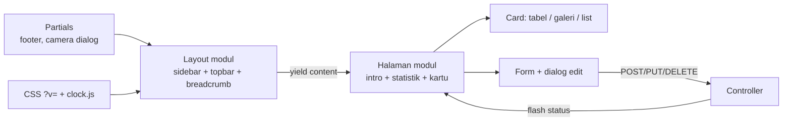

# BAB III — FITUR & ALUR PENGGUNA

## 5. ORGMATE

### 5.1 Dashboard Organisasi

- Hero sambutan berbasis waktu (pagi/siang/malam).
- Statistik nyata dari database: total anggota/pengurus, organisasi terbaru, kegiatan terbaru, saldo kas, iuran lunas.
- Logo organisasi = foto profil akun `organization`; tampil konsisten di semua host.
- Tombol Panduan ORGMATE + jam real-time.
- Catatan jujur: `totalDivisi/totalDokumen/totalPengumuman` ditampilkan `0` karena tabelnya belum ada.

### 5.2 Struktur Kepengurusan

- CRUD jabatan: nama, kelompok (**Pimpinan / Wakil Pimpinan / BPI / Divisi**), urutan tampil.
- Setiap jabatan menunjuk **satu pemegang** dari tabel `members` (satu jabatan = satu pemegang).
- Kandidat pemegang diambil dari `mahasiswas` yang `study_program`-nya sama dengan `organizations.focus`, dikelompokkan per angkatan (`enrollment_year`).
- Menunjuk pemegang otomatis membuat baris `members` bila belum ada.
- Dipakai landing `/struktur/{slug}`: bagan 4 tingkat dari `group_type` + anggota divisi sebagai kartu di bawah koordinatornya (koordinator tidak ikut daftar anggota divisi).

### 5.3 Data Anggota

- CRUD mahasiswa: nama, **NIM unik per organisasi**, email, telepon, fakultas, **divisi**, status aktif/nonaktif.
- Upload foto anggota (disk public, URL versi mtime).
- Modal edit + pagination khusus `vendor.pagination.orgmate` dengan info "Menampilkan X–Y dari Z anggota" dan `?per_page=5–50`.
- Pencarian `name/nim/email`.
- **Anggota adalah data keanggotaan, bukan akun login** — dipakai sebagai pemegang jabatan, saran nama panitia, dan dropdown pengurus iuran.

### 5.4 Arsip SK & Surat

- CRUD arsip: judul, kategori (`sk/surat_masuk/surat_keluar`), nomor, tanggal, file (PDF/gambar/dokumen ≤10 MB).
- Kartu hitungan per kategori; file bisa dibuka/diunduh.
- File lama otomatis dihapus saat diganti atau data dihapus.

### 5.5 Pengumuman & Rekrutmen

- **Pengumuman**: CRUD judul + isi; terbaru muncul di dashboard organisasi.
- **Rekrutmen**: halaman pengelolaan; link pendaftaran dari `organizations.registration_url` tampil di kartu *Open Recruitment* landing.

### 5.6 Pola akses & hubungan antar modul

| Aspek | Keterangan |
|---|---|
| Developer | View-only + pemilih organisasi `?organization=slug` |
| Organization | Hanya menulis data organisasinya (403 untuk data asing) |
| `members` → E-PROGRESS | Saran nama panitia (`committees.name`) |
| `members` → SENTRA | Dropdown pengurus iuran (`dues.name`) |
| `positions.group_type` → Landing | Bagan struktural publik |

---

## 6. E-PROGRESS

### 6.1 Dashboard Kegiatan

- Statistik nyata: total kegiatan, proker, peserta terlibat (presensi), kegiatan selesai.
- Grafik 6 bulan terakhir (kegiatan vs selesai), kegiatan terbaru, banner + periode kepengurusan.
- Tombol Panduan E-PROGRESS + jam real-time.

### 6.2 Proker (Program Kerja)

- CRUD: nama, deskripsi, **status tahapan** (`perencanaan → pelaksanaan → evaluasi → pelaporan → selesai`), tanggal mulai/selesai.
- Proker adalah **jangkar integrasi**: `budgets.work_program_id` (RAB SENTRA) dan progres monitoring merujuk ke sini.

### 6.3 Kalender Kegiatan

- Kalender bulanan interaktif: grid 7×6, header Sen–Min, navigasi bulan, penanda hari ini.
- Kegiatan tampil sebagai *chip* di tanggal mulai.
- Daftar "Kegiatan Bulan Ini" (status, proker, jadwal).
- CRUD kegiatan: nama, proker, lokasi, mulai/selesai (`datetime-local`), status, deskripsi. Edit via modal, hapus dengan konfirmasi.
- Filter tahun/bulan berdasar `start_at`. Developer: monitoring + pemilih organisasi.

### 6.4 Kepanitiaan

- Per kegiatan: susun panitia (nama + peran: Ketua Pelaksana, Koordinator Acara, Sekretaris, Bendahara, Sie, dll.).
- Nama disarankan dari Data Anggota ORGMATE (`members`).
- Statistik: total kegiatan, kegiatan berpanitia, total panitia. CRUD edit/hapus.

### 6.5 Absensi / Presensi QR

- QR asli berformat **SVG** (±260 px) per kegiatan, mengarah ke URL check-in **bertanda tangan** (`URL::temporarySignedRoute(..., now()->addMinutes(5))`).
- Alur: tayangkan QR → peserta scan → form nama → "Saya Hadir" → tercatat `method='qr'`, tanpa login.
- Tombol Unduh QR (SVG) & Cetak (hanya kartu QR yang tercetak).
- Daftar hadir: nomor, avatar inisial, badge metode (QR/Manual), pencarian nama.
- Panitia bisa mencatat manual dan menghapus.

### 6.6 Dokumentasi Kegiatan

- Upload **multi-berkas** (maks 10 file per aksi, ≤20 MB/file): foto, video, dokumen, lainnya + judul & jenis.
- Galeri grid foto (klik → ukuran penuh) + daftar video/dokumen (Buka/Unduh/Edit/Hapus).
- Juga menjadi sumber halaman publik `/kegiatan` — **hanya kegiatan yang punya dokumentasi yang tampil** (`whereHas('documentations')`).

### 6.7 Evaluasi & LPJ

- Per kegiatan: tulis dokumen bertipe **Evaluasi** atau **LPJ**, status Draft/Selesai, isi teks.
- Filter tab Semua / Evaluasi / LPJ.
- Dokumen LPJ tertaut otomatis ke SENTRA Realisasi sebagai bukti pertanggungjawaban (lewat `activities.work_program_id`).

### 6.8 Monitoring Progres Proker

- Progres **nyata** per proker = kegiatan `selesai` ÷ total kegiatan (bar + persen), rincian tahapan, kegiatan terakhir.
- Statistik: total proker, rata-rata progres, proker 100%, proker belum ada kegiatan.

### 6.9 Izin & pengujian

- Developer view-only lintas organisasi; organization menulis org-nya (kegiatan/panitia/dokumentasi terikat proker milik sendiri).
- Tes: WorkProgram, ActivityCalendar, Committee, Attendance, Documentation, Evaluation, MonitoringProgress (±26 test).

---

## 7. SENTRA

### 7.1 Dashboard Keuangan

- Hero + filter periode & organisasi (developer), chip jam real-time.
- **Nyata dari database**: saldo, pemasukan, pengeluaran (Kas), total anggaran (RAB per periode), grafik arus kas bulanan (Chart.js).
- Aksi cepat ke semua menu + kartu Pengajuan (menu dihapus) + Iuran.

### 7.2 Kas Organisasi

- CRUD pemasukan/pengeluaran: keterangan, jenis, tanggal, nominal (`decimal(15,2)`), kategori (Sponsorship, Iuran, Operasional…).
- **BUKTI WAJIB** (foto/PDF ≤10 MB): upload file atau tombol **📷 Kamera** (`getUserMedia` → foto → input file). Tanpa bukti → error, tidak tersimpan.
- Saldo = Σ pemasukan − Σ pengeluaran; format Rupiah `Rp1.000.000`; pencarian judul/kategori; pagination.
- Bukti tampil sebagai thumbnail klik-untuk-lihat; ganti bukti lewat Edit; hapus data ikut menghapus file.

### 7.3 Anggaran & RAB

- CRUD RAB per proker + tahun: nama proker, **taut ke proker E-PROGRESS (opsional)**, tahun, anggaran, realisasi awal.
- Persentase realisasi otomatis (`realized/allocated`), sisa anggaran, status (Belum Dipakai / Berjalan / Hampir Habis / Habis).
- Total anggaran per periode tampil di dashboard SENTRA.

### 7.4 Iuran Anggota

- Catat iuran per pengurus: **dropdown nama dari Data Anggota**, nominal, periode, status, tanggal bayar, **bukti wajib**.
- **Tandai Lunas** → otomatis tercatat pemasukan Kas "Iuran {nama}" kategori Iuran Anggota, bukti tersalin. **Idempoten**: dicek dari judul agar tidak dobel saat tombol ditekan berulang.
- Progres pembayaran (X/Y anggota, persen, terkumpul); filter status/periode; Edit/Hapus.

### 7.5 Realisasi Anggaran (+ LPJ E-PROGRESS)

- Grafik bar Anggaran vs Realisasi per proker; statistik total/sisa/persen.
- Tabel rincian: anggaran, realisasi, persen, **bukti LPJ dari E-PROGRESS** (badge hijau → taut ke menu Evaluasi & LPJ), aksi Catat.
- **Catat Realisasi**: nominal + keterangan + tanggal + **bukti wajib** → satu transaksi: pengeluaran Kas dibuat **dan** `budgets.realized += nominal`.
- Daftar semua dokumen LPJ (`evaluations` tipe `lpj`) beserta kegiatan, penulis, status.

### 7.6 Laporan Keuangan

- Laporan periodik per tahun; unduh CSV (pemasukan/pengeluaran/saldo per bulan).
- Saat ini isi baris masih placeholder `emptyData()` (lihat Bab 18).
- Inventaris & peminjaman aset: tabel tersedia untuk tahap lanjut, menu sudah dihapus.

### 7.7 Aturan uang (wajib)

1. Semua transaksi uang (Kas, Iuran, Realisasi) **wajib lampir bukti** — foto via kamera HP atau upload struk/kuitansi.
2. Iuran lunas & realisasi selalu **menyalin bukti** ke transaksi kas yang dibuatnya → jejak bukti utuh.

### 7.8 Izin & pengujian

- Developer view-only lintas organisasi; organization menulis org-nya dan tidak bisa mengakses RAB/transaksi org lain (403).
- Tes: CashTransaction, Budget, Dues, Realisasi (±17 test SENTRA).

---

## 8. Flowchart alur fitur

### 8.1 Login & panel

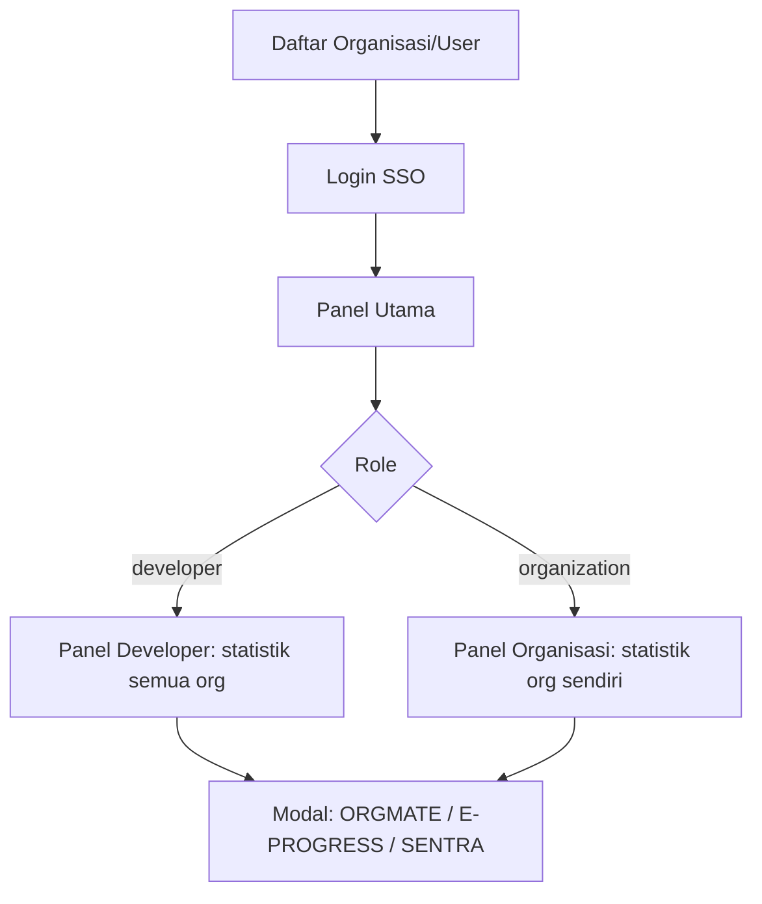

### 8.2 ORGMATE — Struktur & Anggota

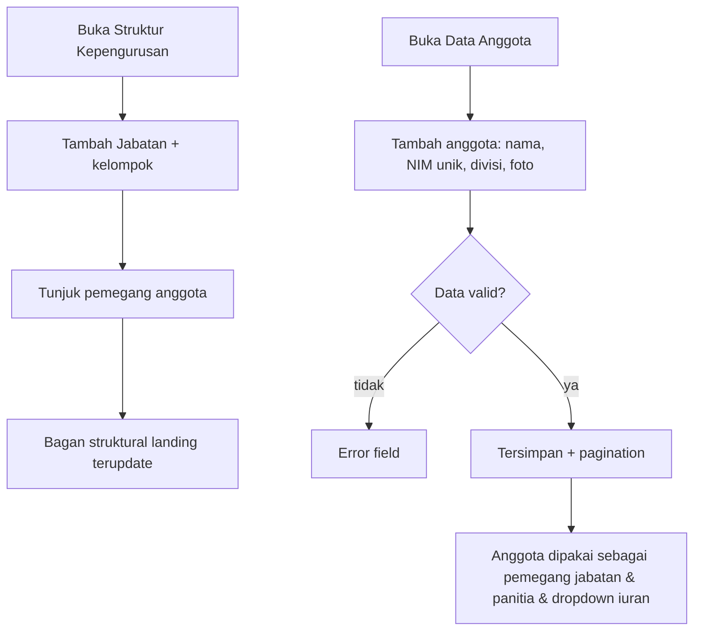

### 8.3 E-PROGRESS — Proker → Kalender → Kegiatan

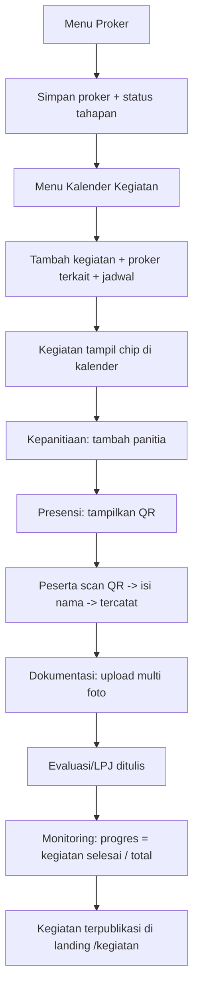

### 8.4 E-PROGRESS — Presensi QR (publik)

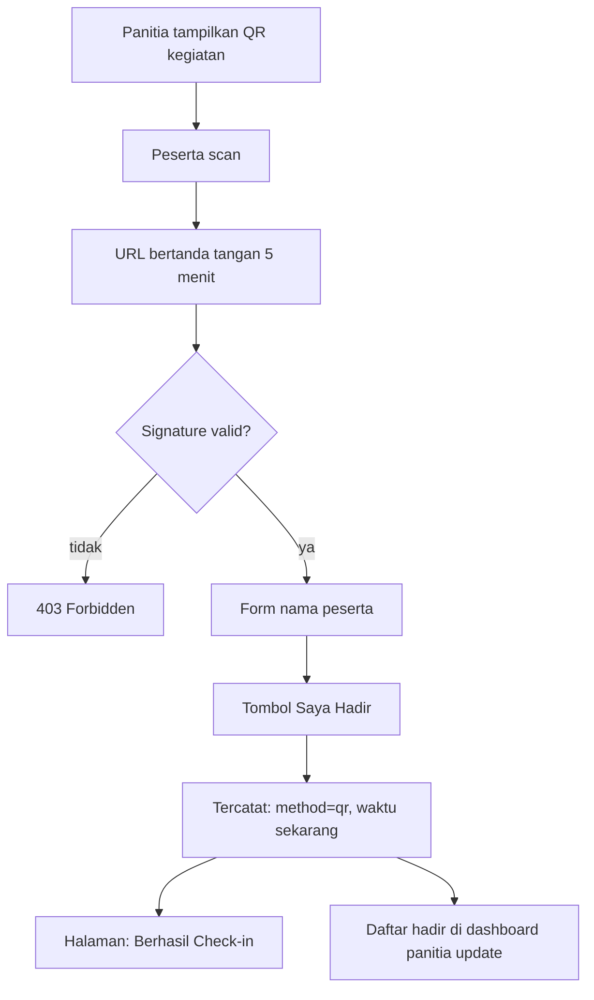

### 8.5 SENTRA — Uang masuk/keluar

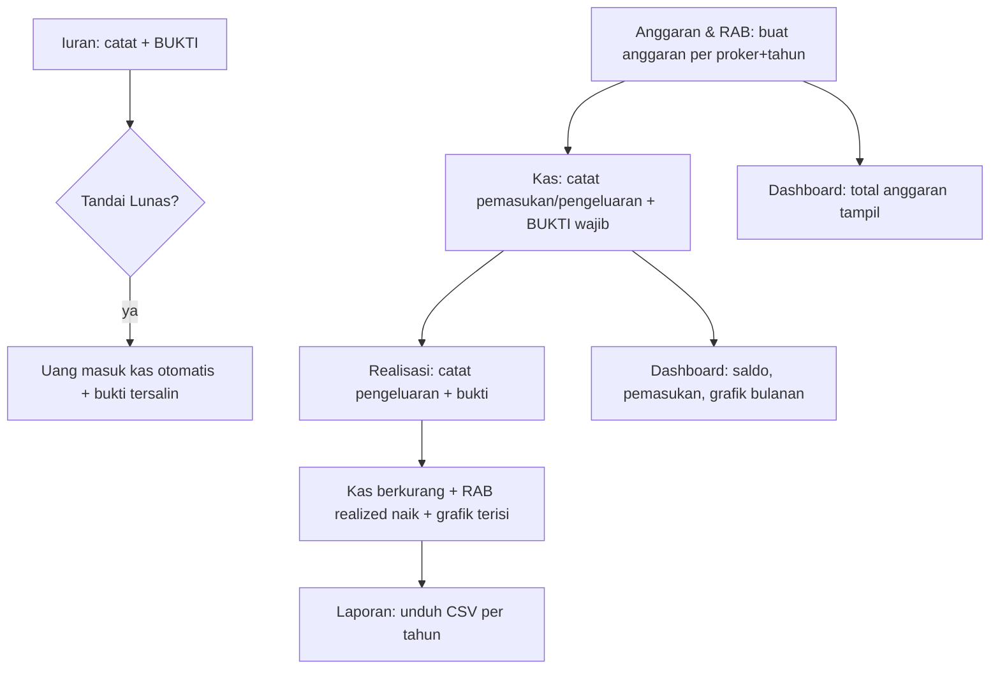

### 8.6 Flowchart umum (semua menu CRUD)

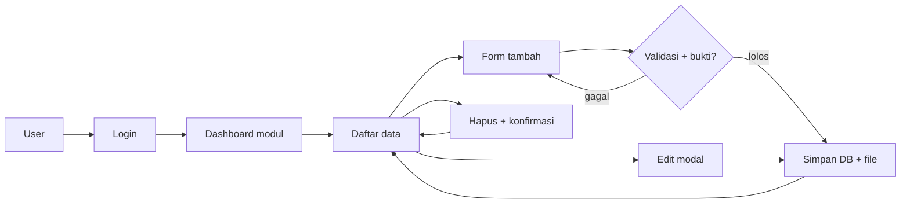

# BAB IV — BACKEND

## 9. Routing

### 9.1 File route

| File | Isi |
|---|---|
| `routes/web.php` | Semua route browser: landing publik, auth, panel, grup `/simora` (modul), presensi publik bertanda tangan |
| `routes/api.php` | API publik read-only `GET /api/v1/...` + `GET /api/v1/me` (token auth) + health + internal API (Bab VII) |
| `routes/console.php` | Jadwal & perintah konsol (relay outbox tiap menit) |
| `bootstrap/app.php` | Alias middleware: `role`, `api.token`, `service.token`; pengecualian CSRF |

### 9.2 Grup middleware

Route modul berada di dalam grup:

```php
Route::middleware(['auth', 'role:developer,organization'])
    ->prefix('simora')->name('simora.')
    ->group(function () { ... });
```

Route tulis (POST/PUT/DELETE) ditambah `->middleware('role:organization')` sehingga `developer` hanya mendapat GET (*view-only*).

### 9.3 Peta route publik

| Method | URI | Nama | Fungsi |
|---|---|---|---|
| GET | `/` | `home` | Landing publik |
| GET | `/kontak` | `kontak` | Halaman kontak |
| GET | `/struktur` | `struktur.index` | Daftar organisasi untuk struktural |
| GET | `/struktur/{organization:slug}` | `struktur.show` | Bagan struktural organisasi |
| GET | `/kegiatan` | `kegiatan.index` | Daftar kegiatan + dokumentasi |
| GET | `/kegiatan/{activity}` | `kegiatan.show` | Detail kegiatan + galeri |
| GET/POST `/login`, POST `/logout` | `login`, `login.store`, `logout` | SSO session (throttle 5/menit) |
| GET | `/panel` | `panel` | Panel utama (developer/organisasi) |
| GET `/presensi/{activity}` (POST sama) | `presensi.checkin(.store)` | Check-in publik QR (middleware `signed`) |

### 9.4 Peta route ORGMATE (`simora.orgmate.*`)

| Route | Method | URI | Fungsi |
|---|---|---|---|
| `orgmate` | GET | `/simora/orgmate` | Dashboard organisasi |
| `orgmate.panduan` | GET | `/simora/orgmate/panduan` | Panduan ORGMATE |
| `orgmate.struktur` | GET | `/simora/orgmate/struktur` | Struktur kepengurusan |
| `orgmate.anggota` (+`.store/.update/.destroy`) | GET/POST/PUT/DELETE | `/simora/orgmate/anggota[/{member}]` | Data anggota |
| `orgmate.rekrutmen` | GET | `/simora/orgmate/rekrutmen` | Rekrutmen |
| `orgmate.arsip` (+`.store/.update/.destroy`) | GET/POST/PUT/DELETE | `/simora/orgmate/arsip[/{archive}]` | Arsip SK & surat |
| `orgmate.pengumuman` (+`.store/.update/.destroy`) | GET/POST/PUT/DELETE | `/simora/orgmate/pengumuman[/{announcement}]` | Pengumuman |

### 9.5 Peta route E-PROGRESS (`simora.e-progress.*`)

| Route | Method | URI | Fungsi |
|---|---|---|---|
| `e-progress` | GET | `/simora/e-progress` | Dashboard kegiatan |
| `e-progress.panduan` | GET | `/simora/e-progress/panduan` | Panduan E-Progress |
| `e-progress.proker` (+store/update/destroy) | GET/POST/PUT/DELETE | `/simora/e-progress/proker[/{workProgram}]` | Program kerja |
| `e-progress.kalender` (+store/update/destroy) | GET/POST/PUT/DELETE | `/simora/e-progress/kalender[/{activity}]` | Kalender + kegiatan |
| `e-progress.kepanitiaan` (+store/update/destroy) | GET/POST/PUT/DELETE | `/simora/e-progress/kepanitiaan[/{committee}]` | Susunan panitia |
| `e-progress.presensi` (+store/destroy) | GET/POST/DELETE | `/simora/e-progress/presensi[/{attendance}]` | QR presensi + daftar |
| `e-progress.dokumentasi` (+store/update/destroy) | GET/POST/PUT/DELETE | `/simora/e-progress/dokumentasi[/{documentation}]` | Galeri dokumentasi |
| `e-progress.evaluasi` (+store/update/destroy) | GET/POST/PUT/DELETE | `/simora/e-progress/evaluasi[/{evaluation}]` | Evaluasi & LPJ |
| `e-progress.monitoring` | GET | `/simora/e-progress/monitoring` | Progres proker |

### 9.6 Peta route SENTRA (`simora.sentra.*`)

| Route | Method | URI | Fungsi |
|---|---|---|---|
| `sentra` | GET | `/simora/sentra` | Dashboard keuangan |
| `sentra.panduan` | GET | `/simora/sentra/panduan` | Panduan SENTRA |
| `sentra.kas` (+store/update/destroy) | GET/POST/PUT/DELETE | `/simora/sentra/kas[/{cashTransaction}]` | Kas organisasi |
| `sentra.rab` (+store/update/destroy) | GET/POST/PUT/DELETE | `/simora/sentra/rab[/{budget}]` | Anggaran & RAB |
| `sentra.iuran` (+store/update/destroy/markPaid) | GET/POST/PUT/DELETE | `/simora/sentra/iuran[/{due}]`, `/{due}/lunas` | Iuran anggota |
| `sentra.realisasi` (+store) | GET/POST | `/simora/sentra/realisasi` | Realisasi anggaran (kas+RAB+LPJ) |
| `sentra.laporan` | GET | `/simora/sentra/laporan` | Laporan keuangan (CSV) |

### 9.7 Route lain

- `simora.organizations.*`, `simora.accounts.*` — kelola organisasi & akun (developer).
- `simora.my-registration.update/destroy`, `my-socials.update`, `my-vision-mission.update` — profil organisasi.
- `simora.landing-management(.update)` — kelola landing (developer).
- `simora.kalender-kerja` — kalender kerja organisasi.
- `GET /api/v1/organizations[/{slug}[/structure]]`, `GET /api/v1/me` — API publik read-only.

### 9.8 Parameter & pola

- *Implicit model binding* Laravel (`{member}`, `{activity}`, `{due}`, …).
- Query string: `?organization=slug`, `?activity=id`, `?periode=YYYY`, `?q=`, `?status=`, `?type=`, `?year=&month=`, `?per_page=5–50`.
- Presensi publik memakai `URL::signedRoute` + middleware `signed`; tanpa signature → `403`.
- Penamaan: `simora.{modul}.{menu}[.store|.update|.destroy]`.

```mermaid
flowchart LR
    PUB[Landing publik<br/>/ , /struktur, /kegiatan, /kontak] --> GET[Controller publik]
    PUB2[QR scan peserta] --> SIGN[GET /presensi/{activity}?signature]
    SIGN -->|valid| CHECKIN[Form check-in nama]
    SIGN -->|tak valid| F403[403 Forbidden]
    LOGIN[Login SSO] --> PANEL[/panel]
    PANEL --> ORG[Panel organisasi] --> ORGMATE[/simora/orgmate...]
    PANEL --> EPROG[/simora/e-progress...]
    PANEL --> SENTRA[/simora/sentra...]
    ORGMATE -->|tulis| POST[POST/PUT/DELETE role:organization]
    POST -->|scope org| DB[(MySQL)]
```

---

## 10. Controller

### 10.1 Controller publik & panel

| Controller | Fungsi |
|---|---|
| `LandingController` | Landing publik (daftar organisasi dari DB) |
| `LandingStructureController` | Bagan struktural publik (index + show, 4 tingkat dari `group_type`) |
| `LandingKegiatanController` | Daftar & detail kegiatan publik (yang berdokumentasi) |
| `ContactController` | Halaman kontak |
| `PanelController` | Panel utama developer & organisasi (statistik nyata) |
| `Auth\LoginController` | Login/logout SSO session (throttle) |

### 10.2 ORGMATE

| Controller | Fungsi |
|---|---|
| `OrgmateController` | Dashboard + halaman: struktur, anggota (+pagination), rekrutmen, arsip, pengumuman, panduan |
| `PositionController` | CRUD jabatan + pemegang anggota (1 jabatan = 1 pemegang) |
| `MemberController` | CRUD anggota mahasiswa (NIM unik per org), foto, modal edit |
| `ArchiveController` | CRUD arsip SK/surat + upload file |
| `AnnouncementController` | CRUD pengumuman |

### 10.3 E-PROGRESS

| Controller | Fungsi |
|---|---|
| `EProgressController` | Dashboard statistik nyata + halaman: kalender, kepanitiaan, presensi, dokumentasi, evaluasi, monitoring, panduan |
| `WorkProgramController` | CRUD proker (nama, deskripsi, status tahapan, tanggal) |
| `ActivityController` | CRUD kegiatan kalender (nama, proker, lokasi, waktu, status) |
| `CommitteeController` | CRUD panitia per kegiatan (nama + peran) |
| `AttendanceController` | Catat manual + hapus presensi; halaman publik check-in QR bertanda tangan |
| `DocumentationController` | Upload multi-berkas dokumentasi (maks 10/file) + edit/hapus |
| `EvaluationController` | CRUD evaluasi/LPJ (judul, isi, tipe, status) |

### 10.4 SENTRA

| Controller | Fungsi |
|---|---|
| `SentraController` | Dashboard (kas nyata + grafik bulanan + total anggaran) + halaman: kas, rab, iuran, realisasi, laporan, panduan |
| `CashTransactionController` | CRUD transaksi kas (**WAJIB bukti**: upload/kamera) |
| `BudgetController` | CRUD RAB per proker+tahun (opsional taut ke proker E-Progress) |
| `DuesController` | CRUD iuran (**WAJIB bukti**) + Tandai Lunas → otomatis masuk kas |
| `RealizationController` | Catat realisasi: pengeluaran kas + realisasi RAB naik (**WAJIB bukti**) |

### 10.5 Lainnya

| Controller | Fungsi |
|---|---|
| `AccountController` | Kelola akun login (developer) |
| `OrganizationController` | Kelola organisasi (developer) |
| `OrganizationRegistrationController` | Link pendaftaran organisasi |
| `OrganizationSocialController` | Sosial media organisasi |
| `OrganizationVisionMissionController` | Visi & misi |
| `LandingManagementController` | Kelola landing (footer, konten) |
| `Api\V1\OrganizationController` | API publik read-only |

### 10.6 Pola controller standar

```php
public function store(Request $request): RedirectResponse
{
    $organization = $request->user()->organization;
    abort_if($organization === null, 403, 'Akun ini belum terhubung ke organisasi.');
    $data = $this->normalize($request->validate($this->rules()));
    $data['organization_id'] = $organization->id;
    Model::create($data);
    return redirect()->route('...')->with('status', '... berhasil ...');
}

public function update(Request $request, Model $model): RedirectResponse
{
    OrganizationScope::assertCanAccessOrganization($request->user(), $model->organization_id);
    ...
}
```

Aturan yang konsisten di semua controller:

- Query halaman selalu dibatasi `organization_id`; developer boleh memfilter `?organization=slug`.
- Validasi selalu memeriksa relasi milik organisasi sendiri (mis. `work_program_id` harus proker org sendiri → error bila asing).
- File: `storePublicly('...', 'public')`; file lama dihapus saat update/destroy.
- Uang: `proof` wajib (foto/PDF ≤10 MB); iuran lunas & realisasi menyalin bukti ke transaksi kas yang mereka buat.

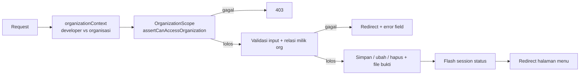

---

## 11. Model & relasi Eloquent

### 11.1 Daftar model (22)

| Model | Tabel | Peran |
|---|---|---|
| `User` | `users` | Akun login SSO (role developer/organization), avatar, api_token |
| `Organization` | `organizations` | Organisasi (HIMA-TI, HIMATIKA, dll.) |
| `Member` | `members` | Anggota mahasiswa per organisasi (bukan akun) |
| `Position` | `positions` | Jabatan struktural → pemegang anggota |
| `Archive` | `archives` | Arsip SK/surat |
| `Announcement` | `announcements` | Pengumuman |
| `Recruitment` | `recruitments` | Rekrutmen anggota |
| `WorkProgram` | `work_programs` | Program kerja (E-Progress) |
| `Activity` | `activities` | Kegiatan (kalender) |
| `Proposal` | `proposals` | Penyimpanan proposal (menu dihapus, data lama) |
| `Committee` | `committees` | Panitia per kegiatan |
| `Attendance` | `attendances` | Presensi (QR/manual) |
| `Documentation` | `documentations` | Dokumentasi kegiatan |
| `Evaluation` | `evaluations` | Evaluasi & LPJ |
| `Budget` | `budgets` | Anggaran RAB per proker+tahun |
| `CashTransaction` | `cash_transactions` | Transaksi kas (+ bukti) |
| `Dues` | `dues` | Iuran anggota (+ bukti) |
| `FundRequest` | `fund_requests` | Penyimpanan pengajuan dana (menu dihapus) |
| `Inventory` | `inventories` | Aset/inventaris (tabel sudah dihapus via migration) |
| `AssetLoan` | `asset_loans` | Peminjaman aset (tabel sudah dihapus) |
| `FooterSetting` | `footer_settings` | Pengaturan footer landing |
| `DomainEvent` | `domain_events` | Outbox sinkronisasi antar modul |

### 11.2 Relasi penting

```
Organization
 ├─ users()                    Akun login organisasi
 ├─ members()                  Anggota mahasiswa
 ├─ positions()                Jabatan struktural
 ├─ archives / announcements / recruitments
 ├─ workPrograms()
 │    └─ activities()          Kegiatan
 │         ├─ committees()     Panitia
 │         ├─ attendances()    Presensi
 │         ├─ documentations() Galeri
 │         └─ evaluations()    Evaluasi/LPJ
 ├─ budgets() ── workProgram() RAB ↔ Proker (integrasi SENTRA↔E-Progress)
 ├─ cashTransactions, dues, fundRequests
 └─ inventories() ── assetLoans()

Activity
 ├─ organization, workProgram, creator
 ├─ proposals/committees/attendances/documentations/evaluations

Documentation: activity, organization, uploader → user
Dues: (name = nama pengurus dari members), organization, user
CashTransaction: organization, creator → user
Budget: organization, workProgram
Evaluation: activity, creator; type = evaluasi|lpj
```

### 11.3 Atribut khas

- `Activity::STAGES` = `perencanaan, pelaksanaan, evaluasi, pelaporan, selesai` (status kegiatan & proker).
- `Proposal::STATUS_PENDING/APPROVED/REJECTED` = `menunggu/disetujui/ditolak`.
- `Dues::STATUS_PAID/UNPAID` = `lunas/belum_bayar`.
- `Evaluation::TYPE_EVALUATION/TYPE_REPORT` = `evaluasi/lpj`, `STATUS_DRAFT/DONE`.
- `Documentation::TYPES` = `foto, video, dokumen, lainnya` + accessor `file_url`, `is_image`.
- `CashTransaction & Dues`: accessor `proof_url`, konstanta tipe, `amount` float.
- `Budget::percentage` accessor (`realized/allocated × 100`).
- `Organization::logo_url` + `User::avatar_url`: logo organisasi = avatar akun organization (satu foto yang sama, tampil di semua host).
- Semua model tabel modul memiliki `organization_id` (kepemilikan data).
- `DomainEvent` (Bab VII): fillable `event_id`, `published_at`; cast tanggal.

---

# BAB V — DATABASE

## 12. Skema tabel

Database: **MySQL** (`DB_CONNECTION=mysql`), driver `SESSION_DRIVER=database`, `CACHE_STORE=database`, `QUEUE_CONNECTION=database`. Total **±24 tabel**. Semua tabel modul memiliki `organization_id` (FK → `organizations`, cascade on delete).

### 12.1 Tabel inti / autentikasi

#### `users`

| Kolom | Tipe | Keterangan |
|---|---|---|
| id | bigint | PK |
| name, email, password | | Akun login; password default `password` (dari seeder) |
| role | varchar | `developer` / `organization` |
| organization_id | FK null | Organisasi pemilik (untuk role organization) |
| nim | varchar null | NIM pengguna |
| avatar_path | varchar null | Foto profil; untuk organization = logo organisasi |
| api_token | varchar null | Token auth API (`GET /api/v1/me`), disimpan sha256 |
| email_verified_at, remember_token, timestamps | | Standar Laravel |

#### `organizations`

`id, name, slug (unik), full_name, banner_color, accent_color, focus, period, registration_url, instagram_url, tiktok_url, youtube_url, whatsapp_url, facebook_url, x_url, email, telegram_url, description, vision, mission, logo_path, sort_order, timestamps`

#### `members`

`id, organization_id, user_id null, name, nim, email null, phone null, faculty null, division null, status (aktif/nonaktif), avatar_path null, timestamps`

- NIM unik per organisasi. `division` = divisi anggota (untuk struktur grup Divisi).

#### `positions`

`id, organization_id, member_id null (FK members), name, description null, sort_order, group_type (Pimpinan/Wakil Pimpinan/BPI/Divisi), timestamps`

- **Satu jabatan = satu pemegang** (menunjuk ke anggota).

#### `mahasiswas` (hasil sinkron SSO, bukan keanggotaan)

`id, nim (unik), name, faculty, study_program, prodi_id, fakultas_id, gender, enrollment_year, synced_at`

#### `footer_settings`

`id, identity_text, tagline, instagram_url, tiktok_url, website_url` (satu baris *current*).

### 12.2 Tabel ORGMATE

| Tabel | Kolom kunci |
|---|---|
| `archives` | organization_id, uploaded_by, title, type (sk/surat_masuk/surat_keluar), number, date, file_path |
| `announcements` | organization_id, created_by, title, content, published_at |
| `recruitments` | organization_id, created_by, title, division, description, deadline, status (dibuka) |

### 12.3 Tabel E-PROGRESS

| Tabel | Kolom kunci |
|---|---|
| `work_programs` | organization_id, created_by, name, description, status (5 tahapan), start_date, end_date |
| `activities` | organization_id, work_program_id null, created_by, name, description, location, start_at, end_at, status |
| `proposals` | organization_id, activity_id null, submitted_by, decided_by, title, description, status (menunggu/disetujui/ditolak), decided_at |
| `committees` | organization_id, activity_id, user_id null, name, role |
| `attendances` | organization_id, activity_id, user_id null, name, checked_at, method (qr/manual) |
| `documentations` | organization_id, activity_id, uploaded_by, title, type (foto/video/dokumen/lainnya), file_path |
| `evaluations` | organization_id, activity_id, created_by, title, content, type (evaluasi/lpj), status (draft/selesai) |

### 12.4 Tabel SENTRA

| Tabel | Kolom kunci |
|---|---|
| `cash_transactions` | organization_id, created_by, type (pemasukan/pengeluaran), title, amount `decimal(15,2)`, date, category, **proof_path** |
| `budgets` | organization_id, work_program_id null (→ E-Progress), program_name, year, allocated, realized |
| `fund_requests` | organization_id, decided_by, title, description, amount, status (menunggu/disetujui/ditolak), applicant, decided_at |
| `dues` | organization_id, user_id null, name (nama pengurus), amount, status (lunas/belum_bayar), paid_at, period, **proof_path** |
| `inventories` / `asset_loans` | Sudah dihapus lewat migration `2026_11_08_072232_drop_inventories_and_asset_loans_tables` |

### 12.5 Tabel sistem

| Tabel | Fungsi |
|---|---|
| `domain_events` | Outbox sinkronisasi: `id, event_id (uuid unik), type, subject_type, subject_id, organization_id, payload json, occurred_at, published_at` |
| `cache` | Rate limit login (`throttle:5,1`) & cache lainnya |
| `jobs` | Antrean job (driver database) |
| `sessions` | Sesi login (driver database) |
| `password_reset_tokens` | Reset password |

### 12.6 Integrasi antar modul (jalur data uang)

1. **ORGMATE → E-PROGRESS**: data `members` menjadi saran nama panitia (`committees.name`).
2. **E-PROGRESS → SENTRA**: `budgets.work_program_id` menaut RAB ke proker; `evaluations` bertipe **LPJ** tampil di halaman Realisasi SENTRA sebagai bukti.
3. **SENTRA internal**: Iuran lunas → pemasukan Kas (salin bukti); Catat Realisasi → pengeluaran Kas + `budgets.realized += jumlah`.

---

## 13. ERD — Entity Relationship Diagram

### 13.1 ERD inti + ORGMATE

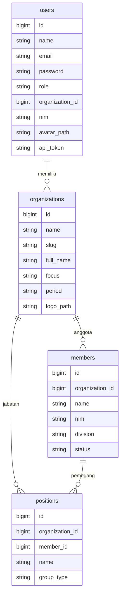

### 13.2 ERD E-PROGRESS

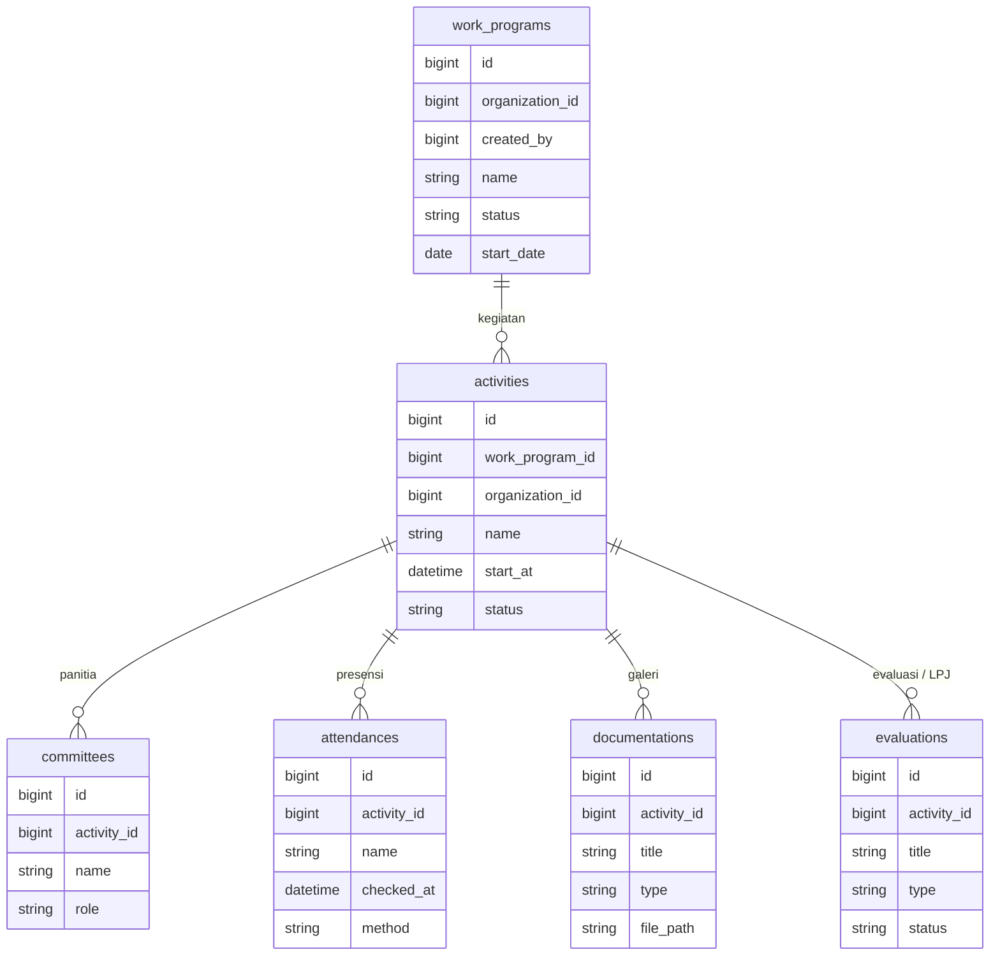

### 13.3 ERD SENTRA

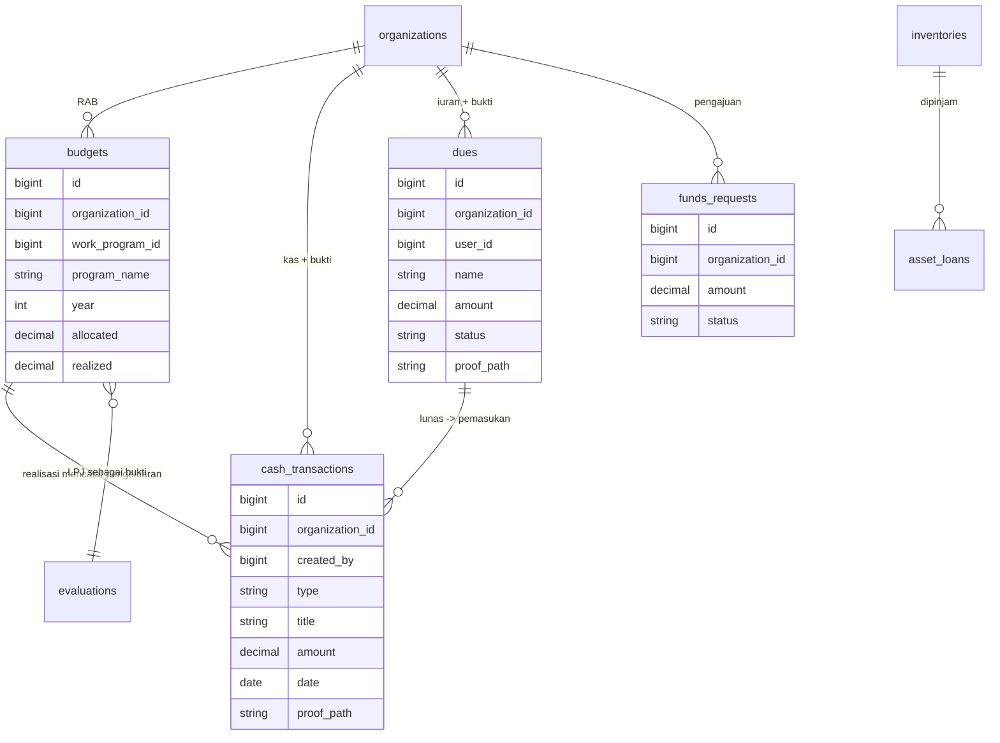

### 13.4 ERD gabungan (referensi lengkap)

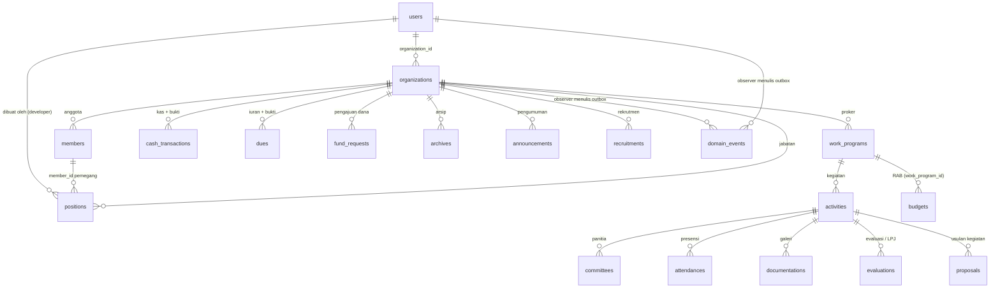

### 13.5 Keterangan relasi

- Semua FK organisasi bersifat `cascadeOnDelete` — saat organisasi dihapus, data modulnya ikut terhapus.
- FK ke pengguna (`created_by`, `uploaded_by`, `user_id`) bersifat `nullOnDelete` agar data tidak hilang bila akun dihapus.
- `budgets.work_program_id` adalah **jembatan SENTRA ↔ E-PROGRESS**; `evaluations` tipe LPJ adalah **jembatan bukti LPJ → Realisasi SENTRA**.
- `dues.name` menyimpan nama pengurus (diambil dari `members`); `dues.user_id` opsional (pemilik tagihan) — karena pengurus bukan akun login.

---

## 14. DFD — Data Flow Diagram

### 14.1 DFD Level 0 (Context Diagram)

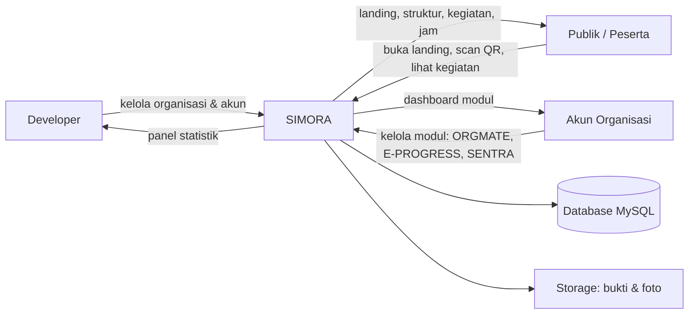

### 14.2 DFD Level 1 — proses utama

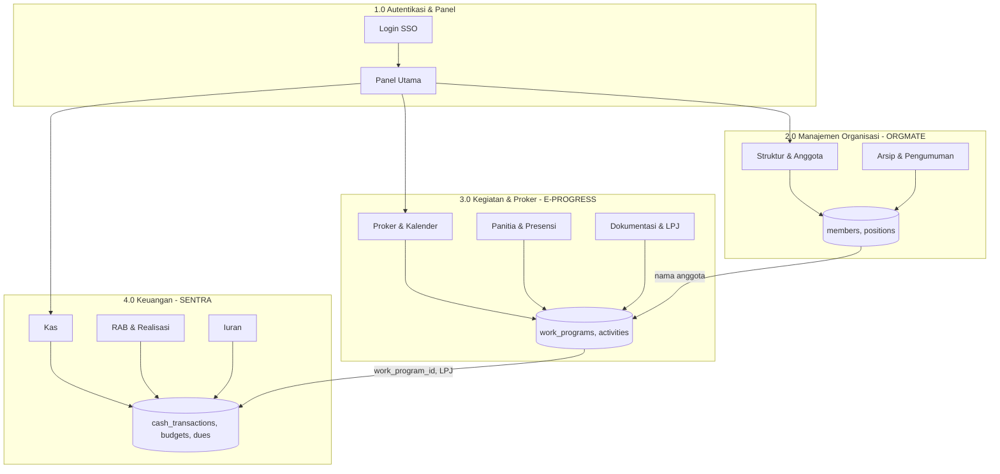

### 14.3 DFD Level 2 — alur dana SENTRA (fokus)

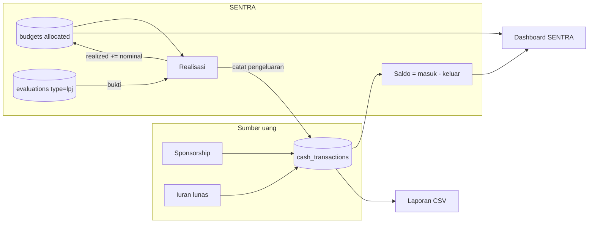

**Catatan:** DFD di sini menggambarkan keadaan *sebelum* pemisahan service. Versi setelah microservice (dengan internal API, publisher, dan ingest) ada di Bab 20 & 24.

---

## 15. Akses data per halaman

Kunci: **R** = dibaca, **W** = ditulis/diubah/dihapus.

### 15.1 Landing (publik, tanpa login)

| Route | Controller | Tabel (R/W) | Catatan |
|---|---|---|---|
| `GET /` | `LandingController` | **R** `organizations` | Urut `sort_order`, `name` → kartu organisasi |
| `GET /kontak` | `ContactController` | **R** `organizations` | Daftar kontak/sosmed |
| `GET /struktur` | `LandingStructureController@index` | **R** `organizations` | Daftar organisasi |
| `GET /struktur/{slug}` | `LandingStructureController@show` | **R** `organizations`, `users`, `positions`, `members` | Bagan struktur + pemegang (`positions.member_id` → `members`) |
| `GET /kegiatan` | `LandingKegiatanController@index` | **R** `activities` + `organizations` + `work_programs` + `documentations` | **Hanya kegiatan yang punya dokumentasi** (`whereHas`) |
| `GET /kegiatan/{activity}` | `LandingKegiatanController@show` | **R** `activities`, `documentations`, `organizations`, `work_programs` | 404 bila tanpa dokumentasi; + 3 kegiatan terkait |
| `GET /presensi/{activity}` (signed) | `AttendanceController@checkin` | **R** `activities` | URL bertanda tangan 5 menit, `throttle:5,1`, tanpa login |
| `POST /presensi/{activity}` (signed) | `AttendanceController@checkinStore` | **W** `attendances` | `method='qr'`, hanya `name` + `checked_at` |
| Partial `site-footer` | (view) | **R** `footer_settings` | `FooterSetting::current()` — satu baris |

**API publik read-only** (`routes/api.php`):

| Endpoint | Tabel (R) | Catatan |
|---|---|---|
| `GET /api/v1/organizations` | `organizations` | Paginasi 15–100 |
| `GET /api/v1/organizations/{slug}` | `organizations` | Detail |
| `GET /api/v1/organizations/{slug}/structure` | `organizations`, `positions` (+`members`), `members` | **PII disembunyikan**: tanpa `nim`, tanpa `status` |
| `GET /api/v1/me` (Bearer) | `users` (+ `organizations`) | Middleware `api.token`, cocokkan `sha256(api_token)` |

### 15.2 Login & sesi

| Route | Tabel (R/W) | Alur |
|---|---|---|
| `GET /login` | — | Jika sudah login → redirect `route('panel')` |
| `POST /login` (`throttle:5,1`) | **R** `users`, **W** `sessions`, **W/R** `cache` | `Auth::attempt()` → `session()->regenerate()` → redirect `route('panel')` |
| `POST /logout` | **W** `sessions` | `invalidate()` + `regenerateToken()` |
| `GET /api/v1/me` | **R** `users` | Token `api_token` (sha256) |

Tabel yang dibaca login **hanya `users`** — role & `organization_id` ikut terbawa dari baris tersebut dan menjadi dasar *scope* semua halaman panel.

### 15.3 Panel SIMORA (`GET /panel`)

`PanelController` bercabang dua berdasar `users.role`:

**a) Role `organization` → `simora.organization-panel`**

| Data | Tabel (R) | Rumus |
|---|---|---|
| Profil & logo | `users` + `organizations` | `$user->load('organization')` |
| Jumlah pengurus | `users` | `organizations.users()->count()` |
| Statistik | `work_programs`, `activities`, `cash_transactions`, `dues` | count proker, count kegiatan, **saldo kas = Σ pemasukan − Σ pengeluaran**, iuran lunas/total |
| Kegiatan terbaru | `activities` (+ `work_programs`) | 5 terbaru berdasar `start_at` |

**b) Role `developer` → `simora.panel`**

| Data | Tabel (R) |
|---|---|
| Statistik global | `organizations` (count), `users` (count + count role organization), `work_programs` (count) |
| Organisasi terbaru | `organizations` (6 terbaru, `sort_order`) |

### 15.4 Panel pendukung

| Route | Role | Tabel (R/W) |
|---|---|---|
| `Route::resource /simora/organisasi` | developer | **R/W** `organizations` (CRUD, slug, sosmed, logo) |
| `Route::resource /simora/akun` | developer | **R/W** `users` (+ `organizations` dropdown); membuat `api_token` (sha256) & menyalin `avatar_path` → `organizations.logo_path` |
| `GET+PUT /simora/kelola-landing` | developer | **R/W** `footer_settings` |
| `PUT /simora/organisasi-saya/pendaftaran` | organization | **R/W** `organizations.registration_url` |
| `PUT /simora/organisasi-saya/sosmed` | organization | **R/W** `organizations.*_url` |
| `PUT /simora/organisasi-saya/visi-misi` | organization | **R/W** `organizations.vision`, `mission` |
| `GET /simora/mahasiswa` | developer | **R** `mahasiswas` (filter prodi + pencarian nama/NIM) |

### 15.5 ORGMATE

| Route | Tabel (R) | Tabel (W) | Catatan |
|---|---|---|---|
| `dashboard` | `organizations`, `users`, `members` | — | Statistik anggota/pengurus, grafik Jan–Des dari `users.created_at` + `email_verified_at`; `totalDivisi/totalDokumen/totalPengumuman` masih **0 jujur** |
| `panduan` | — | — | Data statis |
| `struktur` | `positions` (+`member`), `members`, **`mahasiswas`**, `organizations` | **W** `positions` | Kandidat = `mahasiswas.study_program = organizations.focus`, dikelompokkan per `enrollment_year` |
| `anggota` | `members`, `positions` (opsi divisi), **`mahasiswas`** | **W** `members` | Pencarian `name/nim/email`, paginasi 5–50 |
| `pengumuman` | `announcements` (+`creator`), `organizations` | **W** `announcements` | |
| `arsip` | `archives` (+`uploader`), agregat `groupBy('type')` | **W** `archives` | Unduh file `file_path` |
| `rekrutmen` | `organizations` (`registration_url`, `period`) | — | Menampilkan link pendaftaran |

### 15.6 E-PROGRESS

| Route | Tabel (R) | Tabel (W) | Catatan |
|---|---|---|---|
| `dashboard` | `organizations`, `activities`, `work_programs`, `attendances` | — | Statistik + grafik 6 bulan (`start_at`, status `selesai`) |
| `proker` | `work_programs` | **W** `work_programs` | |
| `monitoring` | `work_programs` + `activities` | — | Progress = kegiatan `selesai` / total kegiatan proker |
| `kalender` | `activities` (+`work_programs`), `work_programs` (dropdown) | **W** `activities` | Filter tahun/bulan `start_at` |
| `kepanitiaan` | `activities`, `committees`, **`members`** (saran nama) | **W** `committees` | |
| `presensi` | `activities`, `attendances` | **W** `attendances` (manual) | QR: `URL::temporarySignedRoute(..., now()->addMinutes(5))` |
| `dokumentasi` | `activities`, `documentations` | **W** `documentations` | Maks 10 file; sumber halaman publik `/kegiatan` |
| `evaluasi` | `activities`, `evaluations` | **W** `evaluations` | Tipe `evaluasi` atau `lpj` |

### 15.7 SENTRA

| Route | Tabel (R) | Tabel (W) | Catatan |
|---|---|---|---|
| `dashboard` | `cash_transactions`, `budgets` | — | Total pemasukan/pengeluaran per bulan (tahun `?periode=`), total anggaran; **`iuranLunas/iuranTotal` masih hardcode 0** |
| `kas` | `cash_transactions` | **W** `cash_transactions` | Pencarian `title/category`, bukti wajib (`proof_path`) |
| `rab` | `budgets` (+`work_programs`), `work_programs` (dropdown) | **W** `budgets` | `budgets.work_program_id` menautkan RAB ke proker |
| `iuran` | `dues`, `members` (dropdown) | **W** `dues` | Filter periode/status, hitung lunas/terkumpul |
| `realisasi` | `budgets` (+`organizations`, `work_programs`), **`evaluations` tipe LPJ** | **W** `cash_transactions`, **W** `budgets.realized` | LPJ dikelompokkan via `evaluations.activity_id → activities.work_program_id` |
| `laporan` | — (saat ini `emptyData()`) | — | Unduh CSV tersedia, **isi baris masih placeholder 0** |
| `panduan` | — | — | Data statis |

### 15.8 Matriks ringkas: halaman → tabel

```text
LANDING      : organizations | positions | members | activities | documentations | work_programs | footer_settings
LOGIN        : users | sessions | cache
PANEL        : users | organizations | work_programs | activities | cash_transactions | dues
ORGMAETE     : members | positions | archives | announcements | mahasiswas | organizations | users
E-PROGRESS   : work_programs | activities | committees | attendances | documentations | evaluations | members | organizations
SENTRA       : cash_transactions | budgets | dues | evaluations | members | work_programs | organizations
MAHASISWA    : mahasiswas (developer) + organizations (dropdown)
KELA LANDING : footer_settings
```

# BAB VI — AUTH, SINKRONISASI & BATASAN

## 16. Auth, role & kepemilikan data

### 16.1 SSO (Single Sign-On berbasis session)

- Login: `POST /login` (email + password, throttle 5/menit) → session cookie `web` middleware.
- `GET /login` diarahkan ke halaman login bila sudah login.
- Logout: `POST /logout`.
- Presensi QR khusus: URL bertanda tangan (`URL::signedRoute`) tanpa session — peserta cukup scan & isi nama.
- API: `GET /api/v1/me` via kolom `users.api_token` + middleware `api.token` (cocokkan `sha256`, header `Authorization: Bearer`).

### 16.2 Role user

| Role | Hak |
|---|---|
| `developer` | Melihat semua organisasi; pilih `?organization=slug`; hanya GET (tulis diblokir `role:organization`) |
| `organization` | Hanya menulis data `organization_id` miliknya; kolom lain dibatasi 403 |

### 16.3 OrganizationScope

`app/Support/OrganizationScope.php`:

- `forUser(Query $q, $user, $column)` — membatasi query listing ke organisasi user.
- `assertCanAccessOrganization($user, $organizationId)` — abort 403 jika tidak memiliki akses (dipakai semua `update/destroy` dan aksi seperti keputusan/realisasi).
- Validasi relasi selalu memastikan objek target (proker, kegiatan, budget, RAB proker) milik organisasi peminta.

### 16.4 Pola halaman (konsisten semua modul)

1. `organizationContext()` → developer/organisasi seperti dijelaskan Bab 15.
2. Query di-scope ke organisasi (atau semua bila developer tanpa pilihan).
3. Form tulis hanya role organization yang terlihat (developer melihat pesan view-only).
4. Route tulis terdaftar dengan `->middleware('role:organization')`.

### 16.5 Data audit & keamanan lain

- `created_by` / `uploaded_by` / `submitted_by` / `decided_by` menunjuk `users` (FK nullOnDelete).
- `domain_events` (outbox): Observer menulis event agar sinkronisasi antar modul tercatat (Bab 17 & 24).
- `api_token` rotasi manual; tidak diekspos di view.
- CSRF aktif (middleware web); kecuali route presensi publik (signed).
- Upload dibatasi tipe & ukuran (mimes + max); storage disk `public`; nama file dari hash storage.
- Pesan error field lokal `@error`; pesan sukses via `session('status')`.

---

## 17. Sinkronisasi data

Ada **tiga lapisan** sinkronisasi: (A) eksternal SSO, (B) internal antar modul dalam satu database, (C) outbox `domain_events` untuk pemisahan modul.

### 17.1 A — Sinkronisasi eksternal: SSO UNUJA → `mahasiswas`

Dijalankan manual via Artisan (belum ada jadwal):

```bash
php artisan sso:sync-mahasiswa --prodi="Teknologi Informasi"   # satu prodi
php artisan sso:sync-mahasiswa                                  # semua prodi dalam scope
```

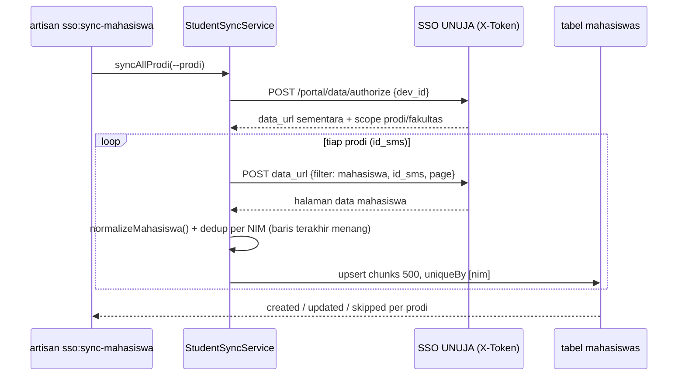

Aturan penting:

- **`mahasiswas` ≠ `members`**. `mahasiswas` = direktori mahasiswa per prodi (hak developer); `members` = keanggotaan organisasi yang ditulis manual oleh role organization.
- Kunci upsert **`nim`**. Kolom diperbarui: `name, faculty, study_program, prodi_id, fakultas_id, gender, enrollment_year, synced_at`.
- Baris tanpa NIM/nama dilewati (`skipped`); proses dibungkus `DB::transaction`.
- Pemakaian hilir: dropdown ORGMATE menyaring `mahasiswas.study_program = organizations.focus`, dikelompokkan per angkatan (`enrollment_year`).

### 17.2 B — Sinkronisasi internal antar modul (satu database)

Karena semua modul berbagi database, sinkronisasi dilakukan lewat **foreign key + query silang + penulisan ganda dalam satu transaksi** (belum memakai message broker).

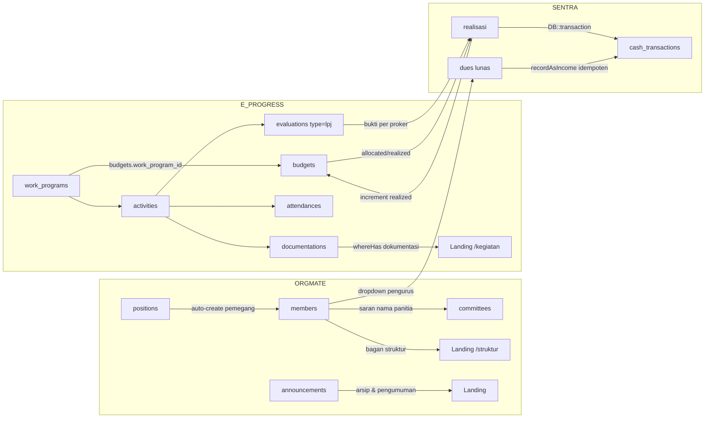

| # | Dari → Ke | Mekanisme | Kode |
|---|---|---|---|
| 1 | ORGMATE → E-PROGRESS | `members` dipakai sebagai saran nama panitia (`committees.name`) | `EProgressController@kepanitiaan` |
| 2 | ORGMATE internal | Menunjuk pemegang jabatan otomatis membuat baris `members` | `PositionController@store` |
| 3 | E-PROGRESS → SENTRA (RAB) | `budgets.work_program_id` menautkan anggaran ke proker | `BudgetController@store` |
| 4 | E-PROGRESS → SENTRA (LPJ) | `evaluations` tipe `lpj` dikelompokkan per `activities.work_program_id` | `SentraController@realisasi` |
| 5 | SENTRA internal (realisasi) | Satu transaksi: insert `cash_transactions` + `budgets.realized += amount` | `RealizationController@store` |
| 6 | SENTRA internal (iuran) | `dues` lunas → insert `cash_transactions`; **idempoten** (cek judul `Iuran {name}`) | `DuesController@markPaid` → `recordAsIncome()` |
| 7 | E-PROGRESS → Landing | Hanya kegiatan yang punya `documentations` yang tampil publik | `LandingKegiatanController` |
| 8 | ORGMATE → Landing | `positions` + `members` membentuk bagan struktur publik | `LandingStructureController@show` |
| 9 | Akun → Organisasi | Avatar akun organization disalin menjadi `organizations.logo_path` | `AccountController@store` |
| 10 | Presensi QR → E-PROGRESS | URL signed 5 menit → insert `attendances` tanpa login | `AttendanceController@checkinStore` |

### 17.3 C — Outbox `domain_events` (persiapan pemisahan modul)

Dalam keadaan awal (sebelum putaran kerja Bab VII), tabel ini bersifat **write-only**: observer mencatat, belum ada konsumen aktif.

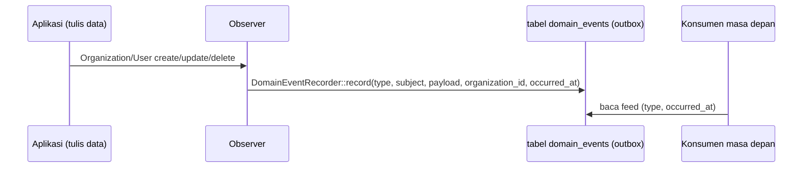

- Index pendukung: `(type, occurred_at)`, `(organization_id, occurred_at)`, `(subject_type, subject_id)`.
- **Status setelah Bab VII**: tidak lagi write-only — ada `RelayDomainEvents`, `DomainEventPublisher`, dan `EventIngestController` (Bab 24).

### 17.4 Ringkasan arah data antar halaman

```mermaid
flowchart TB
    SSO[SSO UNUJA] -->|artisan sso:sync-mahasiswa upsert per NIM| MS[(mahasiswas)]
    MS -->|dropdown per prodi/fokus| OG[ORGMATE]
    MS -->|halaman /simora/mahasiswa| DEV[Developer]

    OG -->|members / positions| LP[Landing publik]
    OG -->|members| EP[E-PROGRESS]
    EP -->|activities + documentations| LP
    EP -->|budgets.work_program_id + evaluations LPJ| SN[SENTRA]
    SN -->|dues lunas → cash_transactions| SN
    SN -->|realisasi → cash_transactions + budgets.realized| SN

    LG[Landing Management / footer_settings] --> LP
    ORG[Organisasi & Akun - developer] -->|organizations| LP
    ORG -->|users api_token| API[API /api/v1/me]
    OBS[Observer] -->|outbox| DE[(domain_events)]
```

---

## 18. Catatan batas & konsistensi

Bagian ini jujur mengungkap apa yang masih placeholder agar tidak menyesatkan.

1. **Scope organisasi**: semua query panel memakai `organizationContext()` — role `organization` selalu `where organization_id = user.organization_id`; role `developer` bebas memilih `?organization=slug` atau melihat agregat semua organisasi.
2. **Developer read-only di modul**: route tulis ORGMATE/E-PROGRESS/SENTRA selalu diberi `->middleware('role:organization')`.
3. **Idempotensi**: pemasukan iuran hanya dibuat sekali (`recordAsIncome` mengecek judul `Iuran {name}`), mencegah duplikasi saat tombol *Tandai Lunas* ditekan berulang.
4. **Bukti transaksi** disimpan di disk `local` (`bukti-iuran/`, `bukti-realisasi/`, arsip, dokumentasi) dan hanya bisa diunduh lewat route dengan pemeriksaan scope organisasi.
5. **Data yang belum diisi jujur (bukan 0 palsu)**: `SentraController@laporan` memakai `emptyData()` (placeholder), `iuranLunas/iuranTotal` dashboard SENTRA masih `0`, dan `OrgmateController` menampilkan `totalDivisi/totalDokumen/totalPengumuman = 0` karena belum ada tabelnya.
6. **PII di endpoint publik**: `/api/v1/organizations/{slug}/structure` tidak mengeluarkan `nim` dan `status` anggota.
7. **Tabel yang sudah dihapus**: `inventories`, `asset_loans` (migration `2026_11_08_072232`).
8. **Batas tambahan pasca-microservice**: lihat Bab 25.5 (circuit breaker, dead-letter, FK organisasi, dll.).

---

# BAB VII — MICROSERVICE READINESS

Bab ini adalah catatan lengkap atas pekerjaan *microservice readiness* SIMORA: alasan di balik setiap keputusan, daftar file, cara kerja tiap lapisan, kontrak API, sampai cara mengoperasikan dan mengujinya.

## 19. Latar belakang & glosarium

### 19.1 Masalah yang dipecahkan

| Masalah | Analogi | Solusi |
|---|---|---|
| **Akses baca lintas modul** terikat ke tabel lokal | Modul A mengambil berkas dari lemari Modul B dengan membuka lemari itu sendiri | Buat **\"pintu\" (contract)**. Modul A meminta data ke pintu; pintu yang menentukan apakah berkas diambil dari lemari lokal atau diminta lewat telepon (HTTP) |
| **Perubahan data tidak diketahui modul lain** | Modul A mengubah data, tapi Modul B tidak pernah dikabari | Buat **\"buku catatan\" (outbox `domain_events`)** + pengirim (`publisher`) + penerima (`ingest`) |

Tujuan pengembangan:

1. Menyamakan kemampuan **SENTRA** dengan ORGMATE dan E-PROGRESS dalam hal *directory* (batas baca antar-modul).
2. Menyiapkan **sakelar konfigurasi** agar perpindahan monolit → microservice cukup mengubah satu variabel environment.
3. Menambahkan **keandalan** (timeout, retry) pada semua pemanggil HTTP.
4. Menambahkan **health check** untuk kebutuhan orchestrator/load balancer.
5. Menutup loop sinkronisasi dengan **penerima event** agar service lain bisa mengirim event ke SIMORA tanpa menimbulkan pengiriman balik (loop).

> **Hasil akhir dalam satu kalimat:** Kini setiap modul memiliki **kontrak baca** yang bisa diarahkan ke database lokal **atau** ke internal API hanya dengan mengubah `MICROSERVICE_MODE`, dan setiap perubahan penting tercatat serta bisa dikirim/diterima sebagai event tanpa duplikasi atau loop.

### 19.2 Glosarium

| Istilah | Arti sederhana | Contoh di SIMORA |
|---|---|---|
| **Contract / interface** | Janji tertulis: "kalau kamu butuh data, panggil method ini", tidak peduli datanya dari mana | `BudgetDirectory::forOrganization(int $id)` |
| **DTO (Data Transfer Object)** | Paket data kecil berisi field yang disepakati saja, bukan model Eloquent | `BudgetSummary`, `DuesSummary` |
| **Directory** | Pelaksana contract. Ada versi lokal (baca DB) dan HTTP (panggil service) | `DatabaseBudgetDirectory`, `HttpBudgetDirectory` |
| **Binding** | Pendaftaran di Laravel: "kalau ada yang meminta interface ini, berikan kelas itu" | `ModuleServiceProvider` |
| **Local mode** | Semua modul masih satu database; directory memakai Eloquent | `MICROSERVICE_MODE=local` |
| **HTTP mode** | Modul sudah dipisah; directory memanggil internal API service lain | `MICROSERVICE_MODE=http` |
| **Internal API** | Endpoint khusus antar-service, bukan untuk publik, wajib token | `/api/internal/v1/organizations/7/budgets` |
| **Service token** | Kata sandi bersama antar-service | Header `X-Service-Token` / `Authorization: Bearer ...` |
| **Outbox** | Tabel tempat mencatat event sebelum dikirim; tidak boleh hilang walau service mati | `domain_events` |
| **Event** | Catatan "sesuatu terjadi" | `sentra.dues.paid` |
| **Publisher** | Pengirim event dari outbox ke webhook/broker | `DomainEventPublisher` |
| **Ingest** | Penerima event dari service lain | `EventIngestController` |
| **Idempotensi** | Mengirim event yang sama dua kali tidak boleh membuat dua baris data | `firstOrCreate` berdasarkan `event_id` (UUID) |
| **Retry** | Mengulang permintaan yang gagal karena gangguan sementara | 5xx/429 → ulang maks. 3 total percobaan |
| **Connect timeout** | Batas waktu hanya untuk **membuat koneksi** (bedakan dengan response timeout) | 3 detik |
| **Loop event** | Event A dikirim ke B, lalu B mengirimnya balik ke A, terus menerus | Dicegah dengan `published_at` saat ingest |

---

## 20. Arsitektur akhir & daftar perubahan

### 20.1 Arsitektur akhir

Dua jalur utama yang saling melengkapi:

- **Jalur tarik (pull / query)** → *Directory* → dipakai saat sebuah modul **membutuhkan data** dari modul lain.
- **Jalur dorong (push / event)** → *Outbox* → dipakai saat sebuah modul ingin **memberi tahu** bahwa data berubah.

```mermaid
flowchart TB
    subgraph APP["Aplikasi SIMORA (satu proses saat ini)"]
        CTRL["Controller / Service consume"]
        PROV["ModuleServiceProvider<br/>sakelar berdasarkan microservices.mode"]
        IFACE["6 Contract Directory"]
        DBC["Database Directory<br/>(Eloquent)"]
        HTC["HTTP Directory<br/>(HttpDirectoryClient)"]

        CTRL --> IFACE
        PROV -. memilih implementasi .-> IFACE
        IFACE -->|local| DBC
        IFACE -->|http| HTC
    end

    DB[("Database SIMORA<br/>ORGMATE + E-PROGRESS + SENTRA")]
    DBC --> DB

    subgraph EXT["Layanan eksternal / service hasil pemisahan"]
        INT["Internal API<br/>/api/internal/v1/*"]
        SVC["Database service lain"]
        WH["Webhook / broker event"]
    end

    HTC -->|"GET + Bearer token"| INT
    INT --> SVC

    subgraph OUTBOX["Jalur event"]
        OBS["Observer model"]
        REC["DomainEventRecorder"]
        TBL[("domain_events<br/>outbox")]
        CMD["domain-events:relay<br/>(tiap menit)"]
        PUB["DomainEventPublisher"]
        CB["Circuit breaker + retry/backoff"]
        DLQ[("domain_events<br/>dead_lettered_at")]
        ING["EventIngestController<br/>POST /api/internal/v1/events"]
        PROJ[("event_projections<br/>read model konsumen")]

        OBS --> REC --> TBL
        TBL --> CMD --> CB --> PUB
        PUB -->|"gagal sebelum max_attempts"| TBL
        PUB -->|"gagal setelah max_attempts"| DLQ
        PUB -->|"http transport"| WH
        WH --> ING
        ING -->|"firstOrCreate + published_at"| TBL
        ING -->|"DomainEventProjector"| PROJ
    end

    DB --- OBS
```

**Poin kunci:** Controller tidak pernah berubah antara mode `local` dan `http`. Ia hanya mengenal interface dan menerima DTO yang sama.

### 20.2 File baru — fondasi & infrastruktur

| File | Fungsi singkat |
|---|---|
| `config/microservices.php` | Satu tempat membaca semua env var microservice |
| `app/Providers/ModuleServiceProvider.php` | Sakelar implementasi directory (local vs http) |
| `app/Http/Middleware/EnsureServiceToken.php` | Penjaga internal API |
| `app/Modules/Shared/Http/HttpDirectoryClient.php` | Konfigurasi HTTP bersama (token, timeout, retry) untuk 6 directory |
| `app/Modules/Shared/Events/DomainEventType.php` | Katalog nama event lintas modul |
| `app/Modules/Shared/Events/DomainEventPublisher.php` | Pengirim event outbox |
| `app/Console/Commands/RelayDomainEvents.php` | Perintah Artisan untuk memproses outbox |
| `app/Http/Controllers/Api/HealthController.php` | Endpoint health check |
| `app/Http/Controllers/Api/Internal/V1/DirectoryController.php` | Server internal API (semua endpoint baca) |
| `app/Http/Controllers/Api/Internal/V1/EventIngestController.php` | Penerima event dari service lain |
| `database/migrations/2026_11_16_042258_add_event_id_and_published_at_to_domain_events_table.php` | Menambah `event_id` (idempotensi) dan `published_at` (status kirim) |
| `app/Modules/Shared/Events/DomainEventProjector.php` | Mengubah event masuk menjadi read model `event_projections` |
| `app/Modules/Shared/Events/EventPublishCircuitBreaker.php` | Circuit breaker relay (closed/open/half-open) berbasis cache |
| `app/Models/EventProjection.php` | Model read model konsumen |
| `app/Console/Commands/ReplayDeadLetterDomainEvents.php` | Mengembalikan event dead-letter ke antrean relay |
| `database/migrations/2026_11_24_045309_create_event_projections_table.php` | Tabel projection konsumen |
| `database/migrations/2026_11_24_045310_harden_domain_events_for_retry_and_decoupling.php` | Kolom `attempts`, `last_error`, `next_attempt_at`, `dead_lettered_at` |
| `database/migrations/2026_11_24_045311_drop_cross_service_foreign_keys.php` | Memutus FK `budgets.work_program_id` dan `domain_events.organization_id` |
| `Dockerfile`, `docker-compose.yml`, `.dockerignore`, `docker/nginx/default.conf` | Image aplikasi + stack lokal (app, nginx, MySQL, queue, scheduler) |
| `.github/workflows/ci.yml` | Pint, PHPUnit, build aset, dan build Docker di CI |

### 20.3 File baru — lapisan Directory (29 file di `app/Modules/`)

| Modul | Contract | Data (DTO) | Database | HTTP |
|---|---|---|---|---|
| ORGMATE | `MemberDirectory` | `MemberSummary` | `DatabaseMemberDirectory` | `HttpMemberDirectory` |
| E-PROGRESS | `WorkProgramDirectory`, `LpjDirectory` | `WorkProgramSummary`, `LpjSummary`, `LpjActivitySummary`, `LpjCreatorSummary` | `DatabaseWorkProgramDirectory`, `DatabaseLpjDirectory` | `HttpWorkProgramDirectory`, `HttpLpjDirectory` |
| **SENTRA** | `BudgetDirectory`, `DuesDirectory`, `CashTransactionDirectory` | `BudgetSummary`, `DuesSummary`, `CashTransactionSummary` | `DatabaseBudgetDirectory`, `DatabaseDuesDirectory`, `DatabaseCashTransactionDirectory` | `HttpBudgetDirectory`, `HttpDuesDirectory`, `HttpCashTransactionDirectory` |

> SENTRA sebelumnya hanya **konsumsi** data modul lain; sekarang SENTRA juga **mengekspos** datanya.

### 20.4 File baru — observer event

| File | Event yang dihasilkan |
|---|---|
| `app/Observers/MemberObserver.php` | `orgmate.member.created/updated/deleted` |
| `app/Observers/PositionObserver.php` | `orgmate.position.created/updated/deleted` |
| `app/Observers/WorkProgramObserver.php` | `eprogress.work_program.*` |
| `app/Observers/ActivityObserver.php` | `eprogress.activity.*` |
| `app/Observers/EvaluationObserver.php` | `eprogress.evaluation.*`, `eprogress.lpj.published` |
| `app/Observers/BudgetObserver.php` | `sentra.budget.*` |
| `app/Observers/DuesObserver.php` | `sentra.dues.*`, `sentra.dues.paid` |
| `app/Observers/CashTransactionObserver.php` | `sentra.cash_transaction.*` |

### 20.5 File baru — tes

| File | Yang diuji |
|---|---|
| `tests/Unit/DirectoryBindingTest.php` | Sakelar mode local/http memilih 6 implementasi yang benar |
| `tests/Unit/HttpDirectoryTest.php` | Pemetaan respons HTTP ORGMATE & E-PROGRESS ke DTO |
| `tests/Unit/HttpSentraDirectoryTest.php` | Pemetaan respons HTTP SENTRA, token, trailing slash, retry, error 401, URL kosong |
| `tests/Feature/InternalDirectoryApiTest.php` | Autentikasi token + isolasi organisasi + tidak bocornya field sensitif |
| `tests/Feature/ModuleOutboxTest.php` | Observer mencatat event, LPJ selesai → event, iuran lunas → event, relay menandai `published_at` |
| `tests/Feature/HealthCheckTest.php` | Status `ok` dan `degraded` (503) |
| `tests/Feature/EventIngestTest.php` | Token, validasi, penyimpanan, idempotensi, organisasi tidak dikenal |
| `tests/Feature/DomainEventRelayTest.php` | Publish sukses, retry + backoff, dead-letter, replay, circuit breaker, outbox tanpa FK organisasi |
| `tests/Feature/DomainEventProjectionTest.php` | Projection dari event, urutan `occurred_at`, event hapus, duplikat |
| `tests/Feature/InternalApiSecurityTest.php` | Token kedaluwarsa, rotasi token, kuota per token |
| `tests/Unit/EventPublishCircuitBreakerTest.php` | Transisi closed → open → half-open → closed |

### 20.6 File yang diubah

| File | Perubahan |
|---|---|
| `routes/api.php` | + route `/health`, + 3 endpoint SENTRA, + `POST /events` |
| `routes/console.php` | + jadwal `domain-events:relay` tiap menit tanpa tumpang tindih |
| `bootstrap/app.php` | + local binding `service.token` |
| `bootstrap/providers.php` | + `ModuleServiceProvider` |
| `app/Providers/AppServiceProvider.php` | + registrasi 10 observer |
| `app/Models/DomainEvent.php` | + atribut fillable `event_id`, `published_at`; + cast tanggal |
| `app/Support/DomainEventRecorder.php` | + UUID `event_id`, helper `forModel()` |
| `app/Observers/OrganizationObserver.php`, `UserObserver.php` | Diselaraskan dengan katalog event |
| `app/Http/Controllers/Simora/BudgetController.php`, `EProgressController.php`, `SentraController.php` | Diselaraskan dengan alur event/DTO |
| `resources/views/simora/SENTRA/realisasi.blade.php` | Penyesuaian tampilan realisasi anggaran |
| `.env.example` | + blok `MICROSERVICE_*` |
| `.env` (lokal, tidak ter-commit) | + blok `MICROSERVICE_*` dengan nilai aman |
| `modull/00-index.md`, `modull/08-dfd.md`, `modull/14-database-schema-akses-dan-sinkronisasi.md` | Dokumentasi arsitektur & sinkronisasi |
| `modull/modulSIMORA.md` | Dokumen ini — referensi final gabungan |

---

## 21. Fondasi konfigurasi

### 21.1 `config/microservices.php`

Semua kode aplikasi **hanya** boleh membaca lewat `config()`, tidak boleh memanggil `env()` langsung. Alasannya: saat `php artisan config:cache` dijalankan, Laravel tidak memuat `.env`, sehingga `env()` akan mengembalikan `null`.

```php
'mode' => env('MICROSERVICE_MODE', 'local'),

// Token utama + token lama saat rotasi (expiry ISO-8601, null = selamanya)
'token' => env('MICROSERVICE_TOKEN'),
'token_expires_at' => env('MICROSERVICE_TOKEN_EXPIRES_AT'),
'token_previous' => env('MICROSERVICE_TOKEN_PREVIOUS'),
'token_previous_expires_at' => env('MICROSERVICE_TOKEN_PREVIOUS_EXPIRES_AT'),

// Kuota internal API dihitung per hash token, bukan per IP
'rate_limit' => [
    'per_minute' => (int) env('MICROSERVICE_RATE_LIMIT_PER_MINUTE', 120),
],

'event_transport' => env('MICROSERVICE_EVENT_TRANSPORT', 'log'),
'event_webhook' => env('MICROSERVICE_EVENT_WEBHOOK'),
'timeout' => (int) env('MICROSERVICE_HTTP_TIMEOUT', 5),

// Reliability outbox
'circuit_breaker' => [
    'failure_threshold' => (int) env('MICROSERVICE_CIRCUIT_FAILURE_THRESHOLD', 5),
    'cooldown_seconds' => (int) env('MICROSERVICE_CIRCUIT_COOLDOWN_SECONDS', 60),
],
'outbox' => [
    'max_attempts' => (int) env('MICROSERVICE_OUTBOX_MAX_ATTEMPTS', 5),
    'backoff_seconds' => (int) env('MICROSERVICE_OUTBOX_BACKOFF_SECONDS', 30),
],

'services' => [
    'orgmate' => ['url' => env('ORGMATE_SERVICE_URL')],
    'eprogress' => ['url' => env('EPROGRESS_SERVICE_URL')],
    'sentra' => ['url' => env('SENTRA_SERVICE_URL')],
],
```

### 21.2 Daftar environment variable

| Variabel | Default | Fungsi |
|---|---|---|
| `MICROSERVICE_MODE` | `local` | `local` = baca DB sendiri; `http` = panggil service lain |
| `MICROSERVICE_TOKEN` | kosong | Token utama untuk `/api/internal/*`. **Wajib diisi** jika endpoint internal dipakai |
| `MICROSERVICE_TOKEN_EXPIRES_AT` | kosong | Tenggat token utama (ISO-8601). Kosong = tidak kedaluwarsa |
| `MICROSERVICE_TOKEN_PREVIOUS` | kosong | Token lama yang masih diterima selama masa rotasi |
| `MICROSERVICE_TOKEN_PREVIOUS_EXPIRES_AT` | kosong | Tenggat token lama; setelah ini token lama ditolak `401` |
| `MICROSERVICE_RATE_LIMIT_PER_MINUTE` | `120` | Kuota `/api/internal/*` per token per menit (429 jika terlampaui) |
| `MICROSERVICE_EVENT_TRANSPORT` | `log` | `log` = event hanya ditulis log; `http` = dikirim ke webhook |
| `MICROSERVICE_EVENT_WEBHOOK` | kosong | URL tujuan event (wajib jika transport `http`) |
| `MICROSERVICE_HTTP_TIMEOUT` | `5` | Batas waktu tanggapan HTTP (detik) |
| `MICROSERVICE_CIRCUIT_FAILURE_THRESHOLD` | `5` | Gagal berturut-turut sebelum relay outbox OPEN |
| `MICROSERVICE_CIRCUIT_COOLDOWN_SECONDS` | `60` | Masa tunggu sebelum satu probe HALF_OPEN |
| `MICROSERVICE_OUTBOX_MAX_ATTEMPTS` | `5` | Batas percobaan sebelum event masuk dead-letter |
| `MICROSERVICE_OUTBOX_BACKOFF_SECONDS` | `30` | Jeda dasar backoff eksponensial (30, 60, 120, ... detik) |
| `ORGMATE_SERVICE_URL` | kosong | Base URL service ORGMATE |
| `EPROGRESS_SERVICE_URL` | kosong | Base URL service E-PROGRESS |
| `SENTRA_SERVICE_URL` | kosong | Base URL service SENTRA |

Nilai default sengaja dibuat aman: aplikasi tetap berperilaku seperti monolit setelah variabel ini ditambahkan.

Rate limiter `internal-api` didaftarkan di `AppServiceProvider` dengan kunci `hash('sha256', token)` (jatuh ke IP hanya jika tidak ada token). Jadi satu service yang mengirim terlalu banyak permintaan tidak menghabiskan kuota service lain. Token yang kedaluwarsa ditolak lebih dulu oleh `EnsureServiceToken` sebelum penghitung kuota dipakai.

---

## 22. Jalur baca: Directory & Internal API

### 22.1 Lapisan 1 — DTO (`final readonly`)

Contoh `BudgetSummary`:

```php
final readonly class BudgetSummary
{
    public function __construct(
        public int $id,
        public string $programName,
        public int $year,
        public float $allocated,
        public float $realized,
        public ?int $workProgramId,
    ) {}
}
```

**Mengapa `final readonly`?**

- `final` → tidak bisa diturunkan, jadi kontrak tidak bisa diubah diam-diam oleh kelas lain.
- `readonly` → tidak bisa dimutasi setelah dibuat. Aman dikirim lintas layer.

**Mengapa tidak langsung memakai model Eloquent?** Model `Budget` membawa `organization_id`, `timestamps`, relasi, dan method `percentage()`. Kalau dikirim ke modul lain, modul tersebut menjadi **terikat pada skema database SENTRA**. Dengan DTO, yang dikirim hanya field yang disepakati.

| Data | Diekspos? | Alasan |
|---|---|---|
| `id`, nama, nominal, status, tanggal | ✅ | Dibutuhkan konsumen |
| `user_id` pada iuran | ✅ | Referensi stabil untuk menyambungkan iuran ke akun/mahasiswa |
| `work_program_id` pada RAB | ✅ | Menjaga tautan SENTRA → E-PROGRESS |
| `organization_id` | ❌ | Konsumen sudah tahu organisasi yang ia minta; mengurangi kebocoran identitas |
| `proof_path` (bukti bayar/kuitansi) | ❌ | Lokasi file sensitif & detail penyimpanan internal |
| `created_by` pada kas | ❌ | Tidak dipakai lintas modul |
| `timestamps`, relasi Eloquent | ❌ | Bukan kontrak antar-modul |

Tanggal memakai `?Carbon` (bukan string), mengikuti pola `LpjSummary::createdAt`, sehingga konsumen bisa langsung memanggil `->toDateString()`.

### 22.2 Lapisan 2 — Contract (batas baca)

```php
interface BudgetDirectory
{
    /**
     * @return Collection<int, BudgetSummary>
     */
    public function forOrganization(int $organizationId): Collection;
}
```

Contract adalah **janji**. Controller yang membutuhkan data hanya tahu interface ini — ia tidak tahu dan tidak peduli datanya berasal dari MySQL lokal atau HTTP service lain. Seluruh method mewajibkan `organizationId`, sehingga query lintas organisasi tidak terjadi secara tidak sengaja (selaras dengan `OrganizationScope`).

| Contract | Method khusus |
|---|---|
| `MemberDirectory` | `forOrganization(int)` |
| `WorkProgramDirectory` | `forOrganization(int)`, `existsForOrganization(int, int)` |
| `LpjDirectory` | `forOrganization(?int)` — `null` berarti semua LPJ |
| `BudgetDirectory` | `forOrganization(int)` |
| `DuesDirectory` | `forOrganization(int)` |
| `CashTransactionDirectory` | `forOrganization(int)` |

### 22.3 Lapisan 3 — Implementasi Database (mode `local`)

```php
return Budget::query()
    ->where('organization_id', $organizationId)
    ->orderBy('program_name')
    ->orderBy('id')          // tie-breaker
    ->get(['id', 'program_name', 'year', 'allocated', 'realized', 'work_program_id'])
    ->map(fn (Budget $budget): BudgetSummary => new BudgetSummary(...))
    ->toBase();
```

Tiga detail yang disengaja:

1. **`get([kolom])`** — hanya kolom yang dibutuhkan. `proof_path` tidak pernah di-hydrate.
2. **`orderBy('id')` sebagai tie-breaker** — jika dua baris punya nama sama, urutan tetap deterministik. Tanpa ini, urutan database tidak dijamin dan tes bisa flaky.
3. **`->toBase()`** — mengubah `Eloquent\Collection` menjadi `Support\Collection`, konsisten dengan implementasi lama.

Untuk kas: `orderByDesc('date')->orderByDesc('id')` (transaksi terbaru lebih dulu). Untuk iuran: `orderBy('name')->orderBy('id')`.

### 22.4 Lapisan 4 — Implementasi HTTP (mode `http`)

#### 22.4.1 Base client bersama

Sebelum perbaikan terakhir, keenam kelas HTTP memiliki salinan pengaturan yang sama. Sekarang semua mewarisi satu kelas:

```php
abstract class HttpDirectoryClient
{
    public function __construct(
        private readonly ?string $baseUrl,
        private readonly ?string $token,
        private readonly int $timeout = 5,
    ) {}

    protected function client(): PendingRequest
    {
        if ($this->baseUrl === null || $this->baseUrl === '') {
            throw new RuntimeException($this->missingUrlMessage());
        }

        return Http::baseUrl(rtrim($this->baseUrl, '/'))
            ->acceptJson()
            ->withToken($this->token ?? '')
            ->connectTimeout(3)
            ->timeout($this->timeout)
            ->retry(3, 100, function (Throwable $exception): bool {
                if ($exception instanceof ConnectionException) {
                    return true;
                }
                if ($exception instanceof RequestException) {
                    return $exception->response->serverError()
                        || $exception->response->status() === 429;
                }
                return false;
            });
    }

    abstract protected function missingUrlMessage(): string;
}
```

| Bagian | Alasan |
|---|---|
| `rtrim($baseUrl, '/')` | URL `https://sentra.test/` dan `https://sentra.test` sama-sama menghasilkan `.../api/internal/...`, tidak ada `//` ganda |
| `acceptJson()` | Meminta balasan JSON |
| `withToken(...)` | Mengirim `Authorization: Bearer <token>` |
| `connectTimeout(3)` | Batas 3 detik **hanya untuk membangun koneksi**, beda dengan `timeout()` yang membatasi seluruh respons |
| `timeout($this->timeout)` | Batas total respons, diambil dari `MICROSERVICE_HTTP_TIMEOUT` |
| `retry(3, 100, $callback)` | **Di Laravel versi terpasang, `retry(n)` = `n` total percobaan, bukan `n` retry.** Jadi `3` = 1 awal + 2 retry, jeda 100 ms |
| Callback `ConnectionException` | Gangguan jaringan sementara → layak diulang |
| Callback 5xx / 429 | Server error dan *rate limit* → layak diulang |
| Callback `false` untuk 4xx lainnya | 401/403/404 tidak akan membaik karena diulang, jadi gagal cepat |
| `RuntimeException` saat URL kosong | Kesalahan konfigurasi terdeteksi segera dengan pesan jelas |

> `Http::fake()` dalam tes tetap menghormati pengaturan retry, sehingga jumlah permintaan diverifikasi dengan `Http::assertSentCount(3)`.

#### 22.4.2 Contoh implementasi HTTP SENTRA

```php
final class HttpDuesDirectory extends HttpDirectoryClient implements DuesDirectory
{
    public function forOrganization(int $organizationId): Collection
    {
        $response = $this->client()
            ->get("/api/internal/v1/organizations/{$organizationId}/dues")
            ->throw();

        return collect($response->json('data', []))
            ->map(fn (array $row): DuesSummary => new DuesSummary(
                id: (int) $row['id'],
                name: (string) $row['name'],
                amount: (float) $row['amount'],
                status: (string) $row['status'],
                period: isset($row['period']) ? (string) $row['period'] : null,
                paidAt: isset($row['paid_at']) ? Carbon::parse($row['paid_at']) : null,
                userId: $row['user_id'] !== null ? (int) $row['user_id'] : null,
            ));
    }

    protected function missingUrlMessage(): string
    {
        return 'URL service SENTRA belum dikonfigurasi (SENTRA_SERVICE_URL).';
    }
}
```

**Mengapa `->throw()`?** Jika service tujuan mengembalikan 401/500, kita ingin **gagal keras**, bukan diam-diam membaca `data: []` lalu menyimpan data kosong yang menyesatkan.

**Mapping tipe sadar format API:** desimal dikirim sebagai string JSON (`"1500000.00"`) → `(float)`; tanggal ISO → `Carbon::parse()`; field nullable dicek dengan `isset()` / `!== null` supaya tidak berubah menjadi `0` atau `""`.

**Peta contract → URL** (semua diawali `/api/internal/v1`):

| Contract | Endpoint |
|---|---|
| `MemberDirectory` | `/organizations/{id}/members` |
| `WorkProgramDirectory` | `/organizations/{id}/work-programs` |
| `LpjDirectory` | `/organizations/{id}/lpjs` atau `/lpjs` jika `null` |
| `BudgetDirectory` | `/organizations/{id}/budgets` |
| `DuesDirectory` | `/organizations/{id}/dues` |
| `CashTransactionDirectory` | `/organizations/{id}/cash-transactions` |

### 22.5 Sakelar di `ModuleServiceProvider`

```php
$this->app->bind(BudgetDirectory::class, function (): BudgetDirectory {
    if (! $this->usesHttp()) {
        return new DatabaseBudgetDirectory;
    }

    return new HttpBudgetDirectory(
        $this->stringConfig('microservices.services.sentra.url'),
        $this->stringConfig('microservices.token'),
        (int) config('microservices.timeout', 5),
    );
});
```

`usesHttp()` memeriksa `config('microservices.mode') === 'http'`. `stringConfig()` mengubah string kosong menjadi `null`, agar base client bisa memberi pesan error yang jelas.

| `MICROSERVICE_MODE` | Implementasi | Sumber data |
|---|---|---|
| `local` (default) | `Database*Directory` | Database SIMORA langsung |
| `http` | `Http*Directory` | Internal API service terkait |

**Ini inti seluruh desain:** satu baris konfigurasi mengganti sumber data tanpa mengubah satu pun controller.

### 22.6 Server Internal API

Ini **sisi server** dari contract di atas. Jika `Http*Directory` mengirim permintaan, `DirectoryController` yang menjawab.

Semua endpoint berada di grup:

```php
Route::prefix('internal/v1')
    ->name('api.internal.v1.')
    ->middleware(['service.token', 'throttle:internal-api'])
    ->group(function () { ... });
```

`service.token` memvalidasi token utama **atau** token lama yang masih aktif. Token utama bisa diberi `MICROSERVICE_TOKEN_EXPIRES_AT`; token lama diberi `MICROSERVICE_TOKEN_PREVIOUS` + `MICROSERVICE_TOKEN_PREVIOUS_EXPIRES_AT`. Perbandingan memakai `hash_equals()` dan tanggal dihitung ulang lewat `Carbon::parse()` pada setiap request (aman setelah `config:cache`). Kuota `throttle:internal-api` dihitung per token, jadi rotasi token juga mengganti "identitas" pembatasan.

| Method | Path | Nama route | Fungsi |
|---|---|---|---|
| GET | `/api/internal/v1/organizations/{organization}/members` | `api.internal.v1.members` | Anggota ORGMATE |
| GET | `/api/internal/v1/organizations/{organization}/work-programs` | `api.internal.v1.work-programs` | Program kerja E-PROGRESS |
| GET | `/api/internal/v1/organizations/{organization}/lpjs` | `api.internal.v1.lpjs` | LPJ per organisasi |
| GET | `/api/internal/v1/lpjs` | `api.internal.v1.lpjs.all` | Semua LPJ |
| GET | `/api/internal/v1/organizations/{organization}/budgets` | `api.internal.v1.budgets` | **RAB SENTRA (baru)** |
| GET | `/api/internal/v1/organizations/{organization}/dues` | `api.internal.v1.dues` | **Iuran SENTRA (baru)** |
| GET | `/api/internal/v1/organizations/{organization}/cash-transactions` | `api.internal.v1.cash-transactions` | **Kas SENTRA (baru)** |
| POST | `/api/internal/v1/events` | `api.internal.v1.events.ingest` | **Penerima event (baru)** |

Semua endpoint baca mengembalikan:

```json
{
  "data": [
    { "id": 12, "program_name": "RAB Seminar", "year": 2026, "allocated": "1500000.00", "realized": "450000.00", "work_program_id": 11 }
  ]
}
```

Kolom yang dikembalikan persis sama dengan field DTO — inilah yang membuat sisi klien dan server tetap sinkron.

#### 22.6.1 Pengamanan: `EnsureServiceToken`

```php
$expected = (string) config('microservices.token');
$provided = (string) ($request->header('X-Service-Token') ?? $request->bearerToken() ?? '');

if ($expected === '' || $provided === '' || ! hash_equals($expected, $provided)) {
    abort(Response::HTTP_UNAUTHORIZED, 'Token antar-service tidak valid.');
}
```

1. **Token wajib dua arah** — kalau token konfigurasi kosong ATAU token permintaan kosong, langsung `401`. Tidak ada jalan "kosong == kosong lolos".
2. **`hash_equals()`** — perbandingan tahan *timing attack* (penyerang tidak bisa menebak token char per char dari lama waktu respons).
3. **Dua header diterima** — `X-Service-Token` (eksplisit) atau `Authorization: Bearer ...` (standar). Klien `Http*Directory` memakai Bearer; tes juga memverifikasi X-Service-Token.

#### 22.6.2 Isolasi organisasi & privasi

Setiap query di controller selalu diawali `where('organization_id', $organization)`. Service yang meminta data organisasi A tidak bisa mendapat data organisasi B, meski tokennya sah. Hanya kolom di `get([...])` yang keluar. Tes feature memastikan:

- `proof_path` tidak pernah muncul pada endpoint iuran dan kas.
- `created_by` tidak pernah muncul pada endpoint kas.
- `organization_id` tidak pernah muncul pada payload (sudah tersirat di URL).

## 23. Health check

### 23.1 Endpoint

```
GET /api/health
```

### 23.2 Implementasi

```php
try {
    DB::select('select 1');
    $database = 'ok';
} catch (Throwable) {
    $database = 'unavailable';
}

$status = $database === 'ok' ? 'ok' : 'degraded';

return response()->json([
    'status' => $status,
    'service' => 'simora',
    'database' => $database,
    'timestamp' => now()->toIso8601String(),
], $status === 'ok' ? 200 : 503);
```

### 23.3 Keputusan dan alasannya

| Keputusan | Alasan |
|---|---|
| **Tanpa token** | Pemeriksa infrastruktur (load balancer, Kubernetes probe) perlu mengaksesnya sebelum kredensial aplikasi tersedia |
| **Query `select 1`** | Cara paling murah memastikan koneksi database benar-benar hidup, bukan hanya proses PHP hidup |
| **Status 503 saat degraded** | Orchestrator perlu sinyal HTTP untuk menghentikan traffic; kalau selalu 200, ia tidak tahu ada masalah |
| **Tidak membocorkan detail koneksi** | Hanya `ok` / `unavailable`, bukan pesan error database mentah |
| **`timestamp` ISO-8601** | Memudahkan perbandingan waktu di sistem monitoring |

Contoh respons sehat:

```json
{
  "status": "ok",
  "service": "simora",
  "database": "ok",
  "timestamp": "2026-11-24T04:00:49+00:00"
}
```

---

## 24. Jalur event: outbox & ingest

### 24.1 Katalog `DomainEventType`

Enum dengan prefix pemilik:

```php
enum DomainEventType: string
{
    case OrganizationCreated = 'organization.created';
    // ...
    case OrgmateMemberCreated = 'orgmate.member.created';
    // ...
    case EProgressLpjPublished = 'eprogress.lpj.published';
    // ...
    case SentraDuesPaid = 'sentra.dues.paid';
    // ...
}
```

Prefix (`orgmate.`, `eprogress.`, `sentra.`) membuat konsumen langsung tahu layanan sumber event saat modul dipisah nanti. Memakai **enum**, bukan string bebas, mencegah typo seperti `sentra.due.paid`.

### 24.2 Pencatat `DomainEventRecorder`

Dua helper:

- `record(...)` — mencatat event dengan `event_id` berupa UUID baru.
- `forModel(type, model, payload)` — otomatis mengambil `subject_type` (class model), `subject_id` (primary key), dan `organization_id` (dari field model, atau dari ID sendiri jika modelnya `Organization`).

```php
DomainEvent::create([
    'event_id' => (string) Str::uuid(),
    'type' => $type instanceof DomainEventType ? $type->value : $type,
    ...
    'occurred_at' => now(),
]);
```

**Mengapa UUID untuk `event_id`?** Primary key `id` dari database lokal hanya unik di database itu. Setelah modul dipisah, dua service bisa saja punya event dengan `id = 42`. UUID bersifat global, sehingga aman dipakai sebagai kunci idempotensi.

### 24.3 Observer

Observer mendengar perubahan model dan langsung memanggil recorder. Contoh `BudgetObserver`:

```php
public function updated(Budget $budget): void
{
    DomainEventRecorder::forModel(
        DomainEventType::SentraBudgetUpdated,
        $budget,
        $this->payload($budget),
    );
}
```

Payload yang dikirim sengaja dibatasi pada field bisnis (misalnya `program_name`, `work_program_id`, `year`, `allocated`, `realized`) — tidak termasuk bukti file atau data sensitif.

Kasus khusus:

- `EvaluationObserver` hanya menghasilkan `eprogress.lpj.published` saat `type = lpj` **dan** `status = selesai`.
- `DuesObserver` menghasilkan `sentra.dues.paid` hanya saat status berubah menjadi `lunas`.

Semua observer didaftarkan di `AppServiceProvider::boot()`.

### 24.4 Migration outbox, retry & projection

Migrasi awal (`2026_11_16_042258_add_event_id_and_published_at_to_domain_events_table.php`):

```php
$table->uuid('event_id')->nullable()->unique()->after('id');
$table->timestamp('published_at')->nullable()->after('occurred_at');
$table->index('published_at');
```

- `unique` pada `event_id` → idempotensi di level database (pengaman kedua setelah `firstOrCreate`).
- `published_at` → penanda event sudah diproses.
- Index pada `published_at` → query "event yang belum terkirim" tetap cepat saat tabel besar.

Hardening berikutnya (`2026_11_24_045310_harden_domain_events_for_retry_and_decoupling.php`):

```php
$table->unsignedInteger('attempts')->default(0)->after('published_at');
$table->text('last_error')->nullable()->after('attempts');
$table->timestamp('next_attempt_at')->nullable()->after('last_error');
$table->timestamp('dead_lettered_at')->nullable()->after('next_attempt_at');

$table->index('next_attempt_at', 'domain_events_next_attempt_at_index');
$table->index('dead_lettered_at', 'domain_events_dead_lettered_at_index');
```

`attempts` dihitung relay, `next_attempt_at` menjadwalkan retry dengan backoff, dan `dead_lettered_at` menandai event yang sudah menyerah setelah `MICROSERVICE_OUTBOX_MAX_ATTEMPTS`. Relay tidak menyentuh baris yang masih dalam masa tunggu atau sudah dead-letter.

Read model konsumen dibuat di `2026_11_24_045309_create_event_projections_table.php`:

```php
$table->id();
$table->string('subject_type');
$table->unsignedBigInteger('subject_id');
$table->unsignedBigInteger('organization_id')->nullable();
$table->string('label')->nullable();
$table->json('payload')->nullable();
$table->timestamp('last_event_at');
$table->timestamps();

$table->unique(['subject_type', 'subject_id'], 'event_projections_subject_unique');
$table->index(['organization_id', 'subject_type'], 'event_projections_org_subject_index');
```

Terakhir, `2026_11_24_045311_drop_cross_service_foreign_keys.php` memutus dua constraint yang melintasi batas calon service:

- `budgets.work_program_id → work_programs` (SENTRA → E-PROGRESS)
- `domain_events.organization_id → organizations` (outbox → ORGMATE)

**Kolomnya tetap ada** sebagai ID referensi. Keberadaan data divalidasi lewat kontrak/directory (`exists:organizations,id` pada ingest tetap dipertahankan sebagai validasi request), bukan lagi oleh foreign key database. FK intra-modul (misalnya `evaluations.activity_id`, `dues.user_id`, `cash_transactions.created_by`) sengaja tidak diubah.

### 24.5 Relay command, circuit breaker & scheduler

```php
#[Signature('domain-events:relay {--limit=100 : Maksimal event yang diproses}')]
class RelayDomainEvents extends Command
{
    public function handle(DomainEventPublisher $publisher, EventPublishCircuitBreaker $breaker): int
    {
        if ($breaker->isOpen()) {
            $this->warn('Circuit breaker outbox sedang OPEN; relay dilewati.');

            return self::SUCCESS;
        }

        $events = DomainEvent::query()
            ->whereNull('published_at')
            ->whereNull('dead_lettered_at')
            ->where(fn ($q) => $q->whereNull('next_attempt_at')
                ->orWhere('next_attempt_at', '<=', now()))
            ->orderBy('id')
            ->limit($limit)
            ->get();

        foreach ($events as $event) {
            try {
                $publisher->publish($event);
                $breaker->recordSuccess();
            } catch (Throwable $e) {
                $breaker->recordFailure();
                // attempts++, last_error, next_attempt_at = backoff eksponensial
                // atau dead_lettered_at bila sudah mencapai max_attempts
            }
        }
    }
}
```

Dijadwalkan di `routes/console.php`:

```php
Schedule::command('domain-events:relay')->everyMinute()->withoutOverlapping();
```

- `whereNull('published_at')` → hanya event baru yang diproses.
- `whereNull('dead_lettered_at')` + `next_attempt_at` → event gagal tidak langsung dicoba ulang; ia menunggu backoff `30 × 2^(attempts-1)` detik (maksimal 8×) atau masuk dead-letter setelah `max_attempts`.
- `orderBy('id')` → urutan kronologis; `limit` mencegah satu proses memakan semua memori.
- `withoutOverlapping()` → mencegah dua relay bersamaan mengirim event yang sama.

**Circuit breaker** (`EventPublishCircuitBreaker`) menyimpan state di cache `microservices:outbox:circuit`:

| State | Perilaku |
|---|---|
| `closed` | Relay normal; gagal terus bertambah sampai `failure_threshold` |
| `open` | Relay dilewati tanpa memanggil webhook sampai `cooldown_seconds` lewat |
| `half_open` | Satu probe diizinkan; sukses → `closed`, gagal → `open` lagi |

Dead-letter **bukan akhir**: jalankan `php artisan domain-events:replay-dead-letter` setelah tujuan diperbaiki. Perintah ini mengosongkan `dead_lettered_at`, `next_attempt_at`, `attempts`, dan `last_error`, lalu mereset circuit ke `closed` agar relay tidak langsung dilewati. Opsi `--limit=50` tersedia.

Pola ini dikenal sebagai **transactional outbox**: perubahan bisnis dan pencatatan event terjadi dalam transaksi yang sama, lalu pengiriman dilakukan terpisah. Jika pengiriman gagal, event tetap ada di tabel, diberi jadwal retry, lalu akhirnya masuk dead-letter — tidak ada yang hilang.

### 24.6 Publisher

```php
if ((string) config('microservices.event_transport', 'log') === 'http') {
    $this->sendHttp($payload);
} else {
    Log::info('domain-event.relayed', $payload);
}

$event->forceFill(['published_at' => now()])->save();
```

Payload yang dikirim sudah memakai format ISO-8601 untuk `occurred_at` dan mencakup `event_id`, `type`, `subject_type`, `subject_id`, `organization_id`, `payload` — persis sesuai skema `POST /events`.

`forceFill()` dipakai karena `published_at` sengaja tidak termasuk `$fillable` model; ini perubahan internal, bukan data dari request pengguna.

Pengiriman HTTP memakai `connectTimeout(3)` terpisah dari `timeout()` (default 5 detik untuk tanggapan). Jika host webhook tidak merespons sama sekali, relay gagal cepat dan circuit breaker dapat segera menghitung kegagalan, bukan menggantung selama lima detik setiap event. `->throw()` memastikan HTTP 4xx/5xx dilempar sebagai exception sehingga masuk jalur retry/dead-letter.

### 24.7 Endpoint ingest (consumer)

```
POST /api/internal/v1/events
```

Dilindungi `service.token` (sama seperti endpoint baca).

**Validasi:**

```php
'event_id' => ['required', 'uuid'],
'type' => ['required', 'string', 'max:255'],
'subject_type' => ['nullable', 'string', 'max:255'],
'subject_id' => ['nullable', 'integer'],
'organization_id' => ['nullable', 'integer', 'exists:organizations,id'],
'payload' => ['nullable', 'array'],
'occurred_at' => ['nullable', 'date'],
```

`exists:organizations,id` ditambahkan setelah ditemukan kasus nyata saat pengujian: organisasi yang belum tersinkron dulu menghasilkan `500 FOREIGN KEY constraint failed`, kini menghasilkan `422` yang jelas. Setelah FK `domain_events.organization_id` diputus (lihat 24.4), validasi ini **tetap dipertahankan** sebagai kontrak-level check agar konsumen tidak menyimpan referensi organisasi yang tidak dikenal, tanpa mengikat service ke database ORGMATE.

**Idempotensi:**

```php
$event = DomainEvent::firstOrCreate(
    ['event_id' => $data['event_id']],
    [
        ...
        'published_at' => now(),
    ],
);
```

- Kunci pencarian `event_id` (UUID global), bukan primary key lokal.
- Pengiriman ulang event yang sama **tidak membuat baris baru**.
- Respons membawa flag `duplicate`:

```json
{
  "data": {
    "id": 15,
    "event_id": "e05c4b1e-6902-4549-9ca5-44f98143fe33",
    "duplicate": false
  }
}
```

| Kondisi | HTTP | `duplicate` |
|---|---|---|
| Event baru | `201 Created` | `false` |
| Event sudah pernah diterima | `200 OK` | `true` |
| Token salah / tidak ada | `401` | — |
| Payload tidak valid | `422` | — |
| Kuota token terlampaui | `429` | — |
| Token kedaluwarsa / tidak cocok | `401` | — |

**Projection read model** — event baru tidak hanya disimpan, tetapi langsung diproyeksikan oleh `DomainEventProjector` ke tabel `event_projections` dalam **transaksi database yang sama** dengan `firstOrCreate()`. Aturannya:

- Event tanpa `subject_type` / `subject_id` → diabaikan (tidak ada entitas untuk diproyeksikan).
- Tipe berakhir `.deleted` atau `.removed` → baris projection dihapus.
- Event lama yang `occurred_at`-nya lebih kecil dari `last_event_at` → diabaikan, tidak menimpa keadaan terbaru (event terlambat tetap aman).
- Label diambil dari payload key pertama yang ada: `name`, `title`, `program_name`, `full_name`.
- Karena transaksi bersifat atomik, gagal projection menggagalkan penyimpanan event juga — tidak ada event "setengah diproses".

**Pencegahan loop event** — bagian yang paling mudah terlewat. Event yang diterima **langsung diberi `published_at = now()`**. Karena `RelayDomainEvents` hanya mengambil yang `published_at IS NULL`, event tidak akan dikirim balik ke pengirimnya. Tanpa ini, event akan berputar tanpa henti antar service.

```mermaid
sequenceDiagram
    participant A as Service A (publisher)
    participant B as SIMORA (ingest)
    participant DB as domain_events
    participant R as Relay (tiap menit)

    A->>B: POST /api/internal/v1/events {event_id, type, ...}
    B->>B: validasi token + payload
    B->>DB: firstOrCreate(event_id, published_at = now())
    B-->>A: 201 {duplicate: false}

    Note over R,DB: Relay hanya ambil WHERE published_at IS NULL
    R->>DB: cari event belum terkirim
    DB-->>R: event A sudah published → tidak diambil
    Note over A,B: Tidak ada event yang dikirim balik (loop terputus)
```

**Contoh payload lengkap:**

```json
{
  "event_id": "e05c4b1e-6902-4549-9ca5-44f98143fe33",
  "type": "orgmate.member.created",
  "subject_type": "App\\\\Models\\\\Member",
  "subject_id": 12,
  "organization_id": 7,
  "payload": { "name": "Rina" },
  "occurred_at": "2026-11-20T08:30:00+00:00"
}
```

---

## 25. Alur end-to-end, keputusan, pengujian & operasional

### 25.1 Jalur baca — mode `local` (kondisi sekarang)

```mermaid
sequenceDiagram
    participant C as Controller modul lain
    participant I as BudgetDirectory interface
    participant P as ModuleServiceProvider
    participant D as DatabaseBudgetDirectory
    participant DB as MySQL

    C->>I: forOrganization(7)
    I->>P: resolve binding
    P-->>I: DatabaseBudgetDirectory (mode = local)
    I->>D: forOrganization(7)
    D->>DB: SELECT kolom tertentu WHERE organization_id = 7
    DB-->>D: baris data
    D-->>C: Collection<BudgetSummary>
```

### 25.2 Jalur baca — mode `http` (setelah dipisah)

```mermaid
sequenceDiagram
    participant C as Controller modul lain
    participant I as BudgetDirectory interface
    participant P as ModuleServiceProvider
    participant H as HttpBudgetDirectory
    participant M as EnsureServiceToken
    participant DC as DirectoryController
    participant SVC as DB service SENTRA

    C->>I: forOrganization(7)
    I->>P: resolve binding
    P-->>I: HttpBudgetDirectory (mode = http)
    I->>H: forOrganization(7)
    H->>M: GET /api/internal/v1/organizations/7/budgets<br/>Bearer token
    M->>M: hash_equals(token)
    M->>DC: request valid
    DC->>SVC: SELECT ... WHERE organization_id = 7
    SVC-->>DC: baris data
    DC-->>H: { data: [...] }
    H-->>C: Collection<BudgetSummary>

    Note over H,M: 5xx/429/gagal koneksi → retry maks. 3 total percobaan
```

**Poin krusial:** controller di kedua diagram menerima **tipe DTO yang sama**. Itulah sebabnya perubahan ini disebut *readiness* — kode bisnis tidak perlu ditulis ulang saat modul dipisah.

### 25.3 Jalur event — penuh

```mermaid
flowchart LR
    A["Perubahan data<br/>mis. iuran lunas"] --> B["Observer"]
    B --> C["DomainEventRecorder<br/>event_id = UUID"]
    C --> D[("domain_events<br/>published_at = NULL")]
    D --> CB{"Circuit breaker<br/>OPEN?"}
    CB -->|ya| SKIP["Relay dilewati"]
    CB -->|tidak| E["domain-events:relay<br/>(tiap menit)"]
    E --> F{"event_transport"}
    F -->|log| G["Log Laravel"]
    F -->|http| H["DomainEventPublisher<br/>POST webhook"]
    H -->|sukses| I["Service lain<br/>EventIngestController"]
    H -->|"gagal < max_attempts"| RT[("next_attempt_at<br/>backoff eksponensial")]
    H -->|"gagal >= max_attempts"| DLQ[("dead_lettered_at<br/>→ replay setelah perbaikan")]
    RT -.-> E
    I --> J[("domain_events<br/>published_at = now()")]
    I --> P[("event_projections<br/>read model lokal")]
    J -.->|"tidak di-relay balik"| E
```

### 25.4 Keputusan desain dan alasannya

| Keputusan | Alternatif yang tidak dipilih | Alasan |
|---|---|---|
| Contract + DTO | Controller langsung query tabel modul lain | Menghindari ketergantungan pada skema database modul lain |
| Sakelar lewat `config()` | `env()` langsung di kode | `env()` null saat config di-cache |
| Satu `HttpDirectoryClient` | Salinan konfigurasi di 6 kelas | Satu tempat mengubah kebijakan timeout/retry |
| `retry(3)` dengan callback selektif | Retry semua error | 401/404 tidak akan membaik; retry hanya buang waktu |
| `connectTimeout` terpisah | Hanya `timeout()` | Mencegah client menunggu lama saat host tidak merespons sama sekali |
| `->throw()` setelah request | Membaca `json()` apa adanya | Gagal keras lebih aman daripada data kosong yang menyesatkan |
| Field sensitif tidak diekspos | Mengirim seluruh model | Prinsip *least privilege* antar-service |
| `hash_equals()` | `===` | Tahan serangan timing |
| UUID `event_id` | Primary key lokal `id` | Unik secara global antar database service |
| `firstOrCreate` saat ingest | `create()` langsung | Idempotensi terhadap pengiriman ulang |
| `published_at` diisi saat ingest | Dibiarkan null | Memutus loop event antar-service |
| Outbox + command terjadwal | Event dikirim synchronous di observer | Jika service tujuan mati, event tidak hilang |
| Health check tanpa token | Ikut group internal | Probe infrastruktur tidak punya kredensial |
| Validasi `exists:organizations,id` | Membiarkan FK menolak | 422 yang jelas lebih baik daripada 500 |
| Putus FK antar-service, simpan kolom ID | FK lintas database | Constraint tidak bisa melintasi service; validasi pindah ke kontrak |
| Kuota per hash token | Kuota per IP | Beberapa service bisa berbagi IP; satu service bermasalah tidak menyita kuota lain |
| Token utama + token lama | Ganti token sekali deploy | Rotasi tanpa downtime; konsumen lama tetap dipakai sampai tenggat |
| `connectTimeout(3)` di publisher | Hanya `timeout()` | Host yang mati dideteksi cepat, circuit breaker segera bereaksi |
| Circuit breaker outbox | Retry tanpa batas | Service yang sakit tidak dihujani request setiap menit |
| Backoff eksponensial + dead-letter | Retry tiap menit selamanya | Jeda membesar, event gagal permanen terkonsentrasi di satu tempat untuk di-replay |
| Projection transaksional di ingest | Simpan event saja | Konsumen punya read model siap pakai tanpa query ulang ke service sumber |
| Docker Compose + CI | Instalasi manual saja | Lingkungan lokal reproducible; image dan tes diverifikasi tiap push |

### 25.5 Batasan dan pekerjaan berikutnya

Sudah terselesaikan dari daftar lama:

- ✅ Circuit breaker outbox + backoff dan dead-letter (poin 3 dan 7 lama).
- ✅ FK `domain_events.organization_id` diputus; validasi request tetap ada (poin 5 lama).
- ✅ Projection event di sisi konsumen (bukan lagi outbox *write-only*).

Yang **masih** menjadi batasan:

1. **Belum ada controller produksi yang mengonsumsi direktori SENTRA maupun `event_projections`.** Pintu keluar dan read model sudah disiapkan, tetapi konsumennya (misalnya dashboard laporan lintas modul) belum dibuat.
2. **`Http*Directory` tidak dipakai SENTRA untuk mengakses datanya sendiri.** SENTRA tetap query tabelnya lewat model. Memanggil diri sendiri lewat HTTP adalah anti-pattern.
3. **Circuit breaker baru ada di jalur outbox.** `HttpDirectoryClient` masih memakai retry tanpa breaker; ini menyusul jika traffic antar-service meningkat.
4. **Belum ada autentikasi mTLS / OAuth antar-service** — masih token bersama (kini dengan rotasi + expiry). Perlu dipertimbangkan jika antar-service melewati jaringan publik.
5. **Transport `log` tidak benar-benar mengirim event ke service lain.** Ia hanya mencatat. Gunakan `http` ketika konsumen sudah siap.
6. **Belum ada broker pesan sungguhan.** Transport `http` masih berupa webhook; tidak ada replay berbasis offset, partitioning, atau consumer group.
7. **Belum ada metrik/tracing dan health check mendalam.** `/api/health` baru memeriksa database, bukan queue, scheduler, atau storage.
8. **Service belum terpisah.** Satu aplikasi + satu MySQL; Docker Compose saat ini menjalankan app, nginx, MySQL, worker, dan scheduler dari image yang sama.

Prioritas lanjutan: **konsumen produksi pertama**, lalu pemisahan proses/DB per service, baru metrik/tracing dan mTLS.

### 25.6 Pengujian dan verifikasi

| Tes | Defect yang terdeteksi jika ada |
|---|---|
| `DirectoryBindingTest` | Sakelar mode salah mengikat implementasi; ada directory SENTRA yang belum terdaftar |
| `HttpDirectoryTest` | Klien ORGMATE/E-PROGRESS salah memetakan respons |
| `HttpSentraDirectoryTest` | Klien SENTRA salah URL, lupa token, trailing slash ganda, desimal/tanggal salah tipe, retry tidak jalan, 401 ikut di-retry, URL kosong tidak dilaporkan |
| `InternalDirectoryApiTest` | Endpoint bisa diakses tanpa token, data organisasi lain bocor, `proof_path` / `created_by` ikut keluar |
| `ModuleOutboxTest` | Observer tidak mencatat event, LPJ/iuran khusus tidak menghasilkan event, relay tidak menandai event |
| `HealthCheckTest` | Endpoint tidak mengembalikan 503 saat database mati |
| `EventIngestTest` | Token bisa dilewati, payload invalid diterima, event duplikat membuat 2 baris, event diterima tapi tidak ditandai published |
| `DomainEventRelayTest` | Retry/backoff tidak jalan, event tidak masuk dead-letter, replay tidak mereset state, circuit OPEN tetap memanggil webhook, outbox menolak organisasi baru |
| `DomainEventProjectionTest` | Projection tidak dibuat, event lama menimpa yang baru, event hapus tidak menghapus projection, duplikat membuat 2 projection |
| `InternalApiSecurityTest` | Token kedaluwarsa masih diterima, token lama tidak berhenti setelah tenggat, kuota tidak per-token |
| `EventPublishCircuitBreakerTest` | Transisi closed → open → half-open → closed salah, probe gagal tidak membuka ulang breaker |

Teknik pengujian:

- **`Http::preventStrayRequests()` + `Http::fake()` dengan URL eksak** — kalau kode salah menuju endpoint lain, tes langsung gagal.
- **`Http::sequence()`** — simulasi 500 → 503 → 200 untuk membuktikan retry benar-benar bekerja.
- **`RefreshDatabase` + factory asli** — isolasi organisasi dan foreign key diuji terhadap SQLite sungguhan.
- **Baseline count sebelum request** — dipakai pada `EventIngestTest` karena pembuatan organisasi memicu `OrganizationObserver` dan menciptakan event; mencegah asumsi "tabel awalnya kosong".

**Bug yang ditemukan dan diperbaikan saat pengujian:**

| Masalah | Penyebab | Perbaikan |
|---|---|---|
| `500 FOREIGN KEY constraint failed` saat ingest | Tes mengirim `organization_id: 7`, tapi `domain_events` punya FK ke `organizations` dan ID itu tidak ada | Validasi `exists:organizations,id` → kini `422` jelas; tes membuat `Organization::factory()` sungguhan |
| Jumlah event tidak sesuai expectation | Membuat `Organization` memicu observer → otomatis mencatat event | Tes memakai baseline count sebelum request, lalu bandingkan `baseline + 1` |
| Tes retry hanya melihat 2 percobaan | Salah paham semantik `retry(n)` | Diubah ke `retry(3)`, ditambahkan catatan di kode + troubleshooting |
| Namespace `DomainEventRecorder` tidak ketemu di tes | Import memakai `App\Modules\Shared\Events\DomainEventRecorder` | Diubah ke `App\Support\DomainEventRecorder` sesuai lokasi asli |
| `updateOrInsert` gagal menulis array JSON | Query builder tidak meng-cast `payload` ke JSON | Dipakai `updateOrCreate()` lewat Eloquent model `EventProjection` |
| Circuit breaker reset saat tes time-travel | TTL cache memakai `now()->addSeconds()`, yang ikut berubah saat `travel()` | State cache disimpan `forever()` dengan `retry_at` berbasis timestamp; transisi dihitung eksplisit |
| Replay tetap gagal setelah webhook pulih | `Http::fake()` kedua digabung dengan fake pertama, sehingga sequence 503 tetap dipakai | Tes memakai satu `Http::sequence()` → 503, 503, 200 |

**Hasil verifikasi akhir:**

| Pemeriksaan | Hasil |
|---|---|
| `vendor/bin/pint --dirty --format agent` | ✅ passed |
| Tes hardening baru (18 tes) | ✅ 18 passed, 69 assertions |
| **Seluruh suite** | ✅ **220 tes passed, 987 assertions** |

```powershell
vendor/bin/pint --dirty --format agent
php artisan test --compact
php artisan test --compact tests/Feature/EventIngestTest.php tests/Feature/HealthCheckTest.php tests/Unit/HttpSentraDirectoryTest.php
php artisan test --compact tests/Feature/DomainEventRelayTest.php tests/Feature/DomainEventProjectionTest.php tests/Feature/InternalApiSecurityTest.php tests/Unit/EventPublishCircuitBreakerTest.php
```

### 25.7 Panduan operasional dan migrasi ke microservice

**Kondisi production hari ini (aman, tanpa perubahan perilaku):**

```dotenv
MICROSERVICE_MODE=local
MICROSERVICE_TOKEN=
MICROSERVICE_TOKEN_EXPIRES_AT=
MICROSERVICE_TOKEN_PREVIOUS=
MICROSERVICE_TOKEN_PREVIOUS_EXPIRES_AT=
MICROSERVICE_RATE_LIMIT_PER_MINUTE=120
MICROSERVICE_EVENT_TRANSPORT=log
MICROSERVICE_EVENT_WEBHOOK=
MICROSERVICE_HTTP_TIMEOUT=5
MICROSERVICE_CIRCUIT_FAILURE_THRESHOLD=5
MICROSERVICE_CIRCUIT_COOLDOWN_SECONDS=60
MICROSERVICE_OUTBOX_MAX_ATTEMPTS=5
MICROSERVICE_OUTBOX_BACKOFF_SECONDS=30
ORGMATE_SERVICE_URL=
EPROGRESS_SERVICE_URL=
SENTRA_SERVICE_URL=
```

**Langkah memisahkan SENTRA menjadi service sendiri:**

1. Siapkan service SENTRA dengan endpoint internal yang sama (`/budgets`, `/dues`, `/cash-transactions`) dan token yang sama.
2. Isi URL dan token di service pemanggil:

   ```dotenv
   MICROSERVICE_MODE=http
   MICROSERVICE_TOKEN=rahasia-bersama-yang-sama-di-kedua-service
   SENTRA_SERVICE_URL=http://127.0.0.1:8001
   MICROSERVICE_HTTP_TIMEOUT=5
   ```

3. Pastikan token identik di kedua service. Kalau berbeda → `401` dan retry **tidak** dilakukan (sengaja, karena 401 tidak akan membaik).
4. Uji koneksi:

   ```powershell
   php artisan route:list --path=api/internal
   curl -H "X-Service-Token: rahasia-bersama-yang-sama-di-kedua-service" http://127.0.0.1:8001/api/internal/v1/organizations/7/budgets
   ```

5. Cek health service tujuan sebelum mengarahkan traffic: `curl http://127.0.0.1:8001/api/health`.
6. Aktifkan transport event setelah penerima siap:

   ```dotenv
   MICROSERVICE_EVENT_TRANSPORT=http
   MICROSERVICE_EVENT_WEBHOOK=http://127.0.0.1:8001/api/internal/v1/events
   ```

7. Pantau outbox agar tidak ada event mengendap:

   ```powershell
   php artisan tinker --execute 'echo App\\Models\\DomainEvent::whereNull("published_at")->count();'
   php artisan domain-events:relay --limit=500
   ```

   Pantau pula dead-letter dan status circuit:

   ```powershell
   php artisan tinker --execute 'echo App\\Models\\DomainEvent::whereNotNull("dead_lettered_at")->count();'
   php artisan domain-events:replay-dead-letter --limit=50
   ```

**Rotasi token tanpa downtime:**

1. Pasang token baru di `MICROSERVICE_TOKEN`.
2. Pindahkan token lama ke `MICROSERVICE_TOKEN_PREVIOUS`.
3. Isi `MICROSERVICE_TOKEN_EXPIRES_AT` untuk token baru dan `MICROSERVICE_TOKEN_PREVIOUS_EXPIRES_AT` untuk token lama (misalnya besok).
4. Deploy ulang semua service, pastikan semua memakai token baru, lalu kosongkan token lama setelah tenggat.
5. Ingat: kuota dihitung per token, jadi konsumen yang masih memakai token lama punya kuota terpisah.

**Checklist sebelum produksi:**

- [ ] `MICROSERVICE_TOKEN` diisi dan tidak kosong; token lama sudah dipindah ke `MICROSERVICE_TOKEN_PREVIOUS` bila sedang rotasi
- [ ] Tenggat token (`*_EXPIRES_AT`) masih di masa depan dan identik di semua service
- [ ] `*_SERVICE_URL` rapi (trailing slash sudah ditoleransi, tetap hindari)
- [ ] `MICROSERVICE_HTTP_TIMEOUT` disesuaikan SLA (default 5 detik)
- [ ] `MICROSERVICE_RATE_LIMIT_PER_MINUTE` lebih besar dari puncak trafik antar-service
- [ ] `MICROSERVICE_EVENT_WEBHOOK` diisi jika transport `http`
- [ ] Threshold/cooldown circuit dan `max_attempts` sudah disepakati (default 5 / 60 detik / 5)
- [ ] Scheduler `domain-events:relay` berjalan (`schedule:run` / supervisor / Laravel Cloud scheduler)
- [ ] Rencana replay dead-letter tersedia: `domain-events:replay-dead-letter`
- [ ] `/api/health` terhubung ke probe/monitoring
- [ ] Seluruh tes lulus setelah perubahan env

**Cara menambah directory baru:**

1. Buat DTO di `app/Modules/<Modul>/Data/` dengan `final readonly`.
2. Buat contract di `app/Modules/<Modul>/Contracts/` dengan method `forOrganization(int)`.
3. Buat `Database<X>Directory` — query `where('organization_id', ...)` + `get([kolom])` + `toBase()`.
4. Buat `Http<X>Directory extends HttpDirectoryClient` — tentukan path dan `missingUrlMessage()`.
5. Daftarkan binding di `ModuleServiceProvider` mengikuti pola yang ada.
6. Tambah method + route di `DirectoryController` / `routes/api.php`.
7. Tambah tes: binding, pemetaan HTTP, dan endpoint feature.
8. Jalankan Pint + tes.

### 25.8 Troubleshooting

| Gejala | Penyebab kemungkinan | Solusi |
|---|---|---|
| `401 Token antar-service tidak valid` | Token kosong di `.env`, atau berbeda antar service | Isi `MICROSERVICE_TOKEN` identik di kedua service, lalu `php artisan config:clear` |
| `RuntimeException: URL service SENTRA belum dikonfigurasi...` | `MICROSERVICE_MODE=http` tapi `SENTRA_SERVICE_URL` kosong | Isi URL service atau kembali ke `mode=local` |
| `Unable to locate file in Vite manifest` setelah ubah tampilan | Asset belum di-build | `npm run build` atau jalankan `npm run dev` |
| Perubahan CSS tidak muncul | Lupa naikkan `?v=` di layout | Update versi query string pada `<link>` |
| Event tidak terkirim | Scheduler tidak jalan / `published_at` sudah terisi | Cek `php artisan schedule:run`, lalu `php artisan domain-events:relay`; cek `whereNull('published_at')` |
| Event dikirim balik terus (loop) | Event ingest tidak menyimpan `published_at` | Pastikan `EventIngestController` memakai `firstOrCreate` dengan `published_at => now()` |
| `422 organization_id does not exist` saat ingest | Organisasi belum ada di service penerima (FK sudah diputus, tapi validasi kontrak tetap ada) | Sinkronkan data organisasi dulu; kolom kini hanya ID referensi |
| Tes retry gagal dengan 2 percobaan saja | Salah paham `retry(n)`: di versi ini `n` = total percobaan | Pakai `retry(3)` untuk 1 awal + 2 retry |
| Health check selalu 503 | Koneksi database tidak tersedia di lingkungan tersebut | Periksa `DB_*` di `.env`; endpoint memang sengaja jujur |
| Respons 500 saat create event dulu terjadi | FK `organization_id` ke `organizations` | FK sudah diputus + validasi `exists:organizations,id` tetap ada |
| `401` padahal token belum diganti | `MICROSERVICE_TOKEN_EXPIRES_AT` / `..._PREVIOUS_EXPIRES_AT` sudah lewat | Perbarui tenggat atau pasang token baru; cek `php artisan config:clear` |
| `429 Too Many Requests` pada internal API | Kuota `MICROSERVICE_RATE_LIMIT_PER_MINUTE` terlampaui | Tunggu satu menit, naikkan kuota, atau perbaiki loop pemanggil |
| relay: `Circuit breaker outbox sedang OPEN` | Gagal webhook berturut-turut melewati threshold | Perbaiki tujuan, tunggu cooldown, atau `domain-events:replay-dead-letter` jika ada event dead-letter |
| Event menumpuk dengan `dead_lettered_at` terisi | Webhook gagal sampai `max_attempts` | Perbaiki tujuan lalu `php artisan domain-events:replay-dead-letter --limit=50` |
| Projection tidak muncul setelah ingest | Event tidak punya `subject_type`/`subject_id`, atau `occurred_at` lebih lama dari `last_event_at` | Sesuai desain; cek payload dan urutan event di `event_projections` |
| Data organisasi lain tampil di modul | Lupa `OrganizationScope` / `where organization_id` | Tambahkan scope di query & `assertCanAccessOrganization` di aksi tulis |
| Developer bisa menekan tombol simpan | Route tulis belum pakai `role:organization` | Tambahkan middleware pada grup route tulis |

# BAB VIII — PENUTUP

## 26. Referensi kode

### 26.1 Dokumentasi per topik (file 01–14, tetap dipertahankan)

| # | File | Isi |
|---|---|---|
| 01 | `01-arsitektur-struktur-project.md` | Arsitektur monolit, struktur folder, alur request, keputusan utama |
| 02 | `02-route-routing.md` | Peta semua route publik & modul + middleware |
| 03 | `03-blade-view.md` | Struktur Blade, pola halaman, CSS/JS, komponen |
| 04 | `04-model-dan-relasi.md` | 22 model + relasi + atribut khas |
| 05 | `05-controller.md` | 30 controller + tanggung jawab + pola controller |
| 06 | `06-database-tabel.md` | Semua tabel + kolom + integrasi antar modul |
| 07 | `07-erd.md` | ERD inti, E-Progress, SENTRA (Mermaid) |
| 08 | `08-dfd.md` | DFD level 0/1/2 (konteks, modul, aliran uang) |
| 09 | `09-flowchart-alur-fitur.md` | Flowchart alur login, ORGMATE, E-Progress, SENTRA |
| 10 | `10-fitur-orgmate.md` | Fitur & penjelasan menu ORGMATE |
| 11 | `11-fitur-eprogress.md` | Fitur & penjelasan menu E-PROGRESS |
| 12 | `12-fitur-sentra.md` | Fitur & penjelasan menu SENTRA |
| 13 | `13-auth-dan-role.md` | Auth, role, kepemilikan data |
| 14 | `14-database-schema-akses-dan-sinkronisasi.md` | Schema DB + tabel per halaman + alur sinkronisasi SSO & antar modul |
| 15 | `modulSIMORA.md` | **Dokumen ini** — gabungan urut 01–14 + microservice readiness |

### 26.2 Kode berdasarkan topik

| Topik | File |
|---|---|
| Route publik + modul | `routes/web.php`, `routes/api.php`, `routes/console.php`, `bootstrap/app.php` |
| Landing | `app/Http/Controllers/LandingController.php`, `LandingStructureController.php`, `LandingKegiatanController.php`, `ContactController.php` |
| Login | `app/Http/Controllers/Auth/LoginController.php` |
| Panel | `app/Http/Controllers/PanelController.php` |
| ORGMATE | `app/Http/Controllers/Simora/OrgmateController.php` + `Member/Position/Archive/AnnouncementController` |
| E-PROGRESS | `app/Http/Controllers/Simora/EProgressController.php` + `WorkProgram/Activity/Committee/Attendance/Documentation/EvaluationController` |
| SENTRA | `app/Http/Controllers/Simora/SentraController.php` + `CashTransaction/Budget/Dues/RealizationController` |
| Sinkron SSO | `app/Console/Commands/SyncMahasiswaFromSso.php`, `app/Services/StudentSyncService.php`, `app/Services/SsoUnujaService.php` |
| Scope | `app/Support/OrganizationScope.php` |
| Outbox & observer | `app/Support/DomainEventRecorder.php`, `app/Observers/*.php`, `app/Modules/Shared/Events/*`, `app/Console/Commands/{RelayDomainEvents,ReplayDeadLetterDomainEvents}.php`, `app/Models/EventProjection.php` |
| Directory | `app/Modules/{Orgmate,EProgress,Sentra}/{Contracts,Data,Directories}/*`, `app/Modules/Shared/Http/HttpDirectoryClient.php`, `app/Providers/ModuleServiceProvider.php` |
| Internal API & health | `app/Http/Controllers/Api/HealthController.php`, `app/Http/Controllers/Api/Internal/V1/{DirectoryController,EventIngestController}.php`, `app/Http/Middleware/EnsureServiceToken.php` |
| Konfigurasi | `config/microservices.php`, `.env.example` |
| Infra & CI | `Dockerfile`, `.dockerignore`, `docker-compose.yml`, `docker/nginx/default.conf`, `.github/workflows/ci.yml` |
| View & aset | `resources/views/**/*.blade.php`, `resources/css/**`, `resources/js/**`, `public/assets/**` |
| Tes | `tests/Feature/*.php`, `tests/Unit/*.php` |

---

## 27. Ringkasan satu halaman

### 27.1 Keadaan project (sebelum dan sesudah seluruh pengembangan)

| Aspek | Sebelum | Sesudah |
|---|---|---|
| Arsitektur | Monolit Laravel 13 / PHP 8.4, 3 modul, satu DB | Tetap monolit secara runtime, tapi **siap dipisah** lewat konfigurasi |
| UI/UX | Blade SSR, 3 layout modul, palet navy+biru, dark mode, jam real-time | Tidak berubah; tetap konsisten |
| Fitur | ORGMATE, E-PROGRESS, SENTRA + landing + panel | Lengkap + penyesuaian alur event/DTO di controller terkait |
| Database | ±24 tabel MySQL, FK antar modul | + `event_id`/`published_at`/retry/DLQ di `domain_events`, + `event_projections`; 2 FK antar-service diputus |
| Sinkronisasi | Query silang + FK + transaksi; outbox write-only | + publisher, relay, circuit breaker, dead-letter, dan consumer ber-projection |
| SENTRA diekspos | ❌ Tidak ada contract/endpoint | ✅ 3 contract + 3 DTO + 3 implementasi DB + 3 HTTP + 3 endpoint |
| Sakelar monolit/microservice | ❌ Tidak ada | ✅ `MICROSERVICE_MODE` di `ModuleServiceProvider` |
| Konsistensi HTTP client | 6 salinan pengaturan | ✅ 1 `HttpDirectoryClient` (token, timeout, connect timeout, retry) |
| Health check | ❌ | ✅ `GET /api/health` (200 / 503) |
| Event keluar | Outbox tanpa `event_id` / status | ✅ UUID + `published_at` + relay + publisher |
| Event masuk | ❌ | ✅ `POST /api/internal/v1/events`, idempoten, anti-loop, projection transaksional |
| Keamanan internal | Token statis | ✅ Token + rotasi/expiry + rate limit per token |
| Reliabilitas outbox | Retry tanpa batas, tanpa circuit breaker | ✅ Backoff, circuit breaker, dead-letter + replay |
| Infra | Instalasi manual | ✅ Dockerfile, Docker Compose (app/nginx/MySQL/queue/scheduler), GitHub Actions CI |
| Pengujian | Test fitur per menu | ✅ 220 tes / 987 assertions lulus |
| Dokumentasi | Tersebar di 01–14 | ✅ File ini (15) sebagai referensi utama yang urut dan lengkap |

### 27.2 Pesan kunci

> Perubahan microservice **tidak mengubah perilaku aplikasi hari ini** (`MICROSERVICE_MODE=local`). Ia hanya memastikan bahwa ketika modul dipisah menjadi service, yang perlu diubah adalah **konfigurasi**, bukan logika bisnis.

### 27.3 Status terkini

- Seluruh perubahan sudah melewati Pint dan seluruh test suite (**220 tes / 987 assertions**).
- Perubahan **masih uncommitted / belum di-push**, belum through review, belum merged.
- File 01–14 sengaja tetap ada; dokumen ini adalah penyatuannya, bukan pengganti.
- Docker CLI tidak tersedia di lingkungan pengembangan saat ini, sehingga image belum dibangun secara lokal; build diverifikasi oleh CI.

### 27.4 Prioritas lanjutan

1. Menambah konsumen produksi pertama untuk 3 directory SENTRA dan `event_projections`.
2. Circuit breaker pada `HttpDirectoryClient` (yang ada saat ini hanya untuk outbox).
3. Pemisahan proses/database per service dan broker pesan pengganti webhook.
4. Autentikasi mTLS/OAuth + metrik/tracing + health check mendalam.
5. Mengisi data yang masih placeholder (laporan SENTRA, statistik kosong ORGMATE) dengan query nyata.

